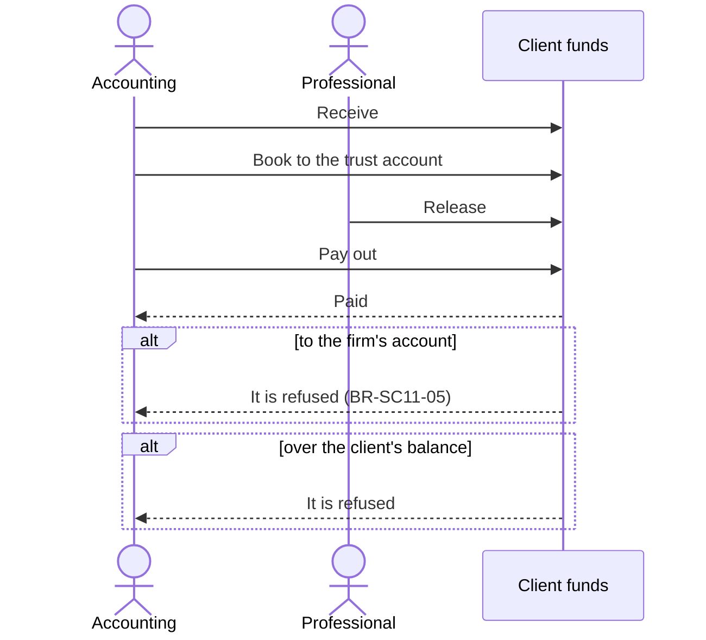

🏠 [Specs](../../../../README.md) › 🏷️ [Sectors](../../../README.md) › ⚖️ [SC11 Professional firms](../../README.md) ›
📝 [Use cases](../README.md) › 📝 [Use cases: FL-SC11-03 Time and billing](README.md) ›
📝 UC-SC11-07 Hold client funds on trust accounts

# 📝 UC-SC11-07 Hold client funds on trust accounts

**Status:** ✅ specified

## Summary

Accounting receives client funds onto the trust account with the shared third-party client money, books them per client
and matter, and pays them out.

## Personas

- [U05 Accounting](../../../../01-users/personas/u05-accounting.md)
- [U36 Professional](../../../../01-users/personas/u36-professional.md)

## Goal

Client money never on the firm's account.

## Trigger

Funds for a client.

## Frequency

Weekly.

## Preconditions

- The SC11 sector pack is installed for the company,
  [UC-F14-02](../../../../02-functional/f14-plugin-store/use-cases/01-find-and-install/uc-f14-02-install-a-plugin-or-sector-pack.md),
  and its users have their roles,
  [UC-F1-06](../../../../02-functional/f01-administration/use-cases/04-edit-a-role/uc-f01-06-edit-a-role-and-its-record-rules.md).

## Postconditions

- **Success:** funds are held and paid out.
- **Failed:** the movement is refused.

## Main flow

1. Accounting receives on [S-SC11-07 Client funds](../../screens/03-time-and-billing/s-sc11-07-client-funds.md).
2. It is booked to the client ledger,
   [UC-F8-21](../../../../02-functional/f08-accounting/use-cases/07-client-money-grants-and-non-profits/uc-f08-21-keep-third-party-client-money.md),
   [BR-F8-13](../../../../02-functional/f08-accounting/business-rules/br-f08-13-client-money-is-segregated-and-never-negative-per-client.md).
3. The professional releases.
4. Accounting pays out.

## Alternative flows

- 1a. Escrow: the funds are held until the agreed event.

## Error flows

- 2e. To the firm's account: it is refused
  ([BR-SC11-05](../../business-rules/br-sc11-05-client-funds-through-the-trust-account.md)).
- 4e. Over the client's balance: it is refused.
- Any step: a call to a service or an outside system fails: it is retried first
  ([BR-F3-32](../../../../02-functional/f03-assistant/business-rules/br-f03-32-retry-before-an-error.md)), then the
  error message pattern ([D122](../../../../06-decisions/ux/d122-error-message-standard.md)) says what failed; what was
  typed is kept.

## Business rules

- [BR-SC11-05 Client funds through the trust account](../../business-rules/br-sc11-05-client-funds-through-the-trust-account.md)
- [BR-F8-13 Client money is segregated and never negative per client](../../../../02-functional/f08-accounting/business-rules/br-f08-13-client-money-is-segregated-and-never-negative-per-client.md)

## Entities

- [E-SC11-08 Trust movement](../../data/e-sc11-08-trust-movement.md)
- [E-F8-17 Client money ledger](../../../../02-functional/f08-accounting/data/e-f08-17-client-money-ledger.md)

## Permissions

The accounting and professional roles; the record rules of their role and site apply,
[UC-F1-06](../../../../02-functional/f01-administration/use-cases/04-edit-a-role/uc-f01-06-edit-a-role-and-its-record-rules.md).

## Notifications

None beyond the in-app updates of the records concerned.

## Audit events

Every creation, change and state change of trust movement, client money ledger records, with who, when and the values
before and after (T3).

## AI involvement

The AI assistant answers questions on the trust movement, client money ledger records of this use case, with links, and
prepares them as drafts the user confirms. It works within the user's rights,
[BR-F3-34](../../../../02-functional/f03-assistant/business-rules/br-f03-34-every-capability-is-reachable-from-the-assistant.md),
and never deletes or does anything irreversible without the user's confirmation,
[BR-F3-07](../../../../02-functional/f03-assistant/business-rules/br-f03-07-no-deletes-no-irreversible-acts.md).

## API, MCP and A2A exposure

Through the API and webhooks (T5) and the MCP and A2A gateway (T6), with the caller's rights,
[BR-F3-34](../../../../02-functional/f03-assistant/business-rules/br-f03-34-every-capability-is-reachable-from-the-assistant.md),
reading, creating and changing the records of this use case; nothing irreversible without a person's confirmation.

## Screens

- [S-SC11-07 Client funds](../../screens/03-time-and-billing/s-sc11-07-client-funds.md)

## Flowchart

See [FL-SC11-03 Time and billing](../../flows/fl-sc11-03-time-and-billing.md#flowchart).

## Sequence diagram

## Acceptance criteria

1. **Given** the example firm's 40,000 EUR for Acme on M-221 **when** it is received **then** the CARPA ledger for Acme
   shows 40,000 EUR.
2. **Given** 40,000 EUR for Acme sent to the firm's account **when** it is booked **then** it is refused
   ([BR-SC11-05](../../business-rules/br-sc11-05-client-funds-through-the-trust-account.md)).

## Non-functional notes

[D408](../../../../06-decisions/technical/d408-performance-and-profiles.md)'s targets
([performance](../../../../05-non-functional/performance.md)): 95 % of screens within 1 second; lists paged on the
server, the first page within 1 second; reports within 5 seconds or in the background. WCAG 2.2 AA and RGAA
([D46](../../../../06-decisions/ux/d46-accessibility-standard.md)).

## Regulatory references

Legal values from the France country pack:
[CR-FR-151 Lawyers' client funds through the CARPA](../../../../10-country-packs/france/professional-firms/cr-fr-151-carpa-client-funds.md).

## Related use cases

- [UC-SC11-06 Bill fees and request advances](uc-sc11-06-bill-fees-and-request-advances.md)

## Open questions

None.

---

⬅️ [UC-SC11-06 Bill fees and request advances](uc-sc11-06-bill-fees-and-request-advances.md) · ⬆️ [Up](README.md) ·
➡️ [UC-SC11-08](../04-deadlines-and-filings/uc-sc11-08-follow-deadlines-hearings-and-limitation-periods.md)
