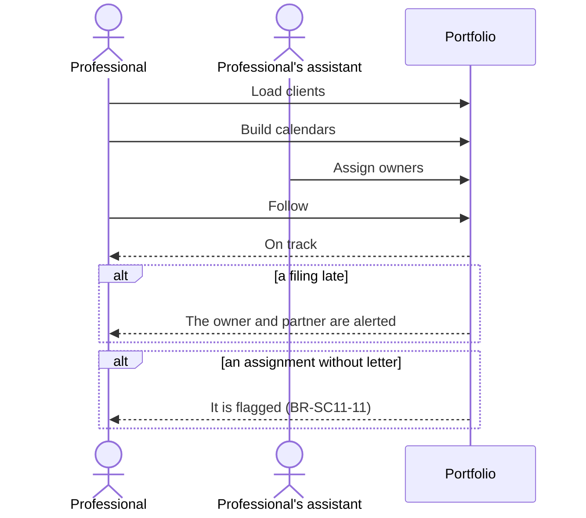

🏠 [Specs](../../../../README.md) › 🏷️ [Sectors](../../../README.md) › ⚖️ [SC11 Professional firms](../../README.md) ›
📝 [Use cases](../README.md) › 📝 [Use cases: FL-SC11-04 Deadlines and filings](README.md) ›
📝 UC-SC11-11 Run an accountant's client portfolio and tax calendar

# 📝 UC-SC11-11 Run an accountant's client portfolio and tax calendar

**Status:** ✅ specified

## Summary

The professional loads accounting clients and their assignments, builds each one's filing calendar and follows it.

## Personas

- [U36 Professional](../../../../01-users/personas/u36-professional.md)
- [U37 Professional's assistant](../../../../01-users/personas/u37-assistant.md)

## Goal

Every client's filings on time.

## Trigger

A new client or year.

## Frequency

Yearly; followed daily.

## Preconditions

- The SC11 sector pack is installed for the company,
  [UC-F14-02](../../../../02-functional/f14-plugin-store/use-cases/01-find-and-install/uc-f14-02-install-a-plugin-or-sector-pack.md),
  and its users have their roles,
  [UC-F1-06](../../../../02-functional/f01-administration/use-cases/04-edit-a-role/uc-f01-06-edit-a-role-and-its-record-rules.md).

## Postconditions

- **Success:** calendars are built and followed.
- **Failed:** the late filing alerts.

## Main flow

1. The professional loads clients on
   [S-SC11-11 Client portfolio](../../screens/04-deadlines-and-filings/s-sc11-11-client-portfolio.md).
2. Calendars come from the tax regimes ([BR-SC11-12](../../business-rules/br-sc11-12-tax-calendar-per-client.md)).
3. Each filing gets an owner.
4. Filings are followed.

## Alternative flows

- 2a. A new regime: the calendar is rebuilt.

## Error flows

- 4e. A filing late: the owner and partner are alerted.
- 1e. An assignment without letter: it is flagged
  ([BR-SC11-11](../../business-rules/br-sc11-11-engagement-letter-per-assignment.md)).
- Any step: a call to a service or an outside system fails: it is retried first
  ([BR-F3-32](../../../../02-functional/f03-assistant/business-rules/br-f03-32-retry-before-an-error.md)), then the
  error message pattern ([D122](../../../../06-decisions/ux/d122-error-message-standard.md)) says what failed; what was
  typed is kept.

## Business rules

- [BR-SC11-12 Tax calendar per client](../../business-rules/br-sc11-12-tax-calendar-per-client.md)
- [BR-SC11-11 An engagement letter per assignment](../../business-rules/br-sc11-11-engagement-letter-per-assignment.md)

## Entities

- [E-SC11-11 Filing](../../data/e-sc11-11-filing.md)

## Permissions

The professional and assistant roles; the record rules of their role and site apply,
[UC-F1-06](../../../../02-functional/f01-administration/use-cases/04-edit-a-role/uc-f01-06-edit-a-role-and-its-record-rules.md).

## Notifications

None beyond the in-app updates of the records concerned.

## Audit events

Every creation, change and state change of filing records, with who, when and the values before and after (T3).

## AI involvement

The AI assistant answers questions on the filing records of this use case, with links, and prepares them as drafts the
user confirms. It works within the user's rights,
[BR-F3-34](../../../../02-functional/f03-assistant/business-rules/br-f03-34-every-capability-is-reachable-from-the-assistant.md),
and never deletes or does anything irreversible without the user's confirmation,
[BR-F3-07](../../../../02-functional/f03-assistant/business-rules/br-f03-07-no-deletes-no-irreversible-acts.md).

## API, MCP and A2A exposure

Through the API and webhooks (T5) and the MCP and A2A gateway (T6), with the caller's rights,
[BR-F3-34](../../../../02-functional/f03-assistant/business-rules/br-f03-34-every-capability-is-reachable-from-the-assistant.md),
reading, creating and changing the records of this use case; nothing irreversible without a person's confirmation.

## Screens

- [S-SC11-11 Client portfolio](../../screens/04-deadlines-and-filings/s-sc11-11-client-portfolio.md)

## Flowchart

See [FL-SC11-04 Deadlines and filings](../../flows/fl-sc11-04-deadlines-and-filings.md#flowchart).

## Sequence diagram

## Acceptance criteria

1. **Given** the example firm's Beta on monthly VAT **when** the calendar is built **then** a VAT filing is due on 24
   November.
2. **Given** Beta's VAT due 24 November **when** it is 25 November **then** the owner and partner are alerted.

## Non-functional notes

[D408](../../../../06-decisions/technical/d408-performance-and-profiles.md)'s targets
([performance](../../../../05-non-functional/performance.md)): 95 % of screens within 1 second; lists paged on the
server, the first page within 1 second; reports within 5 seconds or in the background. WCAG 2.2 AA and RGAA
([D46](../../../../06-decisions/ux/d46-accessibility-standard.md)).

## Regulatory references

Legal values from the France country pack:
[CR-FR-152 Chartered accountants' engagement letter](../../../../10-country-packs/france/professional-firms/cr-fr-152-accountant-engagement-letter.md).

## Related use cases

- [UC-SC11-12 Prepare client filings and their evidence](uc-sc11-12-prepare-client-filings-and-their-evidence.md)

## Open questions

None.

---

⬅️ [UC-SC11-10](../02-matters-and-documents/uc-sc11-10-exchange-securely-with-the-client-in-the-portal.md) ·
⬆️ [Up](README.md) ·
➡️ [UC-SC11-12 Prepare client filings and their evidence](uc-sc11-12-prepare-client-filings-and-their-evidence.md)
