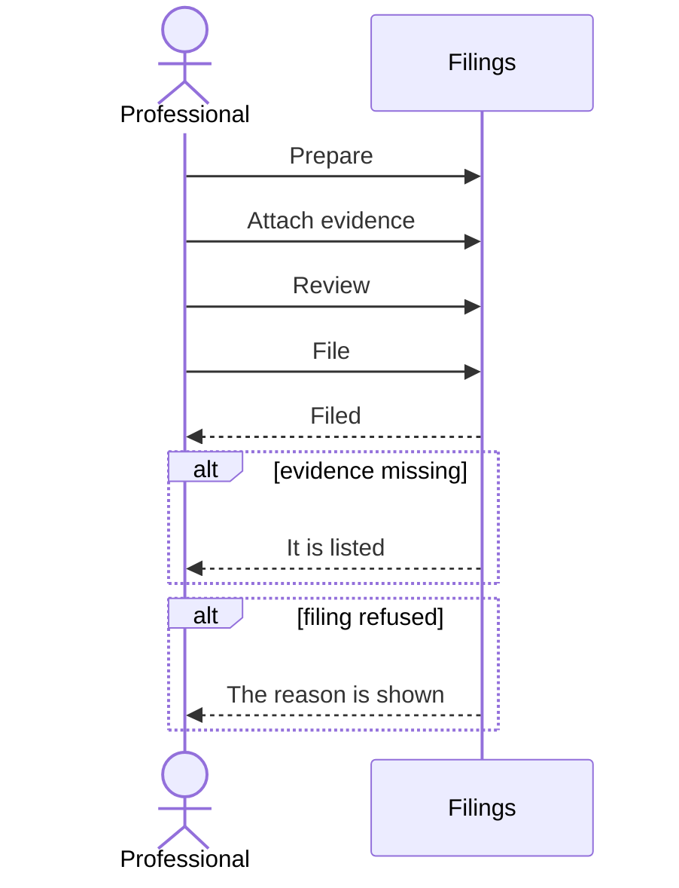

🏠 [Specs](../../../../README.md) › 🏷️ [Sectors](../../../README.md) › ⚖️ [SC11 Professional firms](../../README.md) ›
📝 [Use cases](../README.md) › 📝 [Use cases: FL-SC11-04 Deadlines and filings](README.md) ›
📝 UC-SC11-12 Prepare client filings and their evidence

# 📝 UC-SC11-12 Prepare client filings and their evidence

**Status:** ✅ specified

## Summary

The professional prepares a client's filing with its evidence, reviews and files it.

## Personas

- [U36 Professional](../../../../01-users/personas/u36-professional.md)

## Goal

Filings complete with evidence.

## Trigger

A filing due.

## Frequency

Many a month.

## Preconditions

- The SC11 sector pack is installed for the company,
  [UC-F14-02](../../../../02-functional/f14-plugin-store/use-cases/01-find-and-install/uc-f14-02-install-a-plugin-or-sector-pack.md),
  and its users have their roles,
  [UC-F1-06](../../../../02-functional/f01-administration/use-cases/04-edit-a-role/uc-f01-06-edit-a-role-and-its-record-rules.md).

## Postconditions

- **Success:** the filing is filed.
- **Failed:** missing evidence is listed.

## Main flow

1. The professional prepares on [S-SC11-12 Filings](../../screens/04-deadlines-and-filings/s-sc11-12-filings.md).
2. Evidence is attached.
3. A second professional reviews.
4. The filing is filed,
   [UC-F8-07](../../../../02-functional/f08-accounting/use-cases/04-tax-assets-and-analytics/uc-f08-07-manage-vat-and-file-returns.md).

## Alternative flows

- 1a. Through accounting connectors: the client's books come through connectors (T12).

## Error flows

- 2e. Evidence missing: it is listed.
- 4e. Filing refused: the reason is shown.
- Any step: a call to a service or an outside system fails: it is retried first
  ([BR-F3-32](../../../../02-functional/f03-assistant/business-rules/br-f03-32-retry-before-an-error.md)), then the
  error message pattern ([D122](../../../../06-decisions/ux/d122-error-message-standard.md)) says what failed; what was
  typed is kept.

## Business rules

- [BR-SC11-12 Tax calendar per client](../../business-rules/br-sc11-12-tax-calendar-per-client.md)

## Entities

- [E-SC11-11 Filing](../../data/e-sc11-11-filing.md)
- [E-SC11-10 Matter document](../../data/e-sc11-10-matter-document.md)

## Permissions

The professional roles; the record rules of their role and site apply,
[UC-F1-06](../../../../02-functional/f01-administration/use-cases/04-edit-a-role/uc-f01-06-edit-a-role-and-its-record-rules.md).

## Notifications

None beyond the in-app updates of the records concerned.

## Audit events

Every creation, change and state change of filing, matter document records, with who, when and the values before and
after (T3).

## AI involvement

The AI assistant answers questions on the filing, matter document records of this use case, with links, and prepares
them as drafts the user confirms. It works within the user's rights,
[BR-F3-34](../../../../02-functional/f03-assistant/business-rules/br-f03-34-every-capability-is-reachable-from-the-assistant.md),
and never deletes or does anything irreversible without the user's confirmation,
[BR-F3-07](../../../../02-functional/f03-assistant/business-rules/br-f03-07-no-deletes-no-irreversible-acts.md).

## API, MCP and A2A exposure

Through the API and webhooks (T5) and the MCP and A2A gateway (T6), with the caller's rights,
[BR-F3-34](../../../../02-functional/f03-assistant/business-rules/br-f03-34-every-capability-is-reachable-from-the-assistant.md),
reading, creating and changing the records of this use case; nothing irreversible without a person's confirmation.

## Screens

- [S-SC11-12 Filings](../../screens/04-deadlines-and-filings/s-sc11-12-filings.md)

## Flowchart

See [FL-SC11-04 Deadlines and filings](../../flows/fl-sc11-04-deadlines-and-filings.md#flowchart).

## Sequence diagram

## Acceptance criteria

1. **Given** the example firm's Beta VAT for October **when** it is filed **then** it shows filed with its evidence.
2. **Given** Beta's VAT without purchase invoices **when** it is prepared **then** it is listed.

## Non-functional notes

[D408](../../../../06-decisions/technical/d408-performance-and-profiles.md)'s targets
([performance](../../../../05-non-functional/performance.md)): 95 % of screens within 1 second; lists paged on the
server, the first page within 1 second; reports within 5 seconds or in the background. WCAG 2.2 AA and RGAA
([D46](../../../../06-decisions/ux/d46-accessibility-standard.md)).

## Regulatory references

None specific to this use case; the sector's legal rules are listed in [SC11 regulatory](../../regulatory.md).

## Related use cases

- [UC-SC11-11 Run an accountant's client portfolio and tax calendar](uc-sc11-11-run-an-accountant-s-client-portfolio-and-tax-calendar.md)

## Open questions

None.

---

⬅️ [UC-SC11-11](uc-sc11-11-run-an-accountant-s-client-portfolio-and-tax-calendar.md) · ⬆️ [Up](README.md) ·
➡️ [UC-SC11-13](../02-matters-and-documents/uc-sc11-13-run-architects-and-engineers-projects-by-phase.md)
