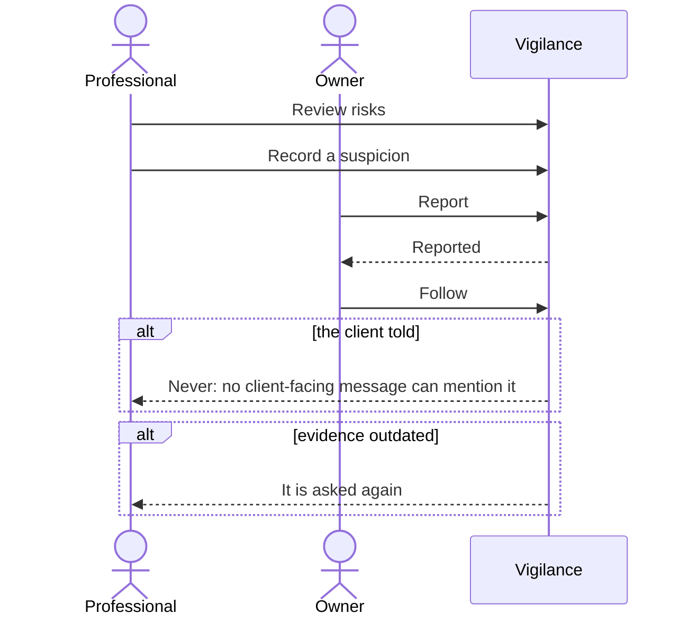

🏠 [Specs](../../../../README.md) › 🏷️ [Sectors](../../../README.md) › ⚖️ [SC11 Professional firms](../../README.md) ›
📝 [Use cases](../README.md) › 📝 [Use cases: FL-SC11-05 Compliance and secrecy](README.md) ›
📝 UC-SC11-15 Run anti-money-laundering vigilance

# 📝 UC-SC11-15 Run anti-money-laundering vigilance

**Status:** ✅ specified

## Summary

The professional reviews client risks, records a suspicion confidentially and reports it through the profession's
channel, never telling the client.

## Personas

- [U36 Professional](../../../../01-users/personas/u36-professional.md)
- [U13 Owner](../../../../01-users/personas/u13-owner.md)

## Goal

Vigilance done and suspicions reported.

## Trigger

A yearly review or an alert.

## Frequency

Yearly per client.

## Preconditions

- The SC11 sector pack is installed for the company,
  [UC-F14-02](../../../../02-functional/f14-plugin-store/use-cases/01-find-and-install/uc-f14-02-install-a-plugin-or-sector-pack.md),
  and its users have their roles,
  [UC-F1-06](../../../../02-functional/f01-administration/use-cases/04-edit-a-role/uc-f01-06-edit-a-role-and-its-record-rules.md).

## Postconditions

- **Success:** the review or report is recorded.
- **Failed:** the review stays open.

## Main flow

1. The professional reviews on [S-SC11-15 Vigilance](../../screens/05-compliance-and-secrecy/s-sc11-15-vigilance.md).
2. A suspicion is recorded, seen by compliance only.
3. The partner reports through the channel
   ([BR-SC11-14](../../business-rules/br-sc11-14-suspicions-reported-through-the-channel.md)).
4. The partner follows the answer.

## Alternative flows

- 1a. The yearly review: each client's risk is reviewed.

## Error flows

- 2e. The client told: never: no client-facing message can mention it.
- 1e. Evidence outdated: it is asked again.
- Any step: a call to a service or an outside system fails: it is retried first
  ([BR-F3-32](../../../../02-functional/f03-assistant/business-rules/br-f03-32-retry-before-an-error.md)), then the
  error message pattern ([D122](../../../../06-decisions/ux/d122-error-message-standard.md)) says what failed; what was
  typed is kept.

## Business rules

- [BR-SC11-02 Identity checked before work](../../business-rules/br-sc11-02-identity-checked-before-work.md)
- [BR-SC11-14 Suspicions reported through the channel](../../business-rules/br-sc11-14-suspicions-reported-through-the-channel.md)

## Entities

- [E-SC11-01 Client identity](../../data/e-sc11-01-client-identity.md)
- [E-SC11-12 Vigilance record](../../data/e-sc11-12-vigilance-record.md)

## Permissions

The professional and owner roles; the record rules of their role and site apply,
[UC-F1-06](../../../../02-functional/f01-administration/use-cases/04-edit-a-role/uc-f01-06-edit-a-role-and-its-record-rules.md).

## Notifications

None beyond the in-app updates of the records concerned.

## Audit events

Every creation, change and state change of client identity, vigilance record records, with who, when and the values
before and after (T3).

## AI involvement

The AI assistant answers questions on the client identity, vigilance record records of this use case, with links, and
prepares them as drafts the user confirms. It works within the user's rights,
[BR-F3-34](../../../../02-functional/f03-assistant/business-rules/br-f03-34-every-capability-is-reachable-from-the-assistant.md),
and never deletes or does anything irreversible without the user's confirmation,
[BR-F3-07](../../../../02-functional/f03-assistant/business-rules/br-f03-07-no-deletes-no-irreversible-acts.md).

## API, MCP and A2A exposure

Through the API and webhooks (T5) and the MCP and A2A gateway (T6), with the caller's rights,
[BR-F3-34](../../../../02-functional/f03-assistant/business-rules/br-f03-34-every-capability-is-reachable-from-the-assistant.md),
reading, creating and changing the records of this use case; nothing irreversible without a person's confirmation.

## Screens

- [S-SC11-15 Vigilance](../../screens/05-compliance-and-secrecy/s-sc11-15-vigilance.md)

## Flowchart

See [FL-SC11-05 Compliance and secrecy](../../flows/fl-sc11-05-compliance-and-secrecy.md#flowchart).

## Sequence diagram

## Acceptance criteria

1. **Given** the example firm's suspicion on Acme on 12 November **when** it is recorded **then** only compliance sees
   it.
2. **Given** a suspicion on Acme **when** a portal message is written **then** never: no client-facing message can
   mention it.

## Non-functional notes

[D408](../../../../06-decisions/technical/d408-performance-and-profiles.md)'s targets
([performance](../../../../05-non-functional/performance.md)): 95 % of screens within 1 second; lists paged on the
server, the first page within 1 second; reports within 5 seconds or in the background. WCAG 2.2 AA and RGAA
([D46](../../../../06-decisions/ux/d46-accessibility-standard.md)).

## Regulatory references

Legal values from the France country pack:
[CR-FR-149 Anti-money-laundering vigilance](../../../../10-country-packs/france/professional-firms/cr-fr-149-aml-vigilance.md).

## Related use cases

- [UC-SC11-01 Open a client file and check identity](../01-client-intake/uc-sc11-01-open-a-client-file-and-check-identity.md)

## Open questions

None.

---

⬅️ [UC-SC11-14](../06-firm-management/uc-sc11-14-follow-work-in-progress-and-the-recovery-rate.md) ·
⬆️ [Up](README.md) · ➡️ [UC-SC11-16 Keep secrecy with access walls](uc-sc11-16-keep-secrecy-with-access-walls.md)
