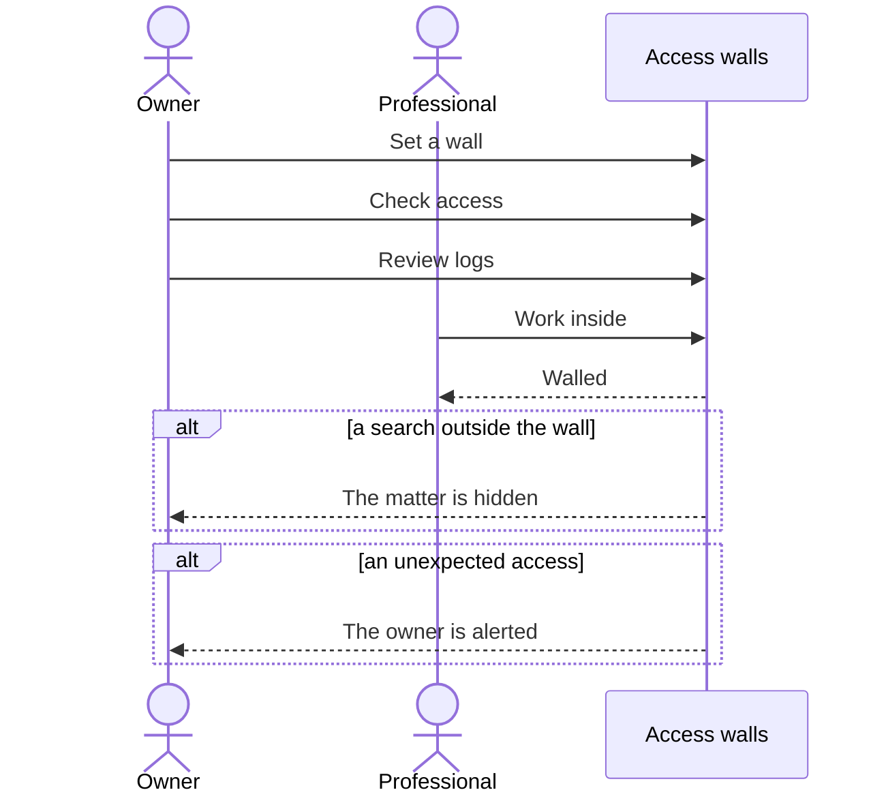

🏠 [Specs](../../../../README.md) › 🏷️ [Sectors](../../../README.md) › ⚖️ [SC11 Professional firms](../../README.md) ›
📝 [Use cases](../README.md) › 📝 [Use cases: FL-SC11-05 Compliance and secrecy](README.md) ›
📝 UC-SC11-16 Keep secrecy with access walls

# 📝 UC-SC11-16 Keep secrecy with access walls

**Status:** ✅ specified

## Summary

The owner sets access walls on sensitive matters, checks who can see them and reviews logs.

## Personas

- [U13 Owner](../../../../01-users/personas/u13-owner.md)
- [U36 Professional](../../../../01-users/personas/u36-professional.md)

## Goal

Secrecy proved.

## Trigger

A sensitive matter.

## Frequency

Per matter.

## Preconditions

- The SC11 sector pack is installed for the company,
  [UC-F14-02](../../../../02-functional/f14-plugin-store/use-cases/01-find-and-install/uc-f14-02-install-a-plugin-or-sector-pack.md),
  and its users have their roles,
  [UC-F1-06](../../../../02-functional/f01-administration/use-cases/04-edit-a-role/uc-f01-06-edit-a-role-and-its-record-rules.md).

## Postconditions

- **Success:** the wall is set and logs reviewed.
- **Failed:** access is refused.

## Main flow

1. The owner sets the wall on
   [S-SC11-16 Access walls](../../screens/05-compliance-and-secrecy/s-sc11-16-access-walls.md).
2. Access is checked ([BR-SC11-06](../../business-rules/br-sc11-06-secrecy-and-access-walls.md)).
3. Logs are reviewed.
4. The team works inside.

## Alternative flows

- 1a. Temporary access: access ends at its date.

## Error flows

- 2e. A search outside the wall: the matter is hidden.
- 3e. An unexpected access: the owner is alerted.
- Any step: a call to a service or an outside system fails: it is retried first
  ([BR-F3-32](../../../../02-functional/f03-assistant/business-rules/br-f03-32-retry-before-an-error.md)), then the
  error message pattern ([D122](../../../../06-decisions/ux/d122-error-message-standard.md)) says what failed; what was
  typed is kept.

## Business rules

- [BR-SC11-06 Secrecy and access walls](../../business-rules/br-sc11-06-secrecy-and-access-walls.md)

## Entities

- [E-SC11-13 Access wall](../../data/e-sc11-13-access-wall.md)

## Permissions

The owner and professional roles; the record rules of their role and site apply,
[UC-F1-06](../../../../02-functional/f01-administration/use-cases/04-edit-a-role/uc-f01-06-edit-a-role-and-its-record-rules.md).

## Notifications

None beyond the in-app updates of the records concerned.

## Audit events

Every creation, change and state change of access wall records, with who, when and the values before and after (T3).

## AI involvement

The AI assistant answers questions on the access wall records of this use case, with links, and prepares them as drafts
the user confirms. It works within the user's rights,
[BR-F3-34](../../../../02-functional/f03-assistant/business-rules/br-f03-34-every-capability-is-reachable-from-the-assistant.md),
and never deletes or does anything irreversible without the user's confirmation,
[BR-F3-07](../../../../02-functional/f03-assistant/business-rules/br-f03-07-no-deletes-no-irreversible-acts.md).

## API, MCP and A2A exposure

Through the API and webhooks (T5) and the MCP and A2A gateway (T6), with the caller's rights,
[BR-F3-34](../../../../02-functional/f03-assistant/business-rules/br-f03-34-every-capability-is-reachable-from-the-assistant.md),
reading, creating and changing the records of this use case; nothing irreversible without a person's confirmation.

## Screens

- [S-SC11-16 Access walls](../../screens/05-compliance-and-secrecy/s-sc11-16-access-walls.md)

## Flowchart

See [FL-SC11-05 Compliance and secrecy](../../flows/fl-sc11-05-compliance-and-secrecy.md#flowchart).

## Sequence diagram

## Acceptance criteria

1. **Given** the example firm's M-221 with 3 allowed **when** logs are reviewed **then** 14 views show, all by the 3.
2. **Given** a professional outside M-221 **when** he searches for Acme **then** the matter is hidden.

## Non-functional notes

[D408](../../../../06-decisions/technical/d408-performance-and-profiles.md)'s targets
([performance](../../../../05-non-functional/performance.md)): 95 % of screens within 1 second; lists paged on the
server, the first page within 1 second; reports within 5 seconds or in the background. WCAG 2.2 AA and RGAA
([D46](../../../../06-decisions/ux/d46-accessibility-standard.md)).

## Regulatory references

Legal values from the France country pack:
[CR-FR-154 Lawyers' professional secrecy](../../../../10-country-packs/france/professional-firms/cr-fr-154-lawyer-secrecy.md).

## Related use cases

- [UC-SC11-04 Open and organise matters](../02-matters-and-documents/uc-sc11-04-open-and-organise-matters.md)

## Open questions

None.

---

⬅️ [UC-SC11-15 Run anti-money-laundering vigilance](uc-sc11-15-run-anti-money-laundering-vigilance.md) ·
⬆️ [Up](README.md) · ➡️ [UC-SC11-17](../06-firm-management/uc-sc11-17-manage-partners-targets-and-profit-shares.md)
