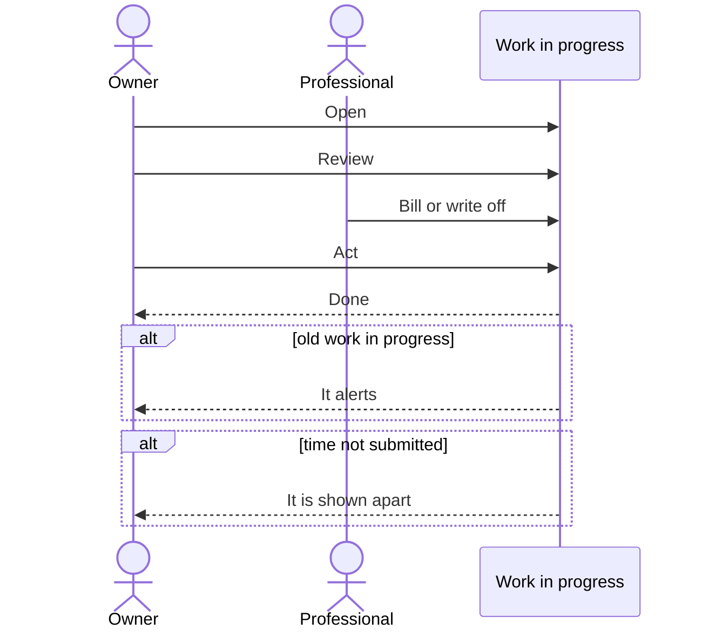

🏠 [Specs](../../../../README.md) › 🏷️ [Sectors](../../../README.md) › ⚖️ [SC11 Professional firms](../../README.md) ›
📝 [Use cases](../README.md) › 📝 [Use cases: FL-SC11-06 Firm management](README.md) ›
📝 UC-SC11-14 Follow work in progress and the recovery rate

# 📝 UC-SC11-14 Follow work in progress and the recovery rate

**Status:** ✅ specified

## Summary

The owner and professionals follow unbilled time and the share of time value recovered.

## Personas

- [U13 Owner](../../../../01-users/personas/u13-owner.md)
- [U36 Professional](../../../../01-users/personas/u36-professional.md)

## Goal

Little unbilled time, high recovery.

## Trigger

Monthly review.

## Frequency

Monthly.

## Preconditions

- The SC11 sector pack is installed for the company,
  [UC-F14-02](../../../../02-functional/f14-plugin-store/use-cases/01-find-and-install/uc-f14-02-install-a-plugin-or-sector-pack.md),
  and its users have their roles,
  [UC-F1-06](../../../../02-functional/f01-administration/use-cases/04-edit-a-role/uc-f01-06-edit-a-role-and-its-record-rules.md).

## Postconditions

- **Success:** actions are taken.
- **Failed:** old work in progress alerts.

## Main flow

1. The owner opens [S-SC11-14 Work in progress](../../screens/06-firm-management/s-sc11-14-work-in-progress.md).
2. Unbilled time and recovery are reviewed.
3. Professionals bill or write off.
4. The owner records actions.

## Alternative flows

- 2a. By partner: figures per partner.

## Error flows

- 2e. Old work in progress: it alerts.
- 1e. Time not submitted: it is shown apart.
- Any step: a call to a service or an outside system fails: it is retried first
  ([BR-F3-32](../../../../02-functional/f03-assistant/business-rules/br-f03-32-retry-before-an-error.md)), then the
  error message pattern ([D122](../../../../06-decisions/ux/d122-error-message-standard.md)) says what failed; what was
  typed is kept.

## Business rules

- [BR-SC11-08 Time billed from records](../../business-rules/br-sc11-08-time-billed-from-records.md)

## Entities

- [E-SC11-06 Time entry](../../data/e-sc11-06-time-entry.md)
- [E-SC11-07 Fee bill](../../data/e-sc11-07-fee-bill.md)

## Permissions

The owner and professional roles; the record rules of their role and site apply,
[UC-F1-06](../../../../02-functional/f01-administration/use-cases/04-edit-a-role/uc-f01-06-edit-a-role-and-its-record-rules.md).

## Notifications

None beyond the in-app updates of the records concerned.

## Audit events

Every creation, change and state change of time entry, fee bill records, with who, when and the values before and after
(T3).

## AI involvement

The AI assistant answers questions on the time entry, fee bill records of this use case, with links, and prepares them
as drafts the user confirms. It works within the user's rights,
[BR-F3-34](../../../../02-functional/f03-assistant/business-rules/br-f03-34-every-capability-is-reachable-from-the-assistant.md),
and never deletes or does anything irreversible without the user's confirmation,
[BR-F3-07](../../../../02-functional/f03-assistant/business-rules/br-f03-07-no-deletes-no-irreversible-acts.md).

## API, MCP and A2A exposure

Through the API and webhooks (T5) and the MCP and A2A gateway (T6), with the caller's rights,
[BR-F3-34](../../../../02-functional/f03-assistant/business-rules/br-f03-34-every-capability-is-reachable-from-the-assistant.md),
reading, creating and changing the records of this use case; nothing irreversible without a person's confirmation.

## Screens

- [S-SC11-14 Work in progress](../../screens/06-firm-management/s-sc11-14-work-in-progress.md)

## Flowchart

See [FL-SC11-06 Firm management](../../flows/fl-sc11-06-firm-management.md#flowchart).

## Sequence diagram

## Acceptance criteria

1. **Given** the example firm's M-221 with 10,000 EUR of time and 8,500 EUR billed **when** it is reviewed **then**
   recovery shows 85 %.
2. **Given** time on M-221 unbilled for 4 months **when** the review opens **then** it alerts.

## Non-functional notes

[D408](../../../../06-decisions/technical/d408-performance-and-profiles.md)'s targets
([performance](../../../../05-non-functional/performance.md)): 95 % of screens within 1 second; lists paged on the
server, the first page within 1 second; reports within 5 seconds or in the background. WCAG 2.2 AA and RGAA
([D46](../../../../06-decisions/ux/d46-accessibility-standard.md)).

## Regulatory references

None specific to this use case; the sector's legal rules are listed in [SC11 regulatory](../../regulatory.md).

## Related use cases

- [UC-SC11-19 Report the firm's performance](uc-sc11-19-report-the-firm-s-performance.md)

## Open questions

None.

---

⬅️ [UC-SC11-13](../02-matters-and-documents/uc-sc11-13-run-architects-and-engineers-projects-by-phase.md) ·
⬆️ [Up](README.md) · ➡️ [UC-SC11-15](../05-compliance-and-secrecy/uc-sc11-15-run-anti-money-laundering-vigilance.md)
