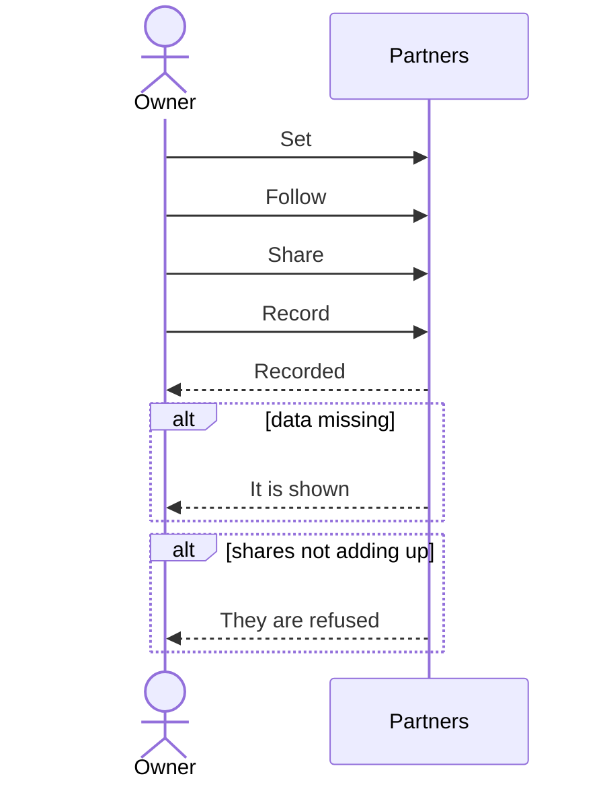

🏠 [Specs](../../../../README.md) › 🏷️ [Sectors](../../../README.md) › ⚖️ [SC11 Professional firms](../../README.md) ›
📝 [Use cases](../README.md) › 📝 [Use cases: FL-SC11-06 Firm management](README.md) ›
📝 UC-SC11-17 Manage partners' targets and profit shares

# 📝 UC-SC11-17 Manage partners' targets and profit shares

**Status:** ✅ specified

## Summary

The owner sets partners' targets with the shared targets capability, follows them and shares the profit by the firm's
key.

## Personas

- [U13 Owner](../../../../01-users/personas/u13-owner.md)

## Goal

Targets known, profit shared as agreed.

## Trigger

The year start and end.

## Frequency

Yearly.

## Preconditions

- The SC11 sector pack is installed for the company,
  [UC-F14-02](../../../../02-functional/f14-plugin-store/use-cases/01-find-and-install/uc-f14-02-install-a-plugin-or-sector-pack.md),
  and its users have their roles,
  [UC-F1-06](../../../../02-functional/f01-administration/use-cases/04-edit-a-role/uc-f01-06-edit-a-role-and-its-record-rules.md).

## Postconditions

- **Success:** shares are computed.
- **Failed:** missing data is shown.

## Main flow

1. The owner sets targets on [S-SC11-17 Partners](../../screens/06-firm-management/s-sc11-17-partners.md),
   [UC-F6-25](../../../../02-functional/f06-customers-and-sales/use-cases/09-sell-on-the-road-and-steer-sales/uc-f06-25-set-sales-targets-and-pay-commissions.md).
2. Targets are followed from billed fees.
3. Profit is shared by points.
4. The shares are recorded.

## Alternative flows

- 3a. A points system: shares follow each partner's points.

## Error flows

- 1e. Data missing: it is shown.
- 3e. Shares not adding up: they are refused.
- Any step: a call to a service or an outside system fails: it is retried first
  ([BR-F3-32](../../../../02-functional/f03-assistant/business-rules/br-f03-32-retry-before-an-error.md)), then the
  error message pattern ([D122](../../../../06-decisions/ux/d122-error-message-standard.md)) says what failed; what was
  typed is kept.

## Business rules

- [BR-SC11-01 Firms follow the country pack](../../business-rules/br-sc11-01-firms-follow-the-country-pack.md)
- [BR-F6-18 Commissions follow paid invoices](../../../../02-functional/f06-customers-and-sales/business-rules/br-f06-18-commissions-follow-paid-invoices.md)

## Entities

- [E-SC11-14 Partner share](../../data/e-sc11-14-partner-share.md)
- [E-F6-18 Commission plan and target](../../../../02-functional/f06-customers-and-sales/data/e-f06-18-commission-plan-and-target.md)

## Permissions

The owner roles; the record rules of their role and site apply,
[UC-F1-06](../../../../02-functional/f01-administration/use-cases/04-edit-a-role/uc-f01-06-edit-a-role-and-its-record-rules.md).

## Notifications

None beyond the in-app updates of the records concerned.

## Audit events

Every creation, change and state change of partner share, commission plan and target records, with who, when and the
values before and after (T3).

## AI involvement

The AI assistant answers questions on the partner share, commission plan and target records of this use case, with
links, and prepares them as drafts the user confirms. It works within the user's rights,
[BR-F3-34](../../../../02-functional/f03-assistant/business-rules/br-f03-34-every-capability-is-reachable-from-the-assistant.md),
and never deletes or does anything irreversible without the user's confirmation,
[BR-F3-07](../../../../02-functional/f03-assistant/business-rules/br-f03-07-no-deletes-no-irreversible-acts.md).

## API, MCP and A2A exposure

Through the API and webhooks (T5) and the MCP and A2A gateway (T6), with the caller's rights,
[BR-F3-34](../../../../02-functional/f03-assistant/business-rules/br-f03-34-every-capability-is-reachable-from-the-assistant.md),
reading, creating and changing the records of this use case; nothing irreversible without a person's confirmation.

## Screens

- [S-SC11-17 Partners](../../screens/06-firm-management/s-sc11-17-partners.md)

## Flowchart

See [FL-SC11-06 Firm management](../../flows/fl-sc11-06-firm-management.md#flowchart).

## Sequence diagram

## Acceptance criteria

1. **Given** the example firm's partner with a 600,000 EUR target and 42 points **when** the year closes **then** his
   share follows his 42 points.
2. **Given** a partner without target **when** the year closes **then** it is shown.

## Non-functional notes

[D408](../../../../06-decisions/technical/d408-performance-and-profiles.md)'s targets
([performance](../../../../05-non-functional/performance.md)): 95 % of screens within 1 second; lists paged on the
server, the first page within 1 second; reports within 5 seconds or in the background. WCAG 2.2 AA and RGAA
([D46](../../../../06-decisions/ux/d46-accessibility-standard.md)).

## Regulatory references

None specific to this use case; the sector's legal rules are listed in [SC11 regulatory](../../regulatory.md).

## Related use cases

- [UC-SC11-19 Report the firm's performance](uc-sc11-19-report-the-firm-s-performance.md)

## Open questions

None.

---

⬅️ [UC-SC11-16](../05-compliance-and-secrecy/uc-sc11-16-keep-secrecy-with-access-walls.md) · ⬆️ [Up](README.md) ·
➡️ [UC-SC11-18 Track continuing professional training](uc-sc11-18-track-continuing-professional-training.md)
