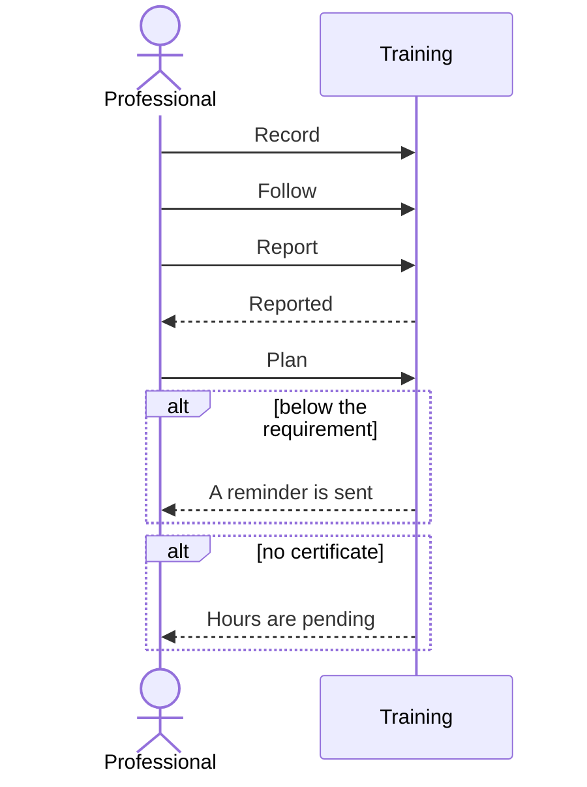

🏠 [Specs](../../../../README.md) › 🏷️ [Sectors](../../../README.md) › ⚖️ [SC11 Professional firms](../../README.md) ›
📝 [Use cases](../README.md) › 📝 [Use cases: FL-SC11-06 Firm management](README.md) ›
📝 UC-SC11-18 Track continuing professional training

# 📝 UC-SC11-18 Track continuing professional training

**Status:** ✅ specified

## Summary

Professionals record training hours against the yearly requirement; reminders go below it.

## Personas

- [U36 Professional](../../../../01-users/personas/u36-professional.md)

## Goal

Requirements met.

## Trigger

A training.

## Frequency

Yearly.

## Preconditions

- The SC11 sector pack is installed for the company,
  [UC-F14-02](../../../../02-functional/f14-plugin-store/use-cases/01-find-and-install/uc-f14-02-install-a-plugin-or-sector-pack.md),
  and its users have their roles,
  [UC-F1-06](../../../../02-functional/f01-administration/use-cases/04-edit-a-role/uc-f01-06-edit-a-role-and-its-record-rules.md).

## Postconditions

- **Success:** hours are recorded and reported.
- **Failed:** a reminder is sent.

## Main flow

1. The professional records hours on [S-SC11-18 Training](../../screens/06-firm-management/s-sc11-18-training.md).
2. Hours are followed ([BR-SC11-15](../../business-rules/br-sc11-15-training-hours-tracked.md)).
3. The yearly report is produced.
4. The next trainings are planned,
   [UC-F9-25](../../../../02-functional/f09-hr-and-projects/use-cases/09-train-and-protect/uc-f09-25-run-the-training-plan-with-opco-funding.md).

## Alternative flows

- 1a. External courses: their certificates are attached.

## Error flows

- 2e. Below the requirement: a reminder is sent.
- 1e. No certificate: hours are pending.
- Any step: a call to a service or an outside system fails: it is retried first
  ([BR-F3-32](../../../../02-functional/f03-assistant/business-rules/br-f03-32-retry-before-an-error.md)), then the
  error message pattern ([D122](../../../../06-decisions/ux/d122-error-message-standard.md)) says what failed; what was
  typed is kept.

## Business rules

- [BR-SC11-15 Training hours tracked](../../business-rules/br-sc11-15-training-hours-tracked.md)

## Entities

- [E-SC11-15 Training record](../../data/e-sc11-15-training-record.md)

## Permissions

The professional roles; the record rules of their role and site apply,
[UC-F1-06](../../../../02-functional/f01-administration/use-cases/04-edit-a-role/uc-f01-06-edit-a-role-and-its-record-rules.md).

## Notifications

None beyond the in-app updates of the records concerned.

## Audit events

Every creation, change and state change of training record records, with who, when and the values before and after (T3).

## AI involvement

The AI assistant answers questions on the training record records of this use case, with links, and prepares them as
drafts the user confirms. It works within the user's rights,
[BR-F3-34](../../../../02-functional/f03-assistant/business-rules/br-f03-34-every-capability-is-reachable-from-the-assistant.md),
and never deletes or does anything irreversible without the user's confirmation,
[BR-F3-07](../../../../02-functional/f03-assistant/business-rules/br-f03-07-no-deletes-no-irreversible-acts.md).

## API, MCP and A2A exposure

Through the API and webhooks (T5) and the MCP and A2A gateway (T6), with the caller's rights,
[BR-F3-34](../../../../02-functional/f03-assistant/business-rules/br-f03-34-every-capability-is-reachable-from-the-assistant.md),
reading, creating and changing the records of this use case; nothing irreversible without a person's confirmation.

## Screens

- [S-SC11-18 Training](../../screens/06-firm-management/s-sc11-18-training.md)

## Flowchart

See [FL-SC11-06 Firm management](../../flows/fl-sc11-06-firm-management.md#flowchart).

## Sequence diagram

## Acceptance criteria

1. **Given** the example firm's professional with 7 hours of tax update **when** it is recorded **then** 7 hours count
   for 2026.
2. **Given** 7 hours of 20 in October **when** the review runs **then** a reminder is sent.

## Non-functional notes

[D408](../../../../06-decisions/technical/d408-performance-and-profiles.md)'s targets
([performance](../../../../05-non-functional/performance.md)): 95 % of screens within 1 second; lists paged on the
server, the first page within 1 second; reports within 5 seconds or in the background. WCAG 2.2 AA and RGAA
([D46](../../../../06-decisions/ux/d46-accessibility-standard.md)).

## Regulatory references

None specific to this use case; the sector's legal rules are listed in [SC11 regulatory](../../regulatory.md).

## Related use cases

- [UC-SC11-19 Report the firm's performance](uc-sc11-19-report-the-firm-s-performance.md)

## Open questions

None.

---

⬅️ [UC-SC11-17 Manage partners' targets and profit shares](uc-sc11-17-manage-partners-targets-and-profit-shares.md) ·
⬆️ [Up](README.md) · ➡️ [UC-SC11-19 Report the firm's performance](uc-sc11-19-report-the-firm-s-performance.md)
