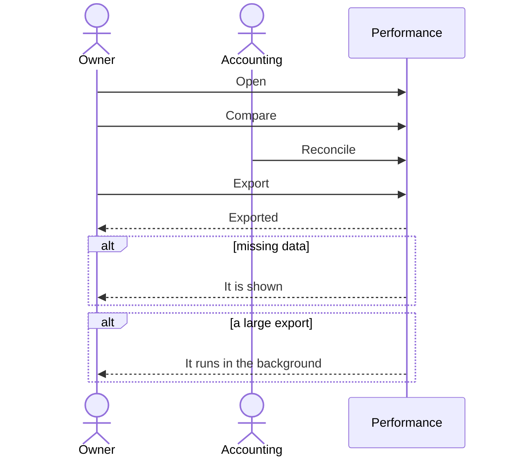

🏠 [Specs](../../../../README.md) › 🏷️ [Sectors](../../../README.md) › ⚖️ [SC11 Professional firms](../../README.md) ›
📝 [Use cases](../README.md) › 📝 [Use cases: FL-SC11-06 Firm management](README.md) ›
📝 UC-SC11-19 Report the firm's performance

# 📝 UC-SC11-19 Report the firm's performance

**Status:** ✅ specified

## Summary

The owner and accounting follow fees, time, recovery and clients, compare and export.

## Personas

- [U13 Owner](../../../../01-users/personas/u13-owner.md)
- [U05 Accounting](../../../../01-users/personas/u05-accounting.md)

## Goal

Steer the firm.

## Trigger

Monthly review.

## Frequency

Monthly.

## Preconditions

- The SC11 sector pack is installed for the company,
  [UC-F14-02](../../../../02-functional/f14-plugin-store/use-cases/01-find-and-install/uc-f14-02-install-a-plugin-or-sector-pack.md),
  and its users have their roles,
  [UC-F1-06](../../../../02-functional/f01-administration/use-cases/04-edit-a-role/uc-f01-06-edit-a-role-and-its-record-rules.md).

## Postconditions

- **Success:** figures are read and exported.
- **Failed:** missing data is shown.

## Main flow

1. The owner opens [S-SC11-19 Performance](../../screens/06-firm-management/s-sc11-19-performance.md).
2. The owner compares practice areas.
3. Accounting checks fees against the books.
4. The export is made.

## Alternative flows

- 2a. By practice area: figures per area.

## Error flows

- 1e. Missing data: it is shown.
- 4e. A large export: it runs in the background.
- Any step: a call to a service or an outside system fails: it is retried first
  ([BR-F3-32](../../../../02-functional/f03-assistant/business-rules/br-f03-32-retry-before-an-error.md)), then the
  error message pattern ([D122](../../../../06-decisions/ux/d122-error-message-standard.md)) says what failed; what was
  typed is kept.

## Business rules

- [BR-SC11-08 Time billed from records](../../business-rules/br-sc11-08-time-billed-from-records.md)

## Entities

- [E-SC11-07 Fee bill](../../data/e-sc11-07-fee-bill.md)
- [E-SC11-14 Partner share](../../data/e-sc11-14-partner-share.md)

## Permissions

The owner and accounting roles; the record rules of their role and site apply,
[UC-F1-06](../../../../02-functional/f01-administration/use-cases/04-edit-a-role/uc-f01-06-edit-a-role-and-its-record-rules.md).

## Notifications

None beyond the in-app updates of the records concerned.

## Audit events

Every creation, change and state change of fee bill, partner share records, with who, when and the values before and
after (T3).

## AI involvement

The AI assistant answers questions on the fee bill, partner share records of this use case, with links, and prepares
them as drafts the user confirms. It works within the user's rights,
[BR-F3-34](../../../../02-functional/f03-assistant/business-rules/br-f03-34-every-capability-is-reachable-from-the-assistant.md),
and never deletes or does anything irreversible without the user's confirmation,
[BR-F3-07](../../../../02-functional/f03-assistant/business-rules/br-f03-07-no-deletes-no-irreversible-acts.md).

## API, MCP and A2A exposure

Through the API and webhooks (T5) and the MCP and A2A gateway (T6), with the caller's rights,
[BR-F3-34](../../../../02-functional/f03-assistant/business-rules/br-f03-34-every-capability-is-reachable-from-the-assistant.md),
reading, creating and changing the records of this use case; nothing irreversible without a person's confirmation.

## Screens

- [S-SC11-19 Performance](../../screens/06-firm-management/s-sc11-19-performance.md)

## Flowchart

See [FL-SC11-06 Firm management](../../flows/fl-sc11-06-firm-management.md#flowchart).

## Sequence diagram

## Acceptance criteria

1. **Given** the example firm's November **when** the report opens **then** fees, time and recovery show per area.
2. **Given** a month without time **when** the report opens **then** it is shown.

## Non-functional notes

[D408](../../../../06-decisions/technical/d408-performance-and-profiles.md)'s targets
([performance](../../../../05-non-functional/performance.md)): 95 % of screens within 1 second; lists paged on the
server, the first page within 1 second; reports within 5 seconds or in the background. WCAG 2.2 AA and RGAA
([D46](../../../../06-decisions/ux/d46-accessibility-standard.md)).

## Regulatory references

None specific to this use case; the sector's legal rules are listed in [SC11 regulatory](../../regulatory.md).

## Related use cases

- [UC-SC11-14 Follow work in progress and the recovery rate](uc-sc11-14-follow-work-in-progress-and-the-recovery-rate.md)

## Open questions

None.

---

⬅️ [UC-SC11-18 Track continuing professional training](uc-sc11-18-track-continuing-professional-training.md) ·
⬆️ [Up](README.md) · ➡️ [UC-SC11-20](../02-matters-and-documents/uc-sc11-20-ask-the-assistant-about-a-matter.md)
