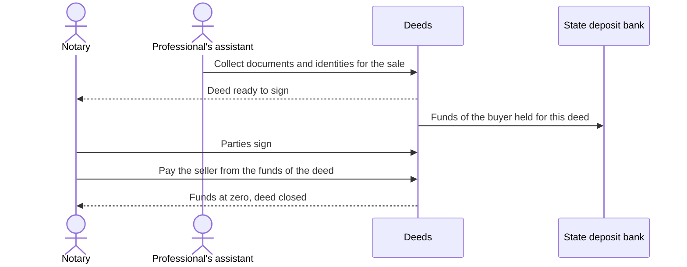

🏠 [Specs](../../../../README.md) › 🏷️ [Sectors](../../../README.md) › ⚖️ [SC11 Professional firms](../../README.md) ›
📝 [Use cases](../README.md) ›
📝 [Use cases: FL-SC11-07 Notaries, brokers, judicial officers and audit firms](README.md) ›
📝 UC-SC11-21 Run a notary's office

# 📝 UC-SC11-21 Run a notary's office

**Status:** 🔄 waiting for the owner

## Summary

A notary's office prepares deeds (property sales, mortgages, wills, company acts). The notary opens a file per deed, the
professional's assistant collects the documents and the parties' identities, the buyer's funds and the taxes to pay to
the state are received in the office's account at the state deposit bank, and the notary pays each person only once the
deed is signed.

## Personas

- [U36 Professional](../../../../01-users/personas/u36-professional.md)
- [U37 Professional's assistant](../../../../01-users/personas/u37-assistant.md)

## Goal

Every deed is prepared with its documents and parties checked, the funds received for it are held at the state deposit
bank and never mixed with the office's own money, and each payment follows the signed deed.

## Trigger

A client asks for a deed, the parties sign, or funds arrive for a deed.

## Frequency

Several deeds a day in an office; funds on each property deed.

## Preconditions

- The parties are client identities with their checks
  ([E-SC11-01 Client identity](../../data/e-sc11-01-client-identity.md)).
- The deed has a matter ([E-SC11-05 Matter](../../data/e-sc11-05-matter.md)) and the engagement is signed
  ([UC-SC11-03](../01-client-intake/uc-sc11-03-sign-the-engagement-letter-and-fee-agreement.md)).

## Postconditions

- **Succeeded:** the deed is saved ([E-SC11-16 Deed](../../data/e-sc11-16-deed.md)) with its parties, documents, funds
  received and paid, and its signature date.
- **Failed:** no payment leaves the account before the deed is signed; the missing document or fund is listed.

## Main flow

1. The notary opens the notary screen
   ([S-SC11-21 Notary](../../screens/07-notaries-brokers-officers-and-auditors/s-sc11-21-notary.md)) and creates the
   deed: kind, parties, property or company, and the expected price.
2. The professional's assistant collects the identities and the documents; the screen shows what is missing for the kind
   of deed.
3. The buyer's funds and the taxes arrive: each amount is recorded as client funds held at the state deposit bank for
   this deed ([BR-SC11-16](../../business-rules/br-sc11-16-client-funds-are-held-at-the-state-deposit-bank.md)).
4. The parties sign; the deed becomes Signed with its date.
5. The notary pays the seller, the taxes to the state and the mortgage release, each from the funds of the deed, and
   prepares the notary's own fees ([UC-SC11-06](../03-time-and-billing/uc-sc11-06-bill-fees-and-request-advances.md)).
6. The deed is Closed when its funds are at zero and the documents are filed.

## Alternative flows

- 3a. A bank sends the buyer's funds directly: the transfer is recorded against the deed on its arrival.
- 2a. A party signs by a power of attorney: the power is recorded and checked before the signature.
- 5a. A payment is returned by the bank: it stays on the deed and the notary is warned.

## Error flows

- 3e. Funds are about to be paid out before the deed is signed: the payment is refused and the reason is shown.
- 3e. Funds of a deed would be paid from another deed's balance: the payment is refused, as the funds are kept per deed.
- 2e. A party's identity is not checked: the deed cannot be signed in the system until it is
  ([UC-SC11-15](../05-compliance-and-secrecy/uc-sc11-15-run-anti-money-laundering-vigilance.md)).
- Any step: a service does not answer; the call is retried first
  ([BR-F3-32](../../../../02-functional/f03-assistant/business-rules/br-f03-32-retry-before-an-error.md)), then the
  message follows the error pattern ([D122](../../../../06-decisions/ux/d122-error-message-standard.md)) and what the
  user typed stays on the screen.

## Business rules

- [BR-SC11-16](../../business-rules/br-sc11-16-client-funds-are-held-at-the-state-deposit-bank.md)
- [BR-SC11-02](../../business-rules/br-sc11-02-identity-checked-before-work.md)
- [BR-SC11-05](../../business-rules/br-sc11-05-client-funds-through-the-trust-account.md)
- [BR-SC11-14](../../business-rules/br-sc11-14-suspicions-reported-through-the-channel.md)

## Entities

- [E-SC11-16 Deed](../../data/e-sc11-16-deed.md): created, changed, closed
- [E-SC11-08 Trust movement](../../data/e-sc11-08-trust-movement.md): created, each movement of the deed's funds
- [E-SC11-01 Client identity](../../data/e-sc11-01-client-identity.md): read, the parties' identities
- [E-SC11-05 Matter](../../data/e-sc11-05-matter.md): read, the matter of the deed

## Permissions

Notary signs, pays and closes; the professional's assistant prepares and collects. Only the notary may
release funds, and the clerk's payment needs the notary's approval.

## Notifications

The notary, in the app: a deed is ready to sign, funds arrived, a document is missing 7 days before the signature. The
client: the date of signature.

## Audit events

Each deed created, signed and closed; each fund received and paid with its deed, amount and who approved it; each
refusal.

## AI involvement

No AI step of its own. The AI assistant may open the screen and prefill it from the user's words; the user checks and
confirms
[BR-F3-07](../../../../02-functional/f03-assistant/business-rules/br-f03-07-no-deletes-no-irreversible-acts.md).

## API, MCP and A2A exposure

T5 operations of the capability for the personas above: create, read, update and list. The MCP tool of the
capability may read and propose, never confirm alone. No A2A skill.

## Screens

- [S-SC11-21 Notary](../../screens/07-notaries-brokers-officers-and-auditors/s-sc11-21-notary.md)

## Flowchart

See
[FL-SC11-07 Notaries, brokers, judicial officers and audit firms](../../flows/fl-sc11-07-notaries-brokers-officers-and-auditors.md#flowchart).

## Sequence diagram

## Acceptance criteria

1. **Given** buyer's funds of 300,000.00 EUR held for a deed **when** the notary tries to pay the seller before the
   signature **then** the payment is refused.
2. **Given** funds of one deed and a payment asked from another deed **when** the clerk asks for it **then** it is
   refused.
3. **Given** a deed signed and funds paid out in full **when** the notary closes it **then** the balance is 0.00 EUR and
   the deed is Closed.
4. **Given** a party whose identity is not checked **when** the deed is signed **then** it is refused until the check.

## Non-functional notes

The screen answers within 2 seconds for 10,000 records; every change is audited.

## Regulatory references

A notary receives the funds of the parties and the taxes due to the state for a deed, holds them at the state
deposit bank apart from the office's own money, and pays them out only as the deed requires, once it is signed. The
office keeps an account per deed and the regulator may inspect it. The France-pack rule is listed below. Related:
[CR-FR-149](../../../../10-country-packs/france/professional-firms/cr-fr-149-aml-vigilance.md),
[CR-FR-151](../../../../10-country-packs/france/professional-firms/cr-fr-151-carpa-client-funds.md) (lawyers' funds, a
different regime).

- France-pack rule, (Proposed) until its law is read:
  [CR-FR-241 Notaries' client funds](../../../../10-country-packs/france/professional-firms/cr-fr-241-notaries-client-funds.md)

## Related use cases

- [UC-SC11-22 Run an insurance brokerage](uc-sc11-22-run-an-insurance-brokerage.md)
- [UC-SC11-07](../03-time-and-billing/uc-sc11-07-hold-client-funds-on-trust-accounts.md)
- [UC-SC11-15](../05-compliance-and-secrecy/uc-sc11-15-run-anti-money-laundering-vigilance.md)

## Open questions

None.

---

⬅️ [UC-SC11-20](../02-matters-and-documents/uc-sc11-20-ask-the-assistant-about-a-matter.md) · ⬆️ [Up](README.md) ·
➡️ [UC-SC11-22 Run an insurance brokerage](uc-sc11-22-run-an-insurance-brokerage.md)
