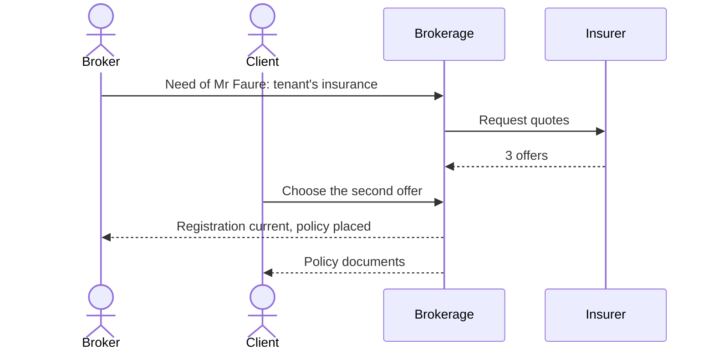

🏠 [Specs](../../../../README.md) › 🏷️ [Sectors](../../../README.md) › ⚖️ [SC11 Professional firms](../../README.md) ›
📝 [Use cases](../README.md) ›
📝 [Use cases: FL-SC11-07 Notaries, brokers, judicial officers and audit firms](README.md) ›
📝 UC-SC11-22 Run an insurance brokerage

# 📝 UC-SC11-22 Run an insurance brokerage

**Status:** 🔄 waiting for the owner

## Summary

An insurance brokerage places its clients' risks with insurers. The broker keeps each policy with its insurer, premium,
commission and renewal date, and the brokerage keeps its own registration current with the registry of insurance
intermediaries. A policy cannot be sold while the broker's registration or the guarantees it needs have lapsed.

## Personas

- [U36 Professional](../../../../01-users/personas/u36-professional.md)
- [U09 Customer](../../../../01-users/personas/u09-customer.md)

## Goal

Every policy is kept with its commission and renewal date, and no policy is placed while the registration is not
current.

## Trigger

A client asks for a quote, a policy is placed, a renewal comes, or the yearly registration falls due.

## Frequency

Dozens of policies a week; one registration renewal a year.

## Preconditions

- The client is a customer
  ([E-F6-01](../../../../02-functional/f06-customers-and-sales/data/e-f06-01-customer-record.md)) with their identity
  checked ([E-SC11-01 Client identity](../../data/e-sc11-01-client-identity.md)).
- The brokerage's registration number and its end date are recorded.

## Postconditions

- **Succeeded:** the policy is saved ([E-SC11-17 Policy](../../data/e-sc11-17-policy.md)) with its insurer, premium,
  commission and renewal date.
- **Failed:** no policy is placed; the lapsed registration or the missing guarantee is shown.

## Main flow

1. The broker opens the brokerage screen
   ([S-SC11-22](../../screens/07-notaries-brokers-officers-and-auditors/s-sc11-22-brokerage.md)) and sees the
   registration status first.
2. The broker records the client's need and requests quotes from the insurers; the offers are compared on one page with
   the cover and the premium.
3. The client chooses an offer; simple-ERP checks that the registration is current
   ([BR-SC11-17](../../business-rules/br-sc11-17-brokers-keep-their-orias-registration-current.md)) and places the
   policy.
4. The policy is Active with its commission and the dates; the client gets the documents on the phone.
5. Before each renewal, the screen proposes a comparison and the client decides.
6. Once a year the brokerage renews its registration with the proof of its professional-liability insurance and its
   financial guarantee.

## Alternative flows

- 2a. The client already has a policy: it is imported as an existing policy with its insurer and dates.
- 5a. The client leaves the brokerage: the policy is moved to its new broker and the commission stops.
- 3a. The cover asks for the client's advice document: it is produced and signed before the policy is placed.

## Error flows

- 3e. The registration has lapsed or ends in less than the warning delay: no new policy is placed and the manager is
  warned.
- 3e. The professional-liability insurance proof is missing: the same refusal applies.
- 4e. The insurer refuses the risk: the policy stays Quoted and the broker looks for another insurer.
- Any step: a service does not answer; the call is retried first
  ([BR-F3-32](../../../../02-functional/f03-assistant/business-rules/br-f03-32-retry-before-an-error.md)), then the
  message follows the error pattern ([D122](../../../../06-decisions/ux/d122-error-message-standard.md)) and what the
  user typed stays on the screen.

## Business rules

- [BR-SC11-17](../../business-rules/br-sc11-17-brokers-keep-their-orias-registration-current.md)
- [BR-SC11-02](../../business-rules/br-sc11-02-identity-checked-before-work.md)
- [BR-SC11-04 Fees agreed in writing](../../business-rules/br-sc11-04-fees-agreed-in-writing.md)

## Entities

- [E-SC11-17 Policy](../../data/e-sc11-17-policy.md): created, changed
- [E-SC11-01 Client identity](../../data/e-sc11-01-client-identity.md): read, the client's identity check
- [E-F6-01](../../../../02-functional/f06-customers-and-sales/data/e-f06-01-customer-record.md): read, the client
- [E-SC11-07 Fee bill](../../data/e-sc11-07-fee-bill.md): read, the fees of the brokerage's other services

## Permissions

Broker places and renews policies; the manager follows the registration. The client sees their policies in
the portal.

## Notifications

The manager, in the app: the registration ends in 60 days. The broker: a policy renews in 60 days. The client: the
renewal offer.

## Audit events

Each policy quoted, placed, renewed or cancelled, with its insurer, premium and commission; each check of the
registration; who and when.

## AI involvement

No AI step of its own. The AI assistant may open the screen and prefill it from the user's words; the user checks and
confirms
[BR-F3-07](../../../../02-functional/f03-assistant/business-rules/br-f03-07-no-deletes-no-irreversible-acts.md).

## API, MCP and A2A exposure

T5 operations of the capability for the personas above: create, read, update and list. The MCP tool of the
capability may read and propose, never confirm alone. No A2A skill.

## Screens

- [S-SC11-22](../../screens/07-notaries-brokers-officers-and-auditors/s-sc11-22-brokerage.md)

## Flowchart

See
[FL-SC11-07 Notaries, brokers, judicial officers and audit firms](../../flows/fl-sc11-07-notaries-brokers-officers-and-auditors.md#flowchart).

## Sequence diagram

## Acceptance criteria

1. **Given** a registration that ends tomorrow **when** the broker places a policy **then** it is placed and the manager
   is warned of the end date.
2. **Given** a registration that has ended **when** the broker places a policy **then** it is refused with the end date.
3. **Given** a policy with a premium of 480.00 EUR and a commission of 12 % **when** the policy is placed **then** the
   commission is 57.60 EUR.
4. **Given** a policy renewing in 60 days **when** the day comes **then** the broker is told and a comparison is
   proposed.

## Non-functional notes

The screen answers within 2 seconds for 10,000 records; every change is audited.

## Regulatory references

An insurance broker must be registered with the national registry of insurance intermediaries, renewed each
year with proof of professional-liability insurance and a financial guarantee, and may place policies only while
registered. The broker gives the client advice and information before the policy. The France-pack rule is listed below.
Related: [CR-FR-149](../../../../10-country-packs/france/professional-firms/cr-fr-149-aml-vigilance.md).

- France-pack rule, (Proposed) until its law is read:
  [CR-FR-242 Insurance brokers and ORIAS](../../../../10-country-packs/france/professional-firms/cr-fr-242-insurance-brokers-orias.md)

## Related use cases

- [UC-SC11-21 Run a notary's office](uc-sc11-21-run-a-notarys-office.md)
- [UC-SC11-23 Run a judicial officer's office](uc-sc11-23-run-a-judicial-officers-office.md)
- [UC-SC11-03](../01-client-intake/uc-sc11-03-sign-the-engagement-letter-and-fee-agreement.md)
- [UC-SC11-18](../06-firm-management/uc-sc11-18-track-continuing-professional-training.md)

## Open questions

None.

---

⬅️ [UC-SC11-21 Run a notary's office](uc-sc11-21-run-a-notarys-office.md) · ⬆️ [Up](README.md) ·
➡️ [UC-SC11-23 Run a judicial officer's office](uc-sc11-23-run-a-judicial-officers-office.md)
