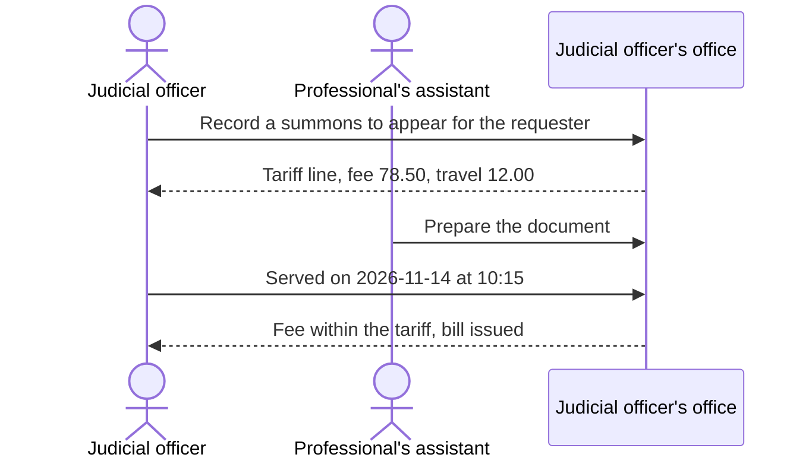

🏠 [Specs](../../../../README.md) › 🏷️ [Sectors](../../../README.md) › ⚖️ [SC11 Professional firms](../../README.md) ›
📝 [Use cases](../README.md) ›
📝 [Use cases: FL-SC11-07 Notaries, brokers, judicial officers and audit firms](README.md) ›
📝 UC-SC11-23 Run a judicial officer's office

# 📝 UC-SC11-23 Run a judicial officer's office

**Status:** ✅ specified

## Summary

A judicial officer's office serves court documents, makes debt recoveries and draws up reports. Each act has a fee that
follows the regulated tariff, with the travel and the disbursements. The office records each act, its date and the
person served, and bills only what the tariff allows.

## Personas

- [U36 Professional](../../../../01-users/personas/u36-professional.md)
- [U37 Professional's assistant](../../../../01-users/personas/u37-assistant.md)

## Goal

Every act is recorded with its date and recipient, and its fee never exceeds the regulated tariff for its type.

## Trigger

A client asks for an act, the act is served, or the fee is billed.

## Frequency

Dozens of acts a day in an office.

## Preconditions

- The requester is a client with their identity checked
  ([E-SC11-01 Client identity](../../data/e-sc11-01-client-identity.md)).
- The tariff of the country pack is loaded for the acts of the office.

## Postconditions

- **Succeeded:** the act is saved ([E-SC11-18 Service act](../../data/e-sc11-18-service-act.md)) with its date,
  recipient and fee; the fee is within the tariff and the bill is issued
  ([E-SC11-07 Fee bill](../../data/e-sc11-07-fee-bill.md)).
- **Failed:** the act is not billed above the tariff; the excess is cut and shown.

## Main flow

1. The judicial officer opens the judicial officer screen
   ([S-SC11-23](../../screens/07-notaries-brokers-officers-and-auditors/s-sc11-23-judicial-officer.md)) and records the
   act asked for: type, requester, recipient and the deadline of the case.
2. SimpleERP proposes the tariff line for the type of act, with travel and the usual disbursements.
3. The professional's assistant prepares the document; the judicial officer serves it and records the date, the time and
   how it was served.
4. The fee is computed from the tariff
   ([BR-SC11-18](../../business-rules/br-sc11-18-fees-follow-the-regulated-tariff.md)) and shown to the requester before
   billing.
5. The bill is issued with the fee, the taxes and the disbursements
   ([UC-SC11-06](../03-time-and-billing/uc-sc11-06-bill-fees-and-request-advances.md)).
6. The act is Billed; the deadline of the case is followed
   ([UC-SC11-08](../04-deadlines-and-filings/uc-sc11-08-follow-deadlines-hearings-and-limitation-periods.md)).

## Alternative flows

- 3a. The act could not be served on the first try: a new attempt is recorded and the first one is kept.
- 2a. The client has a fee agreement for a part of the work that the tariff does not set: that part is billed under the
  agreement, and shown apart.
- 1a. The act is a debt recovery: the amounts collected are held apart
  ([UC-SC11-07](../03-time-and-billing/uc-sc11-07-hold-client-funds-on-trust-accounts.md)).

## Error flows

- 4e. The fee asked is above the tariff for the type of act: the excess is cut and the reason is shown.
- 3e. The recipient's address is not found: the act waits and the officer is told the reasons.
- 3e. The date of service is after the legal deadline: the act is flagged before it is served.
- Any step: a service does not answer; the call is retried first
  ([BR-F3-32](../../../../02-functional/f03-assistant/business-rules/br-f03-32-retry-before-an-error.md)), then the
  message follows the error pattern ([D122](../../../../06-decisions/ux/d122-error-message-standard.md)) and what the
  user typed stays on the screen.

## Business rules

- [BR-SC11-18](../../business-rules/br-sc11-18-fees-follow-the-regulated-tariff.md)
- [BR-SC11-07 Deadlines never silent](../../business-rules/br-sc11-07-deadlines-never-silent.md)
- [BR-SC11-08](../../business-rules/br-sc11-08-time-billed-from-records.md)

## Entities

- [E-SC11-18 Service act](../../data/e-sc11-18-service-act.md): created, changed
- [E-SC11-07 Fee bill](../../data/e-sc11-07-fee-bill.md): created, the fee bill
- [E-SC11-09 Deadline](../../data/e-sc11-09-deadline.md): read, the deadline of the case
- [E-SC11-01 Client identity](../../data/e-sc11-01-client-identity.md): read, the requester

## Permissions

Judicial officer serves acts and approves fees; the professional's assistant prepares documents and bills.
The requester sees their own acts and bills in the portal.

## Notifications

The judicial officer, in the app: a deadline comes in 3 days, an act could not be served. The requester: the act is
served.

## Audit events

Each act recorded, served, billed or cancelled, with the tariff line, the fee, any cut and who and when.

## AI involvement

No AI step of its own. The AI assistant may open the screen and prefill it from the user's words; the user checks and
confirms
[BR-F3-07](../../../../02-functional/f03-assistant/business-rules/br-f03-07-no-deletes-no-irreversible-acts.md).

## API, MCP and A2A exposure

T5 operations of the capability for the personas above: create, read, update and list. The MCP tool of the
capability may read and propose, never confirm alone. No A2A skill.

## Screens

- [S-SC11-23](../../screens/07-notaries-brokers-officers-and-auditors/s-sc11-23-judicial-officer.md)

## Flowchart

See
[FL-SC11-07 Notaries, brokers, judicial officers and audit firms](../../flows/fl-sc11-07-notaries-brokers-officers-and-auditors.md#flowchart).

## Sequence diagram

## Acceptance criteria

1. **Given** an act whose tariff fee is 78.50 EUR **when** the professional's assistant asks to bill 90.00 EUR **then**
   the fee is cut to 78.50 EUR and the excess is shown.
2. **Given** a service attempted without success **when** the officer records it **then** the attempt is kept and a new
   one may be recorded.
3. **Given** a date of service after the legal deadline **when** the officer records it **then** the act is flagged.
4. **Given** a part of work set by a fee agreement **when** the bill is prepared **then** that part is shown apart from
   the tariff fee.

## Non-functional notes

The screen answers within 2 seconds for 10,000 records; every change is audited.

## Regulatory references

The fees of a judicial officer for the acts the law lists follow a regulated tariff set by decree; the
officer may not charge more for those acts, and other work may be billed under an agreement with the client. The tariff
lines and the travel allowance are data of the France pack, written later. Related:
[CR-FR-149](../../../../10-country-packs/france/professional-firms/cr-fr-149-aml-vigilance.md),
[CR-FR-154](../../../../10-country-packs/france/professional-firms/cr-fr-154-lawyer-secrecy.md).

## Related use cases

- [UC-SC11-22 Run an insurance brokerage](uc-sc11-22-run-an-insurance-brokerage.md)
- [UC-SC11-24 Run a statutory audit firm](uc-sc11-24-run-a-statutory-audit-firm.md)
- [UC-SC11-06](../03-time-and-billing/uc-sc11-06-bill-fees-and-request-advances.md)
- [UC-SC11-08](../04-deadlines-and-filings/uc-sc11-08-follow-deadlines-hearings-and-limitation-periods.md)

## Open questions

None.

---

⬅️ [UC-SC11-22 Run an insurance brokerage](uc-sc11-22-run-an-insurance-brokerage.md) · ⬆️ [Up](README.md) ·
➡️ [UC-SC11-24 Run a statutory audit firm](uc-sc11-24-run-a-statutory-audit-firm.md)
