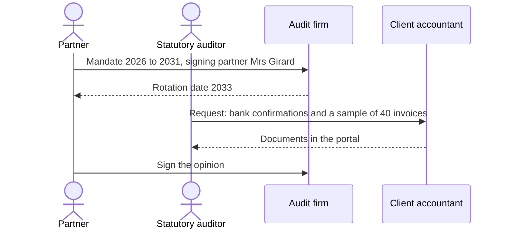

🏠 [Specs](../../../../README.md) › 🏷️ [Sectors](../../../README.md) › ⚖️ [SC11 Professional firms](../../README.md) ›
📝 [Use cases](../README.md) ›
📝 [Use cases: FL-SC11-07 Notaries, brokers, judicial officers and audit firms](README.md) ›
📝 UC-SC11-24 Run a statutory audit firm

# 📝 UC-SC11-24 Run a statutory audit firm

**Status:** ✅ specified

## Summary

A statutory audit firm audits the accounts of its clients for mandates of several years. The partner in charge signs the
opinion, the auditor reads the books, sends requests for documents and samples transactions, and the firm follows the
mandate's length and the rotation of the signing partner the law requires.

## Personas

- [U49 Statutory auditor](../../../../01-users/personas/u49-statutory-auditor.md)
- [U36 Professional](../../../../01-users/personas/u36-professional.md)

## Goal

Every mandate shows its years, its signing partner and its rotation date, and the firm is warned before a partner must
be replaced.

## Trigger

A mandate is accepted, a year is audited, or a rotation date comes near.

## Frequency

One mandate per client for several years; one audit cycle a year.

## Preconditions

- The client is a customer
  ([E-F6-01](../../../../02-functional/f06-customers-and-sales/data/e-f06-01-customer-record.md)) with the engagement
  letter signed ([E-SC11-04 Engagement letter](../../data/e-sc11-04-engagement-letter.md)).
- The firm's partners and auditors are employees with their roles
  ([E-F9-01](../../../../02-functional/f09-hr-and-projects/data/e-f09-01-employee-record.md)).

## Postconditions

- **Succeeded:** the engagement is saved ([E-SC11-19 Audit engagement](../../data/e-sc11-19-audit-engagement.md)) with
  its years, partner and rotation date; each year's work is linked to the mandate.
- **Failed:** the engagement is not Active; the missing letter, the independence check or the partner is shown.

## Main flow

1. The partner opens the audit firm screen
   ([S-SC11-24](../../screens/07-notaries-brokers-officers-and-auditors/s-sc11-24-audit-firm.md)) and creates the
   engagement: the client, the mandate's first year and length, the signing partner and the team.
2. The partner records the independence check; the engagement becomes Active.
3. Each year the auditor sends requests for documents and samples of transactions to the client's accountants, who
   answer in the portal.
4. The auditor records the work and the findings; the partner signs the opinion.
5. SimpleERP shows the years served by each signing partner and the rotation date
   ([BR-SC11-19](../../business-rules/br-sc11-19-partners-rotate-as-the-law-requires.md)).
6. When the rotation date is near, the firm names the replacing partner and the engagement keeps its history.

## Alternative flows

- 3a. The client's accountant sends the documents directly by the portal: the request is closed on receipt.
- 5a. The client is a public-interest entity: the stricter rotation of the pack applies.
- 2a. A conflict is found: the engagement is refused and the reason is kept.

## Error flows

- 2e. The independence check is missing: the engagement cannot become Active.
- 5e. The signing partner has reached the rotation: a new opinion cannot be signed by them and the screen asks for the
  replacing partner.
- 4e. A request stays unanswered past its delay: the auditor is told and may escalate to the client's management.
- Any step: a service does not answer; the call is retried first
  ([BR-F3-32](../../../../02-functional/f03-assistant/business-rules/br-f03-32-retry-before-an-error.md)), then the
  message follows the error pattern ([D122](../../../../06-decisions/ux/d122-error-message-standard.md)) and what the
  user typed stays on the screen.

## Business rules

- [BR-SC11-19](../../business-rules/br-sc11-19-partners-rotate-as-the-law-requires.md)
- [BR-SC11-03](../../business-rules/br-sc11-03-conflicts-checked-before-opening.md)
- [BR-SC11-06](../../business-rules/br-sc11-06-secrecy-and-access-walls.md)
- [BR-SC11-15 Training hours tracked](../../business-rules/br-sc11-15-training-hours-tracked.md)

## Entities

- [E-SC11-19 Audit engagement](../../data/e-sc11-19-audit-engagement.md): created, changed, closed
- [E-SC11-04 Engagement letter](../../data/e-sc11-04-engagement-letter.md): read, the engagement letter
- [E-SC11-03 Conflict check](../../data/e-sc11-03-conflict-check.md): read, the conflict check
- [E-SC11-15 Training record](../../data/e-sc11-15-training-record.md): read, the training hours of the team

## Permissions

Partner opens, signs and rotates engagements; the auditor works on the engagements of their team. A client
sees only the requests addressed to them.

## Notifications

The partner, in the app: a rotation date comes in 12 months, in 6 months and in 3 months; a request is late. The
auditor: new documents arrived.

## Audit events

Each engagement created, accepted, rotated or ended; each independence check, request and sample; each opinion signed
with the signing partner; who and when.

## AI involvement

No AI step of its own. The AI assistant may open the screen and prefill it from the user's words; the user checks and
confirms
[BR-F3-07](../../../../02-functional/f03-assistant/business-rules/br-f03-07-no-deletes-no-irreversible-acts.md).

## API, MCP and A2A exposure

T5 operations of the capability for the personas above: create, read, update and list. The MCP tool of the
capability may read and propose, never confirm alone. No A2A skill.

## Screens

- [S-SC11-24](../../screens/07-notaries-brokers-officers-and-auditors/s-sc11-24-audit-firm.md)

## Flowchart

See
[FL-SC11-07 Notaries, brokers, judicial officers and audit firms](../../flows/fl-sc11-07-notaries-brokers-officers-and-auditors.md#flowchart).

## Sequence diagram

## Acceptance criteria

1. **Given** a mandate of six years and a signing partner who started in 2026 **when** the partner opens the engagement
   **then** the rotation date of the pack is shown.
2. **Given** a partner who has reached the rotation **when** the partner signs a new opinion **then** it is refused and
   a replacing partner is asked for.
3. **Given** a request unanswered after its delay **when** the day passes **then** the auditor is told.
4. **Given** an engagement with no independence check **when** the partner activates it **then** it is refused.

## Non-functional notes

The screen answers within 2 seconds for 10,000 records; every change is audited.

## Regulatory references

A statutory auditor is appointed for a mandate of several financial years; the firm must check its
independence before accepting, and for public-interest entities the signing partner must rotate after a set number of
years, and the firm itself after a longer period: a mandate lasts six financial years, the key audit partners of a
public-interest entity leave the audit at the latest seven years after their appointment and come back only three
years after, and the firm stays at most 10 years alone (up to 24 with joint auditors). The values are data of the
France pack. Related:
[CR-FR-149](../../../../10-country-packs/france/professional-firms/cr-fr-149-aml-vigilance.md),
[CR-FR-152](../../../../10-country-packs/france/professional-firms/cr-fr-152-accountant-engagement-letter.md).

- France-pack rule:
  [CR-FR-243 Statutory auditor rotation](../../../../10-country-packs/france/professional-firms/cr-fr-243-statutory-audit-rotation.md)

## Related use cases

- [UC-SC11-23 Run a judicial officer's office](uc-sc11-23-run-a-judicial-officers-office.md)
- [UC-SC11-02](../01-client-intake/uc-sc11-02-check-conflicts-of-interest.md)
- [UC-SC11-12](../04-deadlines-and-filings/uc-sc11-12-prepare-client-filings-and-their-evidence.md)

## Open questions

None.

---

⬅️ [UC-SC11-23 Run a judicial officer's office](uc-sc11-23-run-a-judicial-officers-office.md) · ⬆️ [Up](README.md)
