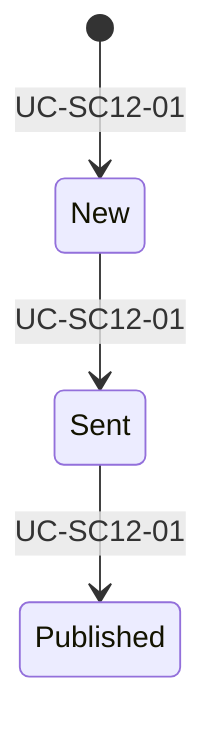

🏠 [Specs](../../../README.md) › 🏷️ [Sectors](../../README.md) › 🎓 [SC12 Education and training](../README.md) ›
🗃️ [Data](README.md) › 🗃️ E-SC12-01 Course

# 🗃️ E-SC12-01 Course

**Status:** 🔄 waiting for the owner

## Purpose

A training course.

## Fields

| Name | Type | Required | Validation | Default | Example | Personal data | Custom fields |
|---|---|---|---|---|---|---|---|
| title, objectives, programme | text | yes | - | - | Excel advanced | no | no |
| duration, price | hours, amount | yes | > 0 | - | 14 h, 690 | no | no |

## Relations

(Proposed) As its use cases.

## Lifecycle

## Indexes and search

(Proposed) By number, date, partner.

## Retention

Kept for the period of its kind of record in the country pack (D293), or else its kind's default in the
[retention schedule](../../../05-non-functional/data-retention.md).

## Audit

Every change.

## Import and export

(Proposed) CSV, FEC where relevant.

## Used by

- [UC-SC12-01](../use-cases/01-offer-and-sessions/uc-sc12-01-publish-the-course-catalogue.md)

## Open questions

None.

---

⬆️ [Up](README.md) · ➡️ [E-SC12-02 Course session](e-sc12-02-course-session.md)
