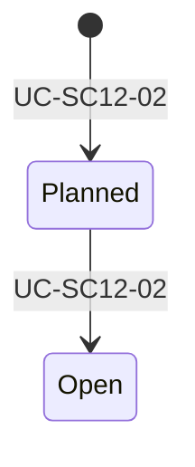

🏠 [Specs](../../../README.md) › 🏷️ [Sectors](../../README.md) › 🎓 [SC12 Education and training](../README.md) ›
🗃️ [Data](README.md) › 🗃️ E-SC12-02 Course session

# 🗃️ E-SC12-02 Course session

**Status:** 🔄 waiting for the owner

## Purpose

A dated delivery of a course.

## Fields

| Name | Type | Required | Validation | Default | Example | Personal data | Custom fields |
|---|---|---|---|---|---|---|---|
| course, dates, place | records | yes | - | - | Excel advanced, 3-4 Dec, Lyon | no | no |
| trainer, room, places | records | yes | BR-SC12-09 | - | U39, room 2, 10 | no | no |

## Relations

(Proposed) As its use cases.

## Lifecycle

## Indexes and search

(Proposed) By number, date, partner.

## Retention

Kept for the period of its kind of record in the country pack (D293), or else its kind's default in the
[retention schedule](../../../05-non-functional/data-retention.md).

## Audit

Every change.

## Import and export

(Proposed) CSV, FEC where relevant.

## Used by

- [UC-SC12-02](../use-cases/01-offer-and-sessions/uc-sc12-02-plan-sessions-with-trainers-and-rooms.md)
- [UC-SC12-16](../use-cases/05-private-school/uc-sc12-16-organise-classes-and-timetables.md)
- [UC-SC12-20](../use-cases/03-deliver-and-assess/uc-sc12-20-ask-the-assistant.md)

## Open questions

None.

---

⬅️ [E-SC12-01 Course](e-sc12-01-course.md) · ⬆️ [Up](README.md) · ➡️ [E-SC12-03 Enrolment](e-sc12-03-enrolment.md)
