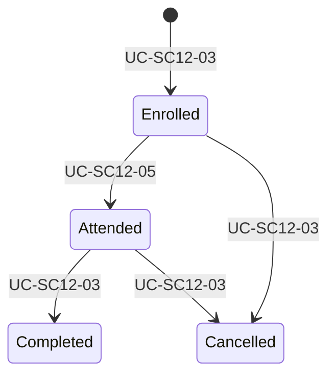

🏠 [Specs](../../../README.md) › 🏷️ [Sectors](../../README.md) › 🎓 [SC12 Education and training](../README.md) ›
🗃️ [Data](README.md) › 🗃️ E-SC12-03 Enrolment

# 🗃️ E-SC12-03 Enrolment

**Status:** 🔄 waiting for the owner

## Purpose

A learner on a session.

## Fields

| Name | Type | Required | Validation | Default | Example | Personal data | Custom fields |
|---|---|---|---|---|---|---|---|
| learner, session | records | yes | - | - | J. Martin, S-41 | yes | no |
| state | enrolled, attended, completed, cancelled | yes | - | enrolled | completed | no | no |

## Relations

(Proposed) As its use cases.

## Lifecycle

## Indexes and search

(Proposed) By number, date, partner.

## Retention

For the legal periods, then deleted:
[CR-FR-052 Personal data kept no longer than needed](../../../10-country-packs/france/data-protection/cr-fr-052-storage-limitation.md).

## Audit

Every change.

## Import and export

(Proposed) CSV, FEC where relevant.

## Used by

- [UC-SC12-03](../use-cases/02-enrol-and-fund/uc-sc12-03-enrol-learners-with-quotes-and-agreements.md)
- [UC-SC12-05](../use-cases/02-enrol-and-fund/uc-sc12-05-send-invitations-and-needs-assessments.md)

## Open questions

None.

---

⬅️ [E-SC12-02 Course session](e-sc12-02-course-session.md) · ⬆️ [Up](README.md) ·
➡️ [E-SC12-04 Training agreement](e-sc12-04-training-agreement.md)
