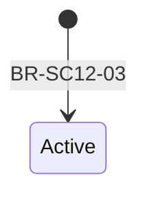

🏠 [Specs](../../../README.md) › 🏷️ [Sectors](../../README.md) › 🎓 [SC12 Education and training](../README.md) ›
🗃️ [Data](README.md) › 🗃️ E-SC12-04 Training agreement

# 🗃️ E-SC12-04 Training agreement

**Status:** ✅ specified

## Purpose

The signed agreement.

## Fields

| Name | Type | Required | Validation | Default | Example | Personal data | Custom fields |
|---|---|---|---|---|---|---|---|
| client, session, price | records | yes | BR-SC12-03 | - | Acme, S-41, 690 | no | no |
| signed, withdrawal end | dates | no | - | - | 2 Nov | no | no |

## Relations

As its use cases.

## Lifecycle

## Indexes and search

By number, date, partner.

## Retention

As an accounting record:
[CR-FR-002 Accounting records kept 10 years](../../../10-country-packs/france/accounting/cr-fr-002-accounting-records-kept-ten-years.md).

## Audit

Every change.

## Import and export

CSV, FEC where relevant.

## Used by

- [UC-SC12-03](../use-cases/02-enrol-and-fund/uc-sc12-03-enrol-learners-with-quotes-and-agreements.md)

## Open questions

None.

---

⬅️ [E-SC12-03 Enrolment](e-sc12-03-enrolment.md) · ⬆️ [Up](README.md) ·
➡️ [E-SC12-05 Training funding](e-sc12-05-training-funding.md)
