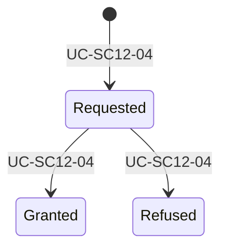

🏠 [Specs](../../../README.md) › 🏷️ [Sectors](../../README.md) › 🎓 [SC12 Education and training](../README.md) ›
🗃️ [Data](README.md) › 🗃️ E-SC12-05 Training funding

# 🗃️ E-SC12-05 Training funding

**Status:** 🔄 waiting for the owner

## Purpose

A learner's funding decision; the funder's agreement with its share and cap is the shared
[E-F6-14 Funder agreement](../../../02-functional/f06-customers-and-sales/data/e-f06-14-funder-agreement.md),
[UC-F6-20](../../../02-functional/f06-customers-and-sales/use-cases/07-special-invoicing/uc-f06-20-invoice-several-payers-with-funders-and-caps.md).

## Fields

| Name | Type | Required | Validation | Default | Example | Personal data | Custom fields |
|---|---|---|---|---|---|---|---|
| enrolment, funder, share | records | yes | BR-SC12-05 | - | J. Martin, skills operator, 540 | no | no |
| state | requested, granted, refused | yes | - | requested | granted | no | no |

## Relations

(Proposed) As its use cases.

## Lifecycle

## Indexes and search

(Proposed) By number, date, partner.

## Retention

As an accounting record:
[CR-FR-002 Accounting records kept 10 years](../../../10-country-packs/france/accounting/cr-fr-002-accounting-records-kept-ten-years.md).

## Audit

Every change.

## Import and export

(Proposed) CSV, FEC where relevant.

## Used by

- [UC-SC12-04](../use-cases/02-enrol-and-fund/uc-sc12-04-get-funding.md)

## Open questions

None.

---

⬅️ [E-SC12-04 Training agreement](e-sc12-04-training-agreement.md) · ⬆️ [Up](README.md) ·
➡️ [E-SC12-06 Attendance sheet](e-sc12-06-attendance-sheet.md)
