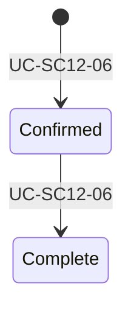

🏠 [Specs](../../../README.md) › 🏷️ [Sectors](../../README.md) › 🎓 [SC12 Education and training](../README.md) ›
🗃️ [Data](README.md) › 🗃️ E-SC12-06 Attendance sheet

# 🗃️ E-SC12-06 Attendance sheet

**Status:** ✅ specified

## Purpose

Signatures per half-day.

## Fields

| Name | Type | Required | Validation | Default | Example | Personal data | Custom fields |
|---|---|---|---|---|---|---|---|
| session, half-day | records | yes | BR-SC12-04 | - | S-41, 3 Dec am | no | no |
| signatures | list | yes | - | - | 9 of 10 | yes | no |

## Relations

As its use cases.

## Lifecycle

## Indexes and search

By number, date, partner.

## Retention

Kept for the period of its kind of record in the country pack (D293), or else its kind's default in the
[retention schedule](../../../05-non-functional/data-retention.md).

## Audit

Every change.

## Import and export

CSV, FEC where relevant.

## Used by

- [UC-SC12-06](../use-cases/03-deliver-and-assess/uc-sc12-06-sign-attendance-per-half-day.md)
- [UC-SC12-20](../use-cases/03-deliver-and-assess/uc-sc12-20-ask-the-assistant.md)

## Open questions

None.

---

⬅️ [E-SC12-05 Training funding](e-sc12-05-training-funding.md) · ⬆️ [Up](README.md) ·
➡️ [E-SC12-07 E-learning record](e-sc12-07-e-learning-record.md)
