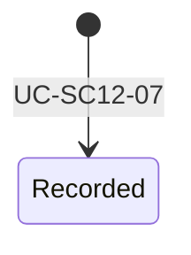

🏠 [Specs](../../../README.md) › 🏷️ [Sectors](../../README.md) › 🎓 [SC12 Education and training](../README.md) ›
🗃️ [Data](README.md) › 🗃️ E-SC12-07 E-learning record

# 🗃️ E-SC12-07 E-learning record

**Status:** ✅ specified

## Purpose

Progress on the platform.

## Fields

| Name | Type | Required | Validation | Default | Example | Personal data | Custom fields |
|---|---|---|---|---|---|---|---|
| learner, module, hours | records | yes | BR-SC12-15 | - | J. Martin, module 3, 2 | yes | no |

## Relations

As its use cases.

## Lifecycle

## Indexes and search

By number, date, partner.

## Retention

Kept for the period of its kind of record in the country pack (D293), or else its kind's default in the
[retention schedule](../../../05-non-functional/data-retention.md).

## Audit

Every change.

## Import and export

CSV, FEC where relevant.

## Used by

- [UC-SC12-07](../use-cases/03-deliver-and-assess/uc-sc12-07-run-e-learning-modules.md)

## Open questions

None.

---

⬅️ [E-SC12-06 Attendance sheet](e-sc12-06-attendance-sheet.md) · ⬆️ [Up](README.md) ·
➡️ [E-SC12-08 Completion certificate](e-sc12-08-completion-certificate.md)
