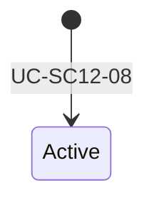

🏠 [Specs](../../../README.md) › 🏷️ [Sectors](../../README.md) › 🎓 [SC12 Education and training](../README.md) ›
🗃️ [Data](README.md) › 🗃️ E-SC12-08 Completion certificate

# 🗃️ E-SC12-08 Completion certificate

**Status:** ✅ specified

## Purpose

A completion certificate.

## Fields

| Name | Type | Required | Validation | Default | Example | Personal data | Custom fields |
|---|---|---|---|---|---|---|---|
| enrolment, date | records | yes | BR-SC12-06 | - | J. Martin, 4 Dec | yes | no |

## Relations

As its use cases.

## Lifecycle

## Indexes and search

By number, date, partner.

## Retention

Kept for the period of its kind of record in the country pack (D293), or else its kind's default in the
[retention schedule](../../../05-non-functional/data-retention.md).

## Audit

Every change.

## Import and export

CSV, FEC where relevant.

## Used by

- [UC-SC12-08](../use-cases/03-deliver-and-assess/uc-sc12-08-assess-learners-and-issue-certificates.md)

## Open questions

None.

---

⬅️ [E-SC12-07 E-learning record](e-sc12-07-e-learning-record.md) · ⬆️ [Up](README.md) ·
➡️ [E-SC12-09 Survey answer](e-sc12-09-survey-answer.md)
