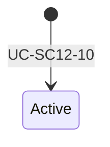

🏠 [Specs](../../../README.md) › 🏷️ [Sectors](../../README.md) › 🎓 [SC12 Education and training](../README.md) ›
🗃️ [Data](README.md) › 🗃️ E-SC12-10 Training invoice

# 🗃️ E-SC12-10 Training invoice

**Status:** ✅ specified

## Purpose

An invoice per payer.

## Fields

| Name | Type | Required | Validation | Default | Example | Personal data | Custom fields |
|---|---|---|---|---|---|---|---|
| session, payer, amount | records | yes | - | - | S-41, operator, 540 | no | no |

## Relations

As its use cases.

## Lifecycle

## Indexes and search

By number, date, partner.

## Retention

As an accounting record:
[CR-FR-002 Accounting records kept 10 years](../../../10-country-packs/france/accounting/cr-fr-002-accounting-records-kept-ten-years.md).

## Audit

Every change.

## Import and export

CSV, FEC where relevant.

## Used by

- [UC-SC12-10](../use-cases/02-enrol-and-fund/uc-sc12-10-bill-learners-employers-and-funders.md)

## Open questions

None.

---

⬅️ [E-SC12-09 Survey answer](e-sc12-09-survey-answer.md) · ⬆️ [Up](README.md) ·
➡️ [E-SC12-11 Trainer profile](e-sc12-11-trainer-profile.md)
