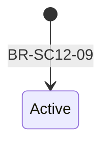

🏠 [Specs](../../../README.md) › 🏷️ [Sectors](../../README.md) › 🎓 [SC12 Education and training](../README.md) ›
🗃️ [Data](README.md) › 🗃️ E-SC12-11 Trainer profile

# 🗃️ E-SC12-11 Trainer profile

**Status:** ✅ specified

## Purpose

A trainer and their skills.

## Fields

| Name | Type | Required | Validation | Default | Example | Personal data | Custom fields |
|---|---|---|---|---|---|---|---|
| person, skills, availability | records | yes | BR-SC12-09 | - | U39, Excel, Mon-Thu | yes | no |

## Relations

As its use cases.

## Lifecycle

## Indexes and search

By number, date, partner.

## Retention

Kept for the period of its kind of record in the country pack (D293), or else its kind's default in the
[retention schedule](../../../05-non-functional/data-retention.md).

## Audit

Every change.

## Import and export

CSV, FEC where relevant.

## Used by

- [UC-SC12-11](../use-cases/01-offer-and-sessions/uc-sc12-11-manage-trainers.md)

## Open questions

None.

---

⬅️ [E-SC12-10 Training invoice](e-sc12-10-training-invoice.md) · ⬆️ [Up](README.md) ·
➡️ [E-SC12-12 Quality evidence](e-sc12-12-quality-evidence.md)
