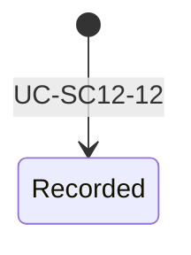

🏠 [Specs](../../../README.md) › 🏷️ [Sectors](../../README.md) › 🎓 [SC12 Education and training](../README.md) ›
🗃️ [Data](README.md) › 🗃️ E-SC12-12 Quality evidence

# 🗃️ E-SC12-12 Quality evidence

**Status:** ✅ specified

## Purpose

Evidence for a criterion.

## Fields

| Name | Type | Required | Validation | Default | Example | Personal data | Custom fields |
|---|---|---|---|---|---|---|---|
| criterion, session, file | records | yes | BR-SC12-07 | - | 1, S-41, needs.pdf | no | no |

## Relations

As its use cases.

## Lifecycle

## Indexes and search

By number, date, partner.

## Retention

Kept for the period of its kind of record in the country pack (D293), or else its kind's default in the
[retention schedule](../../../05-non-functional/data-retention.md).

## Audit

Every change.

## Import and export

CSV, FEC where relevant.

## Used by

- [UC-SC12-12](../use-cases/04-quality-and-reports/uc-sc12-12-keep-the-qualiopi-evidence-file.md)

## Open questions

None.

---

⬅️ [E-SC12-11 Trainer profile](e-sc12-11-trainer-profile.md) · ⬆️ [Up](README.md) ·
➡️ [E-SC12-13 Yearly training report](e-sc12-13-yearly-training-report.md)
