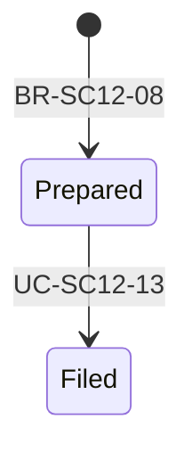

🏠 [Specs](../../../README.md) › 🏷️ [Sectors](../../README.md) › 🎓 [SC12 Education and training](../README.md) ›
🗃️ [Data](README.md) › 🗃️ E-SC12-13 Yearly training report

# 🗃️ E-SC12-13 Yearly training report

**Status:** ✅ specified

## Purpose

The yearly provider report.

## Fields

| Name | Type | Required | Validation | Default | Example | Personal data | Custom fields |
|---|---|---|---|---|---|---|---|
| year, figures | records | yes | BR-SC12-08 | - | 2026, 412 learners | no | no |

## Relations

As its use cases.

## Lifecycle

## Indexes and search

By number, date, partner.

## Retention

Kept for the period of its kind of record in the country pack (D293), or else its kind's default in the
[retention schedule](../../../05-non-functional/data-retention.md).

## Audit

Every change.

## Import and export

CSV, FEC where relevant.

## Used by

- [UC-SC12-13](../use-cases/04-quality-and-reports/uc-sc12-13-produce-the-yearly-report.md)

## Open questions

None.

---

⬅️ [E-SC12-12 Quality evidence](e-sc12-12-quality-evidence.md) · ⬆️ [Up](README.md) ·
➡️ [E-SC12-14 Student](e-sc12-14-student.md)
