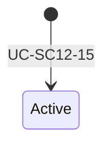

🏠 [Specs](../../../README.md) › 🏷️ [Sectors](../../README.md) › 🎓 [SC12 Education and training](../README.md) ›
🗃️ [Data](README.md) › 🗃️ E-SC12-14 Student

# 🗃️ E-SC12-14 Student

**Status:** ✅ specified

## Purpose

A pupil of a private school.

## Fields

| Name | Type | Required | Validation | Default | Example | Personal data | Custom fields |
|---|---|---|---|---|---|---|---|
| identity, class, parents | records | yes | - | - | L. Martin, 6e B, J. Martin | yes | no |

## Relations

As its use cases.

## Lifecycle

## Indexes and search

By number, date, partner.

## Retention

For the legal periods, then deleted:
[CR-FR-052 Personal data kept no longer than needed](../../../10-country-packs/france/data-protection/cr-fr-052-storage-limitation.md).

## Audit

Every change.

## Import and export

CSV, FEC where relevant.

## Used by

- [UC-SC12-15](../use-cases/05-private-school/uc-sc12-15-enrol-students-in-a-private-school.md)

## Open questions

None.

---

⬅️ [E-SC12-13 Yearly training report](e-sc12-13-yearly-training-report.md) · ⬆️ [Up](README.md) ·
➡️ [E-SC12-15 Class](e-sc12-15-class.md)
