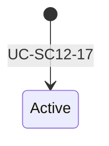

🏠 [Specs](../../../README.md) › 🏷️ [Sectors](../../README.md) › 🎓 [SC12 Education and training](../README.md) ›
🗃️ [Data](README.md) › 🗃️ E-SC12-16 Grade

# 🗃️ E-SC12-16 Grade

**Status:** ✅ specified

## Purpose

A grade or report card.

## Fields

| Name | Type | Required | Validation | Default | Example | Personal data | Custom fields |
|---|---|---|---|---|---|---|---|
| student, subject, term | records | yes | BR-SC12-13 | - | L. Martin, maths, T1 | yes | no |
| value, comment | number, text | yes | - | - | 15/20 | yes | no |

## Relations

As its use cases.

## Lifecycle

## Indexes and search

By number, date, partner.

## Retention

For the legal periods, then deleted:
[CR-FR-052 Personal data kept no longer than needed](../../../10-country-packs/france/data-protection/cr-fr-052-storage-limitation.md).

## Audit

Every change.

## Import and export

CSV, FEC where relevant.

## Used by

- [UC-SC12-17](../use-cases/05-private-school/uc-sc12-17-record-grades-and-report-cards.md)

## Open questions

None.

---

⬅️ [E-SC12-15 Class](e-sc12-15-class.md) · ⬆️ [Up](README.md) ·
➡️ [E-SC12-17 Pupil absence](e-sc12-17-pupil-absence.md)
