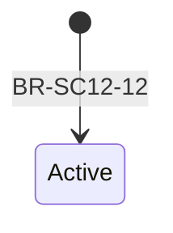

🏠 [Specs](../../../README.md) › 🏷️ [Sectors](../../README.md) › 🎓 [SC12 Education and training](../README.md) ›
🗃️ [Data](README.md) › 🗃️ E-SC12-17 Pupil absence

# 🗃️ E-SC12-17 Pupil absence

**Status:** ✅ specified

## Purpose

An absence or lateness.

## Fields

| Name | Type | Required | Validation | Default | Example | Personal data | Custom fields |
|---|---|---|---|---|---|---|---|
| student, date, reason | records | yes | BR-SC12-12 | - | L. Martin, 4 Dec, ill | yes | no |

## Relations

As its use cases.

## Lifecycle

## Indexes and search

By number, date, partner.

## Retention

For the legal periods, then deleted:
[CR-FR-052 Personal data kept no longer than needed](../../../10-country-packs/france/data-protection/cr-fr-052-storage-limitation.md).

## Audit

Every change.

## Import and export

CSV, FEC where relevant.

## Used by

- [UC-SC12-18](../use-cases/05-private-school/uc-sc12-18-follow-pupils-attendance-and-inform-parents.md)

## Open questions

None.

---

⬅️ [E-SC12-16 Grade](e-sc12-16-grade.md) · ⬆️ [Up](README.md) · ➡️ [E-SC12-18 School fee](e-sc12-18-school-fee.md)
