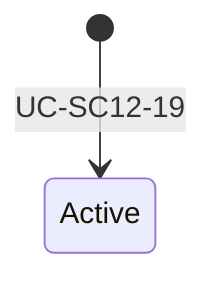

🏠 [Specs](../../../README.md) › 🏷️ [Sectors](../../README.md) › 🎓 [SC12 Education and training](../README.md) ›
🗃️ [Data](README.md) › 🗃️ E-SC12-18 School fee

# 🗃️ E-SC12-18 School fee

**Status:** 🔄 waiting for the owner

## Purpose

A fee or instalment.

## Fields

| Name | Type | Required | Validation | Default | Example | Personal data | Custom fields |
|---|---|---|---|---|---|---|---|
| student, period, amount | records | yes | - | - | L. Martin, Q1, 1 200 | yes | no |

## Relations

(Proposed) As its use cases.

## Lifecycle

## Indexes and search

(Proposed) By number, date, partner.

## Retention

As an accounting record:
[CR-FR-002 Accounting records kept 10 years](../../../10-country-packs/france/accounting/cr-fr-002-accounting-records-kept-ten-years.md).

## Audit

Every change.

## Import and export

(Proposed) CSV, FEC where relevant.

## Used by

- [UC-SC12-19](../use-cases/05-private-school/uc-sc12-19-bill-school-fees-and-grants.md)

## Open questions

None.

---

⬅️ [E-SC12-17 Pupil absence](e-sc12-17-pupil-absence.md) · ⬆️ [Up](README.md) ·
➡️ [E-SC12-19 Session invitation](e-sc12-19-session-invitation.md)
