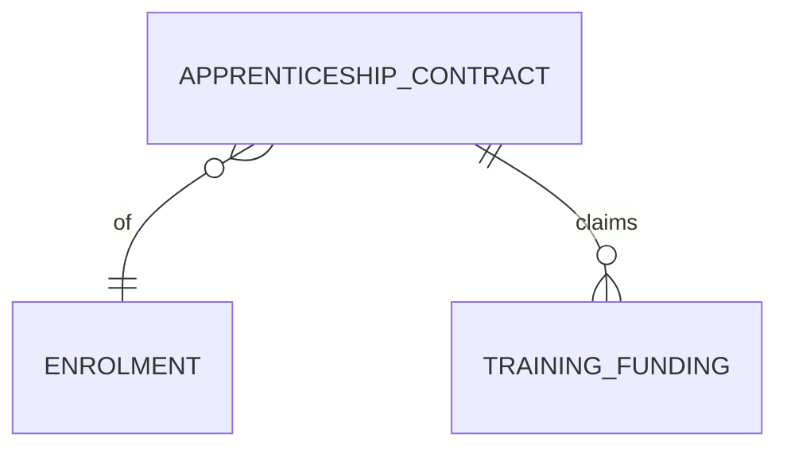
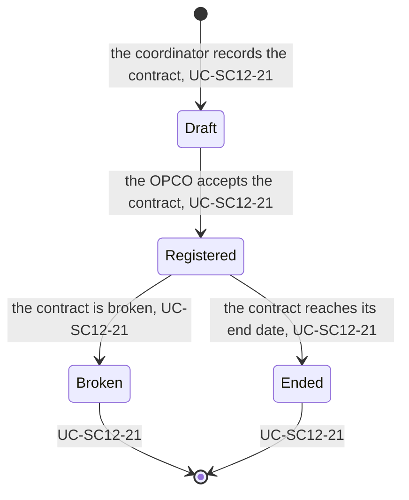

🏠 [Specs](../../../README.md) › 🏷️ [Sectors](../../README.md) › 🎓 [SC12 Education and training](../README.md) ›
🗃️ [Data](README.md) › 🗃️ E-SC12-20 Apprenticeship contract

# 🗃️ E-SC12-20 Apprenticeship contract

**Status:** ✅ specified

## Purpose

An apprenticeship contract between an employer and an apprentice followed by the centre: its diploma, dates, OPCO,
support level and the months claimed
([D556](../../../06-decisions/sectors/d556-benchmark-gaps-sc12-education-and-training.md)). The training agreement
([E-SC12-04 Training agreement](e-sc12-04-training-agreement.md)) is the contract for a trainee in the centre's other
courses; this one is signed with an employer and drives the OPCO funding
([E-SC12-05 Training funding](e-sc12-05-training-funding.md)).

## Fields

| Name | Type | Required | Validation | Default | Example | Personal data | Custom fields |
|---|---|---|---|---|---|---|---|
| apprentice | enrolment (E-SC12-03) | yes | an enrolment of the centre | - | Lea Martin | yes | no |
| employer | customer (E-F6-01) | yes | a company | - | Atelier Faure | no | no |
| diploma | choice | yes | a diploma of the centre | - | sales diploma | no | no |
| start date | date | yes | - | - | 2026-09-01 | no | no |
| end date | date | yes | after the start | - | 2028-08-31 | no | no |
| OPCO | choice | yes | an operator of the pack | from the employer | OPCO Commerce | no | no |
| support level | amount a year | yes | from the pack or the branch | from the diploma | 7,500.00 EUR | no | no |
| break date | date | no | within the contract | - | - | no | no |
| instalments claimed | list | no | one line per instalment, with the days counted | - | 40 % on 2026-09-30 | no | no |
| state | Draft, Registered, Broken, Ended | yes | the lifecycle below | Draft | Registered | no | no |
| owner | user | yes | a user of the company | the creator | Claire P. | yes | no |

## Relations

- [E-SC12-03 Enrolment](e-sc12-03-enrolment.md)
- [E-SC12-04 Training agreement](e-sc12-04-training-agreement.md)
- [E-SC12-05 Training funding](e-sc12-05-training-funding.md)
- [E-F6-01](../../../02-functional/f06-customers-and-sales/data/e-f06-01-customer-record.md)

## Lifecycle

## Indexes and search

By apprentice, employer, diploma, OPCO and state.

## Retention

Kept for the years the OPCO and the centre's records require
([CR-FR-156](../../../10-country-packs/france/education/cr-fr-156-training-report-bpf.md)).

## Audit

Every contract change, registration, break, claim and OPCO answer, with who, when and the amounts.

## Import and export

Export of the claims in the OPCO's format; no import.

## Used by

- [UC-SC12-21](../use-cases/06-apprentices-driving-nurseries-and-canteens/uc-sc12-21-run-an-apprentice-training-centre.md)
- [UC-SC12-04 Get funding](../use-cases/02-enrol-and-fund/uc-sc12-04-get-funding.md)

## Open questions

None.

---

⬅️ [E-SC12-19 Session invitation](e-sc12-19-session-invitation.md) · ⬆️ [Up](README.md) ·
➡️ [E-SC12-21 Driving lesson](e-sc12-21-driving-lesson.md)
