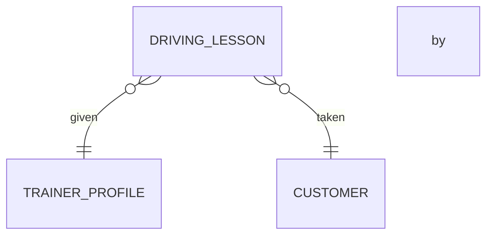
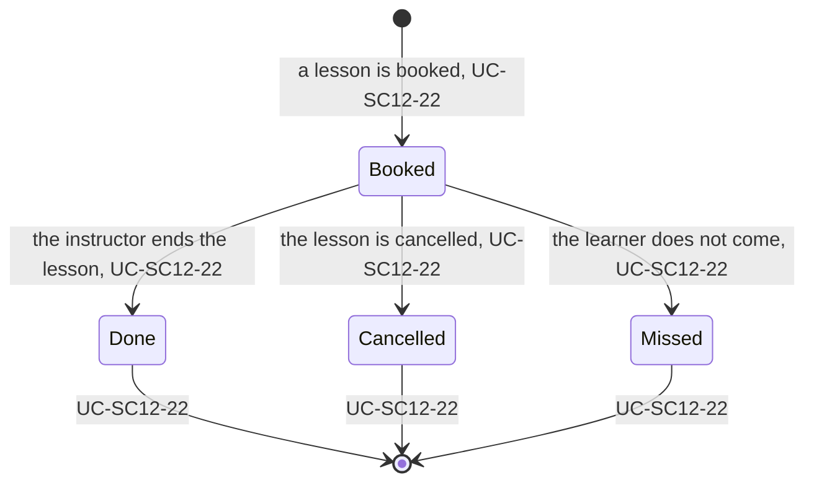

🏠 [Specs](../../../README.md) › 🏷️ [Sectors](../../README.md) › 🎓 [SC12 Education and training](../README.md) ›
🗃️ [Data](README.md) › 🗃️ E-SC12-21 Driving lesson

# 🗃️ E-SC12-21 Driving lesson

**Status:** ✅ specified

## Purpose

One driving lesson given to a learner: its instructor, vehicle, time and booklet entry
([D556](../../../06-decisions/sectors/d556-benchmark-gaps-sc12-education-and-training.md)). A lesson is not a course
session ([E-SC12-02 Course session](e-sc12-02-course-session.md)): it is individual, tied to a vehicle and to the
instructor's authorisation, and it counts towards the hours the exam needs.

## Fields

| Name | Type | Required | Validation | Default | Example | Personal data | Custom fields |
|---|---|---|---|---|---|---|---|
| learner | customer (E-F6-01) | yes | a customer of the school | - | Sofia B. | yes | no |
| instructor | trainer (E-SC12-11) | yes | authorised for the category | - | Mr Roche | no | no |
| vehicle | choice | yes | registered and inspected | - | Car 3 | no | no |
| category | choice | yes | a licence category | B | B | no | no |
| starts at | date and time | yes | in the instructor's planning | - | 2026-11-21 10:00 | no | no |
| hours | number | yes | above 0 | 1 | 1 | no | no |
| booklet entry | text | no | required to be Done | - | parking, 1 hour | no | no |
| charge | amount | no | 0 or more | from the contract | 48.00 EUR | no | no |
| state | Booked, Done, Cancelled, Missed | yes | the lifecycle below | Booked | Done | no | no |
| owner | user | yes | a user of the company | the creator | Claire P. | yes | no |

## Relations

- [E-SC12-11 Trainer profile](e-sc12-11-trainer-profile.md)
- [E-SC12-05 Training funding](e-sc12-05-training-funding.md)
- [E-F6-01](../../../02-functional/f06-customers-and-sales/data/e-f06-01-customer-record.md)

## Lifecycle

## Indexes and search

By learner, instructor, vehicle, date and state.

## Retention

Kept with the learner's file for the years the school's rules require
([CR-FR-156](../../../10-country-packs/france/education/cr-fr-156-training-report-bpf.md)).

## Audit

Every lesson booked, given, cancelled or missed, every refusal, with who, when and the instructor.

## Import and export

Export of the booklet of a learner as a PDF; no import.

## Used by

- [UC-SC12-22](../use-cases/06-apprentices-driving-nurseries-and-canteens/uc-sc12-22-run-a-driving-school.md)
- [UC-SC12-11 Manage trainers](../use-cases/01-offer-and-sessions/uc-sc12-11-manage-trainers.md)

## Open questions

None.

---

⬅️ [E-SC12-20 Apprenticeship contract](e-sc12-20-apprenticeship-contract.md) · ⬆️ [Up](README.md) ·
➡️ [E-SC12-22 Childcare place](e-sc12-22-childcare-place.md)
