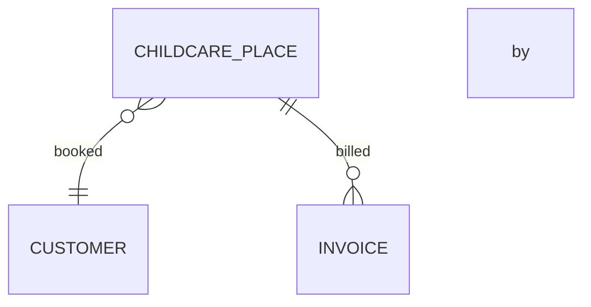
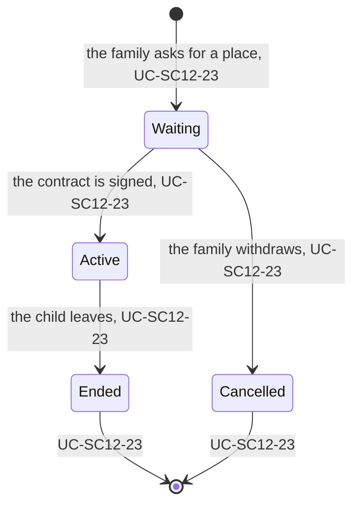

🏠 [Specs](../../../README.md) › 🏷️ [Sectors](../../README.md) › 🎓 [SC12 Education and training](../README.md) ›
🗃️ [Data](README.md) › 🗃️ E-SC12-22 Childcare place

# 🗃️ E-SC12-22 Childcare place

**Status:** ✅ specified

## Purpose

A child's place in the nursery: the contracted hours, the family's hourly rate from the fund's scale and the hours done
([D556](../../../06-decisions/sectors/d556-benchmark-gaps-sc12-education-and-training.md)). It is not a training
enrolment ([E-SC12-03 Enrolment](e-sc12-03-enrolment.md)): it follows hours of care and the fund's payment, with no
course or certificate.

## Fields

| Name | Type | Required | Validation | Default | Example | Personal data | Custom fields |
|---|---|---|---|---|---|---|---|
| child | text | yes | the child's first name and date of birth | - | Lina, 2024-05-03 | yes | no |
| family | customer (E-F6-01) | yes | a customer of the nursery | - | Mrs Idrissi | yes | no |
| contract hours | days and times | yes | within the opening hours | - | Mon, Tue, Thu | no | no |
| income reference | amount a month | no | from the fund | ceiling | 2,400.00 EUR | no | no |
| family size | number | yes | 1 or more | 1 | 2 | no | no |
| hourly rate | amount | yes | within the floor and ceiling | from the scale | 1.48 EUR | no | no |
| hours done | number | yes | 0 or more | 0 | 112 | no | no |
| report | none, prepared, sent | yes | one of the three | none | prepared | no | no |
| start date | date | yes | - | - | 2026-09-01 | no | no |
| state | Waiting, Active, Ended, Cancelled | yes | the lifecycle below | Waiting | Active | no | no |
| owner | user | yes | a user of the company | the creator | Claire P. | yes | no |

## Relations

- [E-F6-01](../../../02-functional/f06-customers-and-sales/data/e-f06-01-customer-record.md)
- [E-F6-05 Invoice](../../../02-functional/f06-customers-and-sales/data/e-f06-05-invoice.md)
- [E-SC12-05 Training funding](e-sc12-05-training-funding.md)

## Lifecycle

## Indexes and search

By family, child, state and start date. Children are searched only by users with a nursery role.

## Retention

Kept for the years the fund and the accounts require, then the child's data is erased
([CR-FR-002](../../../10-country-packs/france/accounting/cr-fr-002-accounting-records-kept-ten-years.md)).

## Audit

Every place, contract, rate, presence record, invoice and report, with who, when and the values.

## Import and export

Export of the hours in the fund's format; no import.

## Used by

- [UC-SC12-23](../use-cases/06-apprentices-driving-nurseries-and-canteens/uc-sc12-23-run-a-nursery.md)
- [UC-SC12-19](../use-cases/05-private-school/uc-sc12-19-bill-school-fees-and-grants.md)

## Open questions

None.

---

⬅️ [E-SC12-21 Driving lesson](e-sc12-21-driving-lesson.md) · ⬆️ [Up](README.md) ·
➡️ [E-SC12-23 Meal booking](e-sc12-23-meal-booking.md)
