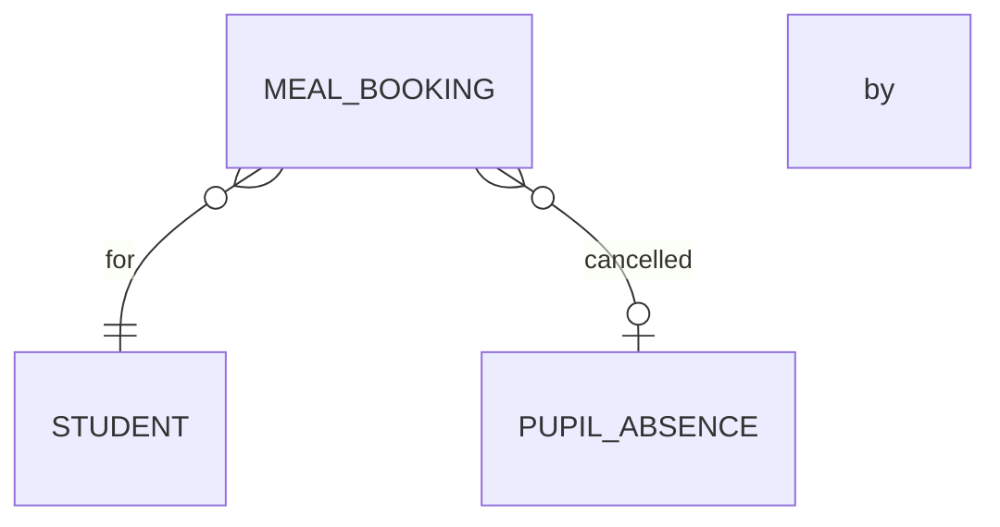
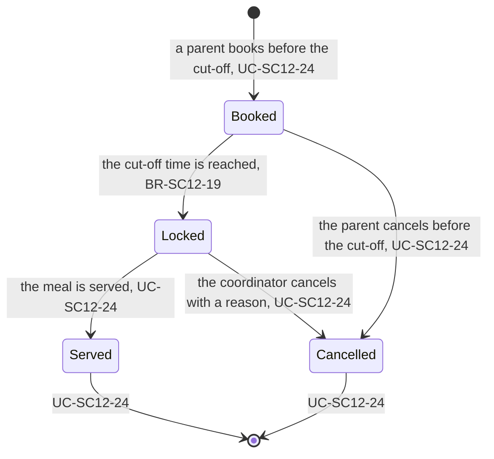

🏠 [Specs](../../../README.md) › 🏷️ [Sectors](../../README.md) › 🎓 [SC12 Education and training](../README.md) ›
🗃️ [Data](README.md) › 🗃️ E-SC12-23 Meal booking

# 🗃️ E-SC12-23 Meal booking

**Status:** ✅ specified

## Purpose

A pupil's booking of a meal or an after-school activity for one day: its menu, diet, cut-off and state
([D556](../../../06-decisions/sectors/d556-benchmark-gaps-sc12-education-and-training.md)). It is the canteen's record;
the pupil's absence ([E-SC12-17 Pupil absence](e-sc12-17-pupil-absence.md)) may cancel it and the school bill
([E-SC12-18 School fee](e-sc12-18-school-fee.md)) takes its charge.

## Fields

| Name | Type | Required | Validation | Default | Example | Personal data | Custom fields |
|---|---|---|---|---|---|---|---|
| pupil | student (E-SC12-14) | yes | a pupil of the school | - | Emma R. | yes | no |
| date | date | yes | a school day | - | 2026-11-23 | no | no |
| menu | choice | yes | a menu or an activity of the day | - | pasta bolognese | no | no |
| diet | choice | no | one of the school's diets | none | vegetarian | yes | no |
| cut-off | date and time | yes | set by the school | from the school | 2026-11-20 09:00 | no | no |
| served | yes or no | yes | set at the canteen | no | no | no | no |
| charge | amount | yes | 0 or more | from the rate | 3.80 EUR | no | no |
| state | Booked, Locked, Cancelled, Served | yes | the lifecycle below | Booked | Locked | no | no |
| owner | user | yes | a user of the company | the creator | Claire P. | yes | no |

## Relations

- [E-SC12-14 Student](e-sc12-14-student.md)
- [E-SC12-17 Pupil absence](e-sc12-17-pupil-absence.md)
- [E-SC12-18 School fee](e-sc12-18-school-fee.md)

## Lifecycle

## Indexes and search

By pupil, date, menu and state. Diets are searched only by users with a canteen role.

## Retention

Kept with the school bills for the years the accounts require
([CR-FR-002](../../../10-country-packs/france/accounting/cr-fr-002-accounting-records-kept-ten-years.md)).

## Audit

Every booking, cancellation, lock and change after the lock, with who, when and the reason.

## Import and export

Export of the day's count for the kitchen; import of a standing list as a CSV.

## Used by

- [UC-SC12-24](../use-cases/06-apprentices-driving-nurseries-and-canteens/uc-sc12-24-run-the-canteen-and-activities.md)
- [UC-SC12-18](../use-cases/05-private-school/uc-sc12-18-follow-pupils-attendance-and-inform-parents.md)

## Open questions

None.

---

⬅️ [E-SC12-22 Childcare place](e-sc12-22-childcare-place.md) · ⬆️ [Up](README.md)
