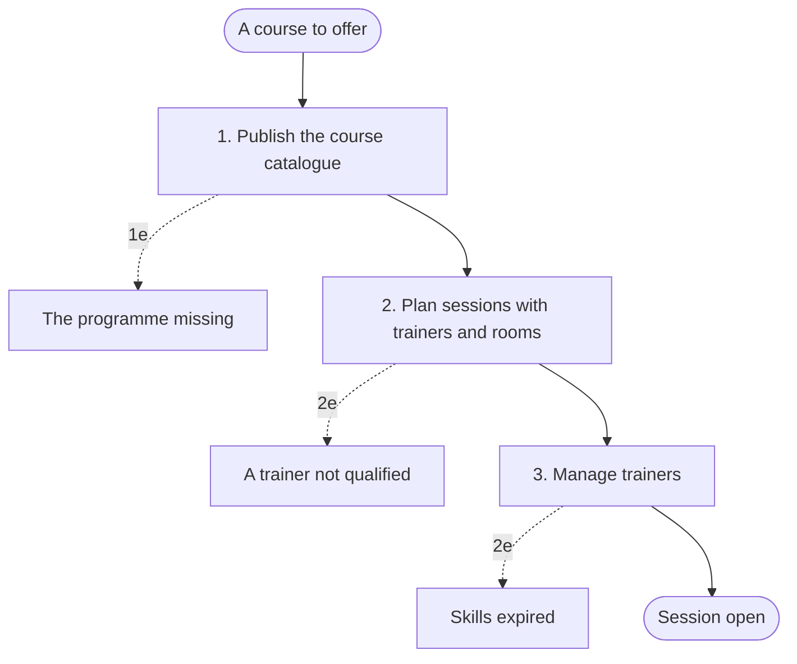

🏠 [Specs](../../../README.md) › 🏷️ [Sectors](../../README.md) › 🎓 [SC12 Education and training](../README.md) ›
🔀 [Flows](README.md) › 🔀 FL-SC12-01 Offer and sessions

# 🔀 FL-SC12-01 Offer and sessions

**Status:** ✅ specified

## Summary

The offer: catalogue, sessions on the shared booking engine, trainers. It covers
[UC-SC12-01 Publish the course catalogue](../use-cases/01-offer-and-sessions/uc-sc12-01-publish-the-course-catalogue.md),
[UC-SC12-02 Plan sessions with trainers and rooms](../use-cases/01-offer-and-sessions/uc-sc12-02-plan-sessions-with-trainers-and-rooms.md),
[UC-SC12-11 Manage trainers](../use-cases/01-offer-and-sessions/uc-sc12-11-manage-trainers.md).

## Personas

- [U38 Training coordinator](../../../01-users/personas/u38-training-coordinator.md)

## Flowchart

## Sequence diagram

See each use case.

## Steps

| Step | Persona | Screen | Use case | What happens |
|---|---|---|---|---|
| 1 | U38 | [S-SC12-01](../screens/01-offer-and-sessions/s-sc12-01-catalogue.md) | [UC-SC12-01](../use-cases/01-offer-and-sessions/uc-sc12-01-publish-the-course-catalogue.md) | The training coordinator writes courses with objectives, programme, duration and prices, and publishes them on the website and the training account platform |
| 2 | U38 | [S-SC12-02](../screens/01-offer-and-sessions/s-sc12-02-sessions.md) | [UC-SC12-02](../use-cases/01-offer-and-sessions/uc-sc12-02-plan-sessions-with-trainers-and-rooms.md) | The training coordinator creates sessions, assigns a qualified trainer and books a room through the shared booking engine, then opens enrolment |
| 3 | U38 | [S-SC12-11](../screens/01-offer-and-sessions/s-sc12-11-trainers.md), [S-SC12-02](../screens/01-offer-and-sessions/s-sc12-02-sessions.md) | [UC-SC12-11](../use-cases/01-offer-and-sessions/uc-sc12-11-manage-trainers.md) | The training coordinator records trainers' contracts, skills and availability, and plans them |

### Entities and screens

| Entity | States in this flow | Shown at step and screen | Aggregated view |
|---|---|---|---|
| [E-SC12-01 Course](../data/e-sc12-01-course.md) | New, Sent, Published | 1 [S-SC12-01](../screens/01-offer-and-sessions/s-sc12-01-catalogue.md) | Courses |
| [E-SC12-02 Course session](../data/e-sc12-02-course-session.md) | Planned, Open | 2, 3 [S-SC12-02](../screens/01-offer-and-sessions/s-sc12-02-sessions.md) | Course sessions |
| [E-F2-17 Bookable resource setting](../../../02-functional/f02-no-code-configuration/data/e-f02-17-bookable-resource-setting.md) | Published | Shown elsewhere: [S-F2-18 Booking settings](../../../02-functional/f02-no-code-configuration/screens/08-views-and-bookings/s-f02-18-booking-settings.md) | Bookable resource settings |
| [E-SC12-11 Trainer profile](../data/e-sc12-11-trainer-profile.md) | Active | 2, 3 [S-SC12-02](../screens/01-offer-and-sessions/s-sc12-02-sessions.md); 3 [S-SC12-11](../screens/01-offer-and-sessions/s-sc12-11-trainers.md) | Trainer profiles |

## Errors

- [UC-SC12-01](../use-cases/01-offer-and-sessions/uc-sc12-01-publish-the-course-catalogue.md) 1e. The programme missing:
  it is not published.
- [UC-SC12-01](../use-cases/01-offer-and-sessions/uc-sc12-01-publish-the-course-catalogue.md) 4e. The platform refuses:
  the reason is shown.
- [UC-SC12-02](../use-cases/01-offer-and-sessions/uc-sc12-02-plan-sessions-with-trainers-and-rooms.md) 2e. A trainer not
  qualified: they are not proposed.
- [UC-SC12-02](../use-cases/01-offer-and-sessions/uc-sc12-02-plan-sessions-with-trainers-and-rooms.md) 3e. The room
  taken: another room is proposed.
- [UC-SC12-11](../use-cases/01-offer-and-sessions/uc-sc12-11-manage-trainers.md) 2e. Skills expired: the trainer is not
  planned.
- [UC-SC12-11](../use-cases/01-offer-and-sessions/uc-sc12-11-manage-trainers.md) 3e. Availability conflicts: they are
  shown.

## Images

Every step and error, for each persona taking part, in light and dark mode (D120). Steps are numbered as in the Steps
table; E rows are the error cases.

| Step | Persona | Device | Light | Dark |
|---|---|---|---|---|
| 1 | U38 | desktop | [light](../images/01-offer-and-sessions/u38-training-coordinator/1-catalogue-desktop-light.png) | [dark](../images/01-offer-and-sessions/u38-training-coordinator/1-catalogue-desktop-dark.png) |
| 2 | U38 | desktop | [light](../images/01-offer-and-sessions/u38-training-coordinator/2-sessions-desktop-light.png) | [dark](../images/01-offer-and-sessions/u38-training-coordinator/2-sessions-desktop-dark.png) |
| 3 | U38 | desktop | [light](../images/01-offer-and-sessions/u38-training-coordinator/3-trainers-desktop-light.png) | [dark](../images/01-offer-and-sessions/u38-training-coordinator/3-trainers-desktop-dark.png) |
| E1 | U38 | desktop | [light](../images/01-offer-and-sessions/u38-training-coordinator/e1-trainer-not-qualified-desktop-light.png) | [dark](../images/01-offer-and-sessions/u38-training-coordinator/e1-trainer-not-qualified-desktop-dark.png) |

## Open questions

None.

---

⬆️ [Up](README.md) · ➡️ [FL-SC12-02 Enrol and fund](fl-sc12-02-enrol-and-fund.md)
