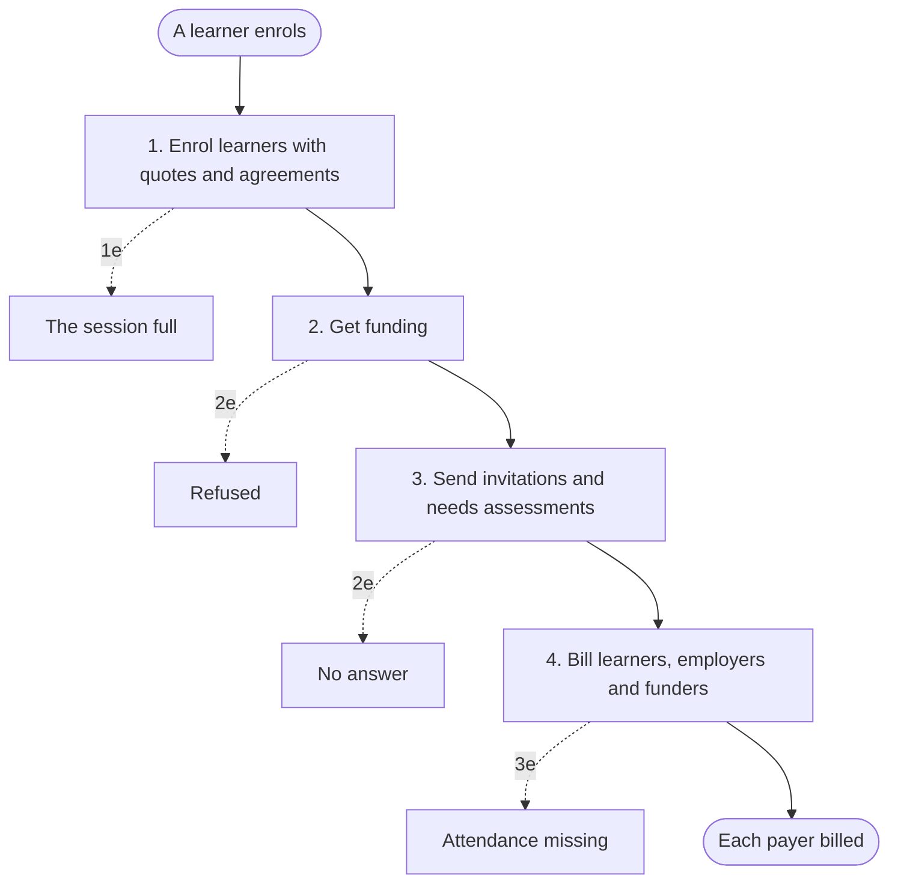

🏠 [Specs](../../../README.md) › 🏷️ [Sectors](../../README.md) › 🎓 [SC12 Education and training](../README.md) ›
🔀 [Flows](README.md) › 🔀 FL-SC12-02 Enrol and fund

# 🔀 FL-SC12-02 Enrol and fund

**Status:** ✅ specified

## Summary

Enrolment and funding with the shared multi-payer invoicing. It covers
[UC-SC12-03 Enrol learners with quotes and agreements](../use-cases/02-enrol-and-fund/uc-sc12-03-enrol-learners-with-quotes-and-agreements.md),
[UC-SC12-04 Get funding](../use-cases/02-enrol-and-fund/uc-sc12-04-get-funding.md),
[UC-SC12-05 Send invitations and needs assessments](../use-cases/02-enrol-and-fund/uc-sc12-05-send-invitations-and-needs-assessments.md),
[UC-SC12-10 Bill learners, employers and funders](../use-cases/02-enrol-and-fund/uc-sc12-10-bill-learners-employers-and-funders.md).

## Personas

- [U05 Accounting](../../../01-users/personas/u05-accounting.md)
- [U09 Customer](../../../01-users/personas/u09-customer.md)
- [U38 Training coordinator](../../../01-users/personas/u38-training-coordinator.md)

## Flowchart

## Sequence diagram

See each use case.

## Steps

| Step | Persona | Screen | Use case | What happens |
|---|---|---|---|---|
| 1 | U38, U09 | [S-SC12-03](../screens/02-enrol-and-fund/s-sc12-03-enrolment.md) | [UC-SC12-03](../use-cases/02-enrol-and-fund/uc-sc12-03-enrol-learners-with-quotes-and-agreements.md) | The training coordinator enrols learners, sends the quote and has the agreement signed, an individual paying keeps a withdrawal period |
| 2 | U38, U05 | [S-SC12-04](../screens/02-enrol-and-fund/s-sc12-04-funding.md) | [UC-SC12-04](../use-cases/02-enrol-and-fund/uc-sc12-04-get-funding.md) | The training coordinator requests funding from the employer, skills operators or the training account, records decisions, and the price is split with the shared multi-payer invoicing |
| 3 | U38, U09 | [S-SC12-05](../screens/02-enrol-and-fund/s-sc12-05-invitations.md) | [UC-SC12-05](../use-cases/02-enrol-and-fund/uc-sc12-05-send-invitations-and-needs-assessments.md) | The training coordinator sends invitations and pre-course questionnaires and shares the answers with the trainer |
| 4 | U05, U38 | [S-SC12-10](../screens/02-enrol-and-fund/s-sc12-10-billing.md) | [UC-SC12-10](../use-cases/02-enrol-and-fund/uc-sc12-10-bill-learners-employers-and-funders.md) | Accounting closes the session, and simple-ERP bills each payer its share through the shared multi-payer invoicing, with attendance as proof |

### Entities and screens

| Entity | States in this flow | Shown at step and screen | Aggregated view |
|---|---|---|---|
| [E-F6-03 Quote](../../../02-functional/f06-customers-and-sales/data/e-f06-03-quote.md) | Refused, Sent | Shown elsewhere: [S-F6-03 Quote editor](../../../02-functional/f06-customers-and-sales/screens/01-lead-to-quote/s-f06-03-quote-editor.md) | Quotes |
| [E-SC12-04 Training agreement](../data/e-sc12-04-training-agreement.md) | Active | 1 [S-SC12-03](../screens/02-enrol-and-fund/s-sc12-03-enrolment.md) | Training agreements |
| [E-SC12-02 Course session](../data/e-sc12-02-course-session.md) | Planned, Open | Shown elsewhere: [S-SC12-02 Sessions](../screens/01-offer-and-sessions/s-sc12-02-sessions.md) | Course sessions |
| [E-SC12-05 Training funding](../data/e-sc12-05-training-funding.md) | Requested, Refused | 2 [S-SC12-04](../screens/02-enrol-and-fund/s-sc12-04-funding.md) | Training fundings |
| [E-SC12-06 Attendance sheet](../data/e-sc12-06-attendance-sheet.md) | Confirmed, Complete | Shown elsewhere: [S-SC12-06 Attendance](../screens/03-deliver-and-assess/s-sc12-06-attendance.md) | Attendance sheets |

## Errors

- [UC-SC12-03](../use-cases/02-enrol-and-fund/uc-sc12-03-enrol-learners-with-quotes-and-agreements.md) 1e. The session
  full: the learner goes on the waiting list.
- [UC-SC12-03](../use-cases/02-enrol-and-fund/uc-sc12-03-enrol-learners-with-quotes-and-agreements.md) 3e. Not signed:
  the place is released after a delay.
- [UC-SC12-04](../use-cases/02-enrol-and-fund/uc-sc12-04-get-funding.md) 2e. Refused: the learner is told.
- [UC-SC12-04](../use-cases/02-enrol-and-fund/uc-sc12-04-get-funding.md) 2f. A decision late: the coordinator is
  reminded.
- [UC-SC12-05](../use-cases/02-enrol-and-fund/uc-sc12-05-send-invitations-and-needs-assessments.md) 2e. No answer: a
  reminder is sent.
- [UC-SC12-05](../use-cases/02-enrol-and-fund/uc-sc12-05-send-invitations-and-needs-assessments.md) 1e. No email: the
  employer is asked.
- [UC-SC12-10](../use-cases/02-enrol-and-fund/uc-sc12-10-bill-learners-employers-and-funders.md) 3e. Attendance missing:
  the funder's invoice is held.
- [UC-SC12-10](../use-cases/02-enrol-and-fund/uc-sc12-10-bill-learners-employers-and-funders.md) 4e. A funder rejects:
  accounting fixes it; other invoices stay.

## Images

Every step and error, for each persona taking part, in light and dark mode (D120). Steps are numbered as in the Steps
table; E rows are the error cases.

| Step | Persona | Device | Light | Dark |
|---|---|---|---|---|
| 1 | U38 | desktop | [light](../images/02-enrol-and-fund/u38-training-coordinator/1-enrol-desktop-light.png) | [dark](../images/02-enrol-and-fund/u38-training-coordinator/1-enrol-desktop-dark.png) |
| 1 | U09 | phone | [light](../images/02-enrol-and-fund/u09-customer/1-enrol-phone-light.png) | [dark](../images/02-enrol-and-fund/u09-customer/1-enrol-phone-dark.png) |
| 2 | U38 | desktop | [light](../images/02-enrol-and-fund/u38-training-coordinator/2-funding-desktop-light.png) | [dark](../images/02-enrol-and-fund/u38-training-coordinator/2-funding-desktop-dark.png) |
| 2 | U05 | desktop | [light](../images/02-enrol-and-fund/u05-accounting/2-funding-desktop-light.png) | [dark](../images/02-enrol-and-fund/u05-accounting/2-funding-desktop-dark.png) |
| 3 | U09 | phone | [light](../images/02-enrol-and-fund/u09-customer/3-invitation-phone-light.png) | [dark](../images/02-enrol-and-fund/u09-customer/3-invitation-phone-dark.png) |
| 3 | U38 | desktop | [light](../images/02-enrol-and-fund/u38-training-coordinator/3-invitation-desktop-light.png) | [dark](../images/02-enrol-and-fund/u38-training-coordinator/3-invitation-desktop-dark.png) |
| 4 | U05 | desktop | [light](../images/02-enrol-and-fund/u05-accounting/4-billing-desktop-light.png) | [dark](../images/02-enrol-and-fund/u05-accounting/4-billing-desktop-dark.png) |
| 4 | U38 | desktop | [light](../images/02-enrol-and-fund/u38-training-coordinator/4-billing-desktop-light.png) | [dark](../images/02-enrol-and-fund/u38-training-coordinator/4-billing-desktop-dark.png) |
| E1 | U38 | desktop | [light](../images/02-enrol-and-fund/u38-training-coordinator/e1-full-desktop-light.png) | [dark](../images/02-enrol-and-fund/u38-training-coordinator/e1-full-desktop-dark.png) |

## Open questions

None.

---

⬅️ [FL-SC12-01 Offer and sessions](fl-sc12-01-offer-and-sessions.md) · ⬆️ [Up](README.md) ·
➡️ [FL-SC12-03 Deliver and assess](fl-sc12-03-deliver-and-assess.md)
