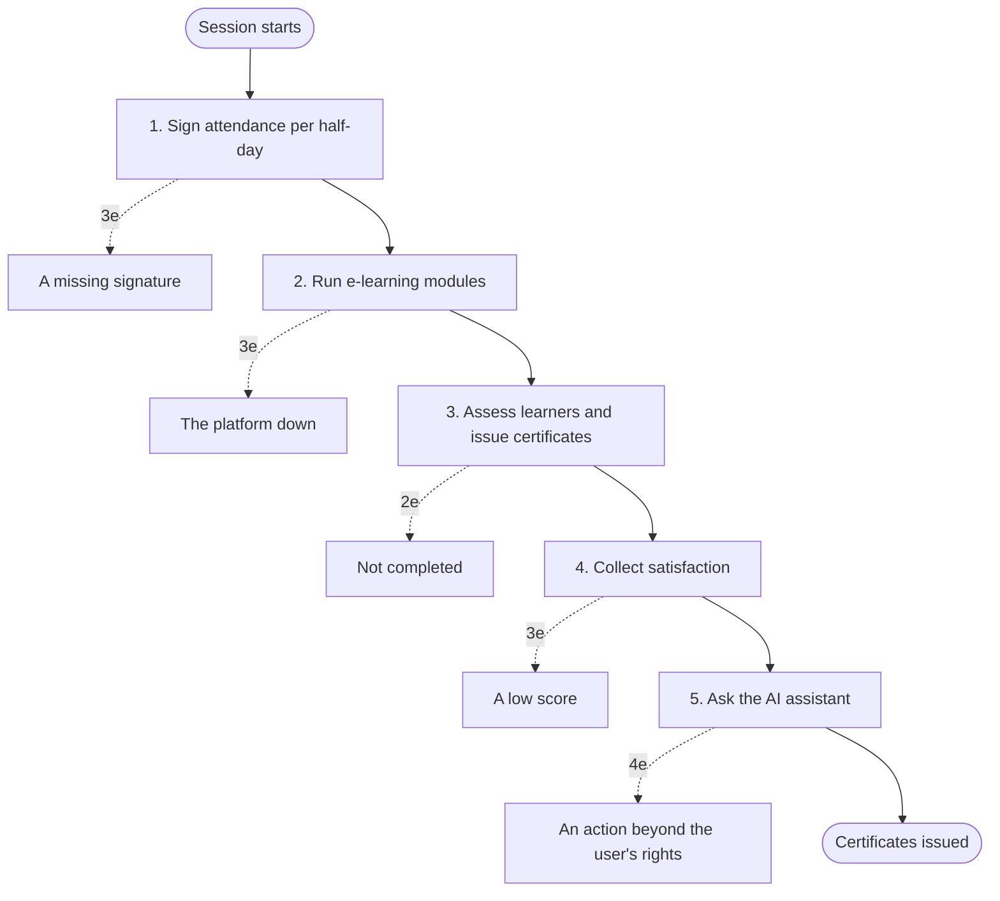

🏠 [Specs](../../../README.md) › 🏷️ [Sectors](../../README.md) › 🎓 [SC12 Education and training](../README.md) ›
🔀 [Flows](README.md) › 🔀 FL-SC12-03 Deliver and assess

# 🔀 FL-SC12-03 Deliver and assess

**Status:** ✅ specified

## Summary

Delivery: attendance, e-learning, certificates, satisfaction, the AI assistant. It covers
[UC-SC12-06 Sign attendance per half-day](../use-cases/03-deliver-and-assess/uc-sc12-06-sign-attendance-per-half-day.md),
[UC-SC12-07 Run e-learning modules](../use-cases/03-deliver-and-assess/uc-sc12-07-run-e-learning-modules.md),
[UC-SC12-08 Assess learners and issue certificates](../use-cases/03-deliver-and-assess/uc-sc12-08-assess-learners-and-issue-certificates.md),
[UC-SC12-09 Collect satisfaction](../use-cases/03-deliver-and-assess/uc-sc12-09-collect-satisfaction.md),
[UC-SC12-20 Ask the AI assistant](../use-cases/03-deliver-and-assess/uc-sc12-20-ask-the-assistant.md).

## Personas

- [U09 Customer](../../../01-users/personas/u09-customer.md)
- [U38 Training coordinator](../../../01-users/personas/u38-training-coordinator.md)
- [U39 Trainer](../../../01-users/personas/u39-trainer.md)

## Flowchart

## Sequence diagram

See each use case.

## Steps

| Step | Persona | Screen | Use case | What happens |
|---|---|---|---|---|
| 1 | U39, U09, U38 | [S-SC12-06](../screens/03-deliver-and-assess/s-sc12-06-attendance.md) | [UC-SC12-06](../use-cases/03-deliver-and-assess/uc-sc12-06-sign-attendance-per-half-day.md) | Learners sign attendance per half-day on the trainer's tablet or their phone, the trainer confirms |
| 2 | U09, U38 | [S-SC12-07](../screens/03-deliver-and-assess/s-sc12-07-e-learning.md) | [UC-SC12-07](../use-cases/03-deliver-and-assess/uc-sc12-07-run-e-learning-modules.md) | The coordinator assigns modules on the learning platform, learners follow them, progress and time are imported |
| 3 | U39, U38, U09 | [S-SC12-08](../screens/03-deliver-and-assess/s-sc12-08-certificates.md) | [UC-SC12-08](../use-cases/03-deliver-and-assess/uc-sc12-08-assess-learners-and-issue-certificates.md) | The trainer assesses learners, the coordinator checks completion and issues certificates |
| 4 | U38, U09 | [S-SC12-09](../screens/03-deliver-and-assess/s-sc12-09-satisfaction.md) | [UC-SC12-09](../use-cases/03-deliver-and-assess/uc-sc12-09-collect-satisfaction.md) | The coordinator sends hot and cold surveys, collects and analyses them, a low score leads to an action |
| 5 | U38, U39 | [S-SC12-20](../screens/03-deliver-and-assess/s-sc12-20-training-assistant.md) | [UC-SC12-20](../use-cases/03-deliver-and-assess/uc-sc12-20-ask-the-assistant.md) | The coordinator or trainer asks the AI assistant about sessions to fill, funding to chase or a learner's attendance, within their role's rights |

### Entities and screens

| Entity | States in this flow | Shown at step and screen | Aggregated view |
|---|---|---|---|
| [E-SC12-02 Course session](../data/e-sc12-02-course-session.md) | Planned, Open | 5 [S-SC12-20](../screens/03-deliver-and-assess/s-sc12-20-training-assistant.md) | Course sessions |
| [E-SC12-06 Attendance sheet](../data/e-sc12-06-attendance-sheet.md) | Confirmed, Complete | 1 [S-SC12-06](../screens/03-deliver-and-assess/s-sc12-06-attendance.md); 5 [S-SC12-20](../screens/03-deliver-and-assess/s-sc12-20-training-assistant.md) | Attendance sheets |
| [E-SC12-07 E-learning record](../data/e-sc12-07-e-learning-record.md) | Recorded | 2 [S-SC12-07](../screens/03-deliver-and-assess/s-sc12-07-e-learning.md) | E-learning records |
| [E-SC12-08 Completion certificate](../data/e-sc12-08-completion-certificate.md) | Active | 3 [S-SC12-08](../screens/03-deliver-and-assess/s-sc12-08-certificates.md) | Completion certificates |
| [E-SC12-09 Survey answer](../data/e-sc12-09-survey-answer.md) | Recorded | 4 [S-SC12-09](../screens/03-deliver-and-assess/s-sc12-09-satisfaction.md) | Survey answers |
| [E-F3-04 Assistant change batch](../../../02-functional/f03-assistant/data/e-f03-04-assistant-change-batch.md) | Proposed, Cancelled, Done, Partly done, Undone | Shown elsewhere: [S-F3-01 Assistant panel](../../../02-functional/f03-assistant/screens/01-ask-the-assistant/s-f03-01-assistant-panel.md) | Assistant change batches |
| [E-F1-03 User](../../../02-functional/f01-administration/data/e-f01-03-user.md) | Invited, Active, Deactivated | Shown elsewhere: [S-F1-03 Users](../../../02-functional/f01-administration/screens/03-user-lifecycle/s-f01-03-users.md) | Users |
| [E-F1-06 Role](../../../02-functional/f01-administration/data/e-f01-06-role.md) | Active | Shown elsewhere: [S-F1-06 Role editor](../../../02-functional/f01-administration/screens/04-edit-a-role/s-f01-06-role-editor.md) | Roles |

## Errors

- [UC-SC12-06](../use-cases/03-deliver-and-assess/uc-sc12-06-sign-attendance-per-half-day.md) 3e. A missing signature:
  it is flagged.
- [UC-SC12-06](../use-cases/03-deliver-and-assess/uc-sc12-06-sign-attendance-per-half-day.md) 1e. No network: the sheet
  is kept on the tablet and synced,
  [UC-F2-22](../../../02-functional/f02-no-code-configuration/use-cases/09-portals-and-offline-forms/uc-f02-22-fill-a-form-offline-on-the-phone.md).
- [UC-SC12-07](../use-cases/03-deliver-and-assess/uc-sc12-07-run-e-learning-modules.md) 3e. The platform down: it is
  shown and retried.
- [UC-SC12-07](../use-cases/03-deliver-and-assess/uc-sc12-07-run-e-learning-modules.md) 2e. A learner not started: a
  reminder is sent.
- [UC-SC12-08](../use-cases/03-deliver-and-assess/uc-sc12-08-assess-learners-and-issue-certificates.md) 2e. Not
  completed: no certificate.
- [UC-SC12-08](../use-cases/03-deliver-and-assess/uc-sc12-08-assess-learners-and-issue-certificates.md) 1e. An
  assessment missing: the trainer is asked.
- [UC-SC12-09](../use-cases/03-deliver-and-assess/uc-sc12-09-collect-satisfaction.md) 3e. A low score: an action is
  opened.
- [UC-SC12-09](../use-cases/03-deliver-and-assess/uc-sc12-09-collect-satisfaction.md) 2e. No answer: one reminder is
  sent.
- [UC-SC12-20](../use-cases/03-deliver-and-assess/uc-sc12-20-ask-the-assistant.md) 4e. An action beyond the user's
  rights: the AI assistant refuses.
- [UC-SC12-20](../use-cases/03-deliver-and-assess/uc-sc12-20-ask-the-assistant.md) 2e. No data: the AI assistant says
  so.

## Images

Every step and error, for each persona taking part, in light and dark mode (D120). Steps are numbered as in the Steps
table; E rows are the error cases.

| Step | Persona | Device | Light | Dark |
|---|---|---|---|---|
| 1 | U39 | phone | [light](../images/03-deliver-and-assess/u39-trainer/1-attendance-phone-light.png) | [dark](../images/03-deliver-and-assess/u39-trainer/1-attendance-phone-dark.png) |
| 1 | U39 | desktop | [light](../images/03-deliver-and-assess/u39-trainer/1-attendance-desktop-light.png) | [dark](../images/03-deliver-and-assess/u39-trainer/1-attendance-desktop-dark.png) |
| 1 | U39 | tablet | [light](../images/03-deliver-and-assess/u39-trainer/1-attendance-tablet-light.png) | [dark](../images/03-deliver-and-assess/u39-trainer/1-attendance-tablet-dark.png) |
| 1 | U09 | phone | [light](../images/03-deliver-and-assess/u09-customer/1-attendance-phone-light.png) | [dark](../images/03-deliver-and-assess/u09-customer/1-attendance-phone-dark.png) |
| 1 | U38 | desktop | [light](../images/03-deliver-and-assess/u38-training-coordinator/1-attendance-desktop-light.png) | [dark](../images/03-deliver-and-assess/u38-training-coordinator/1-attendance-desktop-dark.png) |
| 2 | U09 | phone | [light](../images/03-deliver-and-assess/u09-customer/2-e-learning-phone-light.png) | [dark](../images/03-deliver-and-assess/u09-customer/2-e-learning-phone-dark.png) |
| 2 | U38 | desktop | [light](../images/03-deliver-and-assess/u38-training-coordinator/2-e-learning-desktop-light.png) | [dark](../images/03-deliver-and-assess/u38-training-coordinator/2-e-learning-desktop-dark.png) |
| 3 | U38 | desktop | [light](../images/03-deliver-and-assess/u38-training-coordinator/3-certificate-desktop-light.png) | [dark](../images/03-deliver-and-assess/u38-training-coordinator/3-certificate-desktop-dark.png) |
| 3 | U09 | phone | [light](../images/03-deliver-and-assess/u09-customer/3-certificate-phone-light.png) | [dark](../images/03-deliver-and-assess/u09-customer/3-certificate-phone-dark.png) |
| 3 | U39 | desktop | [light](../images/03-deliver-and-assess/u39-trainer/3-certificate-desktop-light.png) | [dark](../images/03-deliver-and-assess/u39-trainer/3-certificate-desktop-dark.png) |
| 3 | U39 | phone | [light](../images/03-deliver-and-assess/u39-trainer/3-certificate-phone-light.png) | [dark](../images/03-deliver-and-assess/u39-trainer/3-certificate-phone-dark.png) |
| 3 | U39 | tablet | [light](../images/03-deliver-and-assess/u39-trainer/3-certificate-tablet-light.png) | [dark](../images/03-deliver-and-assess/u39-trainer/3-certificate-tablet-dark.png) |
| 4 | U38 | desktop | [light](../images/03-deliver-and-assess/u38-training-coordinator/4-satisfaction-desktop-light.png) | [dark](../images/03-deliver-and-assess/u38-training-coordinator/4-satisfaction-desktop-dark.png) |
| 4 | U09 | phone | [light](../images/03-deliver-and-assess/u09-customer/4-satisfaction-phone-light.png) | [dark](../images/03-deliver-and-assess/u09-customer/4-satisfaction-phone-dark.png) |
| 5 | U38 | desktop | [light](../images/03-deliver-and-assess/u38-training-coordinator/5-assistant-desktop-light.png) | [dark](../images/03-deliver-and-assess/u38-training-coordinator/5-assistant-desktop-dark.png) |
| 5 | U39 | desktop | [light](../images/03-deliver-and-assess/u39-trainer/5-assistant-desktop-light.png) | [dark](../images/03-deliver-and-assess/u39-trainer/5-assistant-desktop-dark.png) |
| 5 | U39 | phone | [light](../images/03-deliver-and-assess/u39-trainer/5-assistant-phone-light.png) | [dark](../images/03-deliver-and-assess/u39-trainer/5-assistant-phone-dark.png) |
| 5 | U39 | tablet | [light](../images/03-deliver-and-assess/u39-trainer/5-assistant-tablet-light.png) | [dark](../images/03-deliver-and-assess/u39-trainer/5-assistant-tablet-dark.png) |
| E1 | U38 | desktop | [light](../images/03-deliver-and-assess/u38-training-coordinator/e1-no-certificate-desktop-light.png) | [dark](../images/03-deliver-and-assess/u38-training-coordinator/e1-no-certificate-desktop-dark.png) |

## Open questions

None.

---

⬅️ [FL-SC12-02 Enrol and fund](fl-sc12-02-enrol-and-fund.md) · ⬆️ [Up](README.md) ·
➡️ [FL-SC12-04 Quality and reports](fl-sc12-04-quality-and-reports.md)
