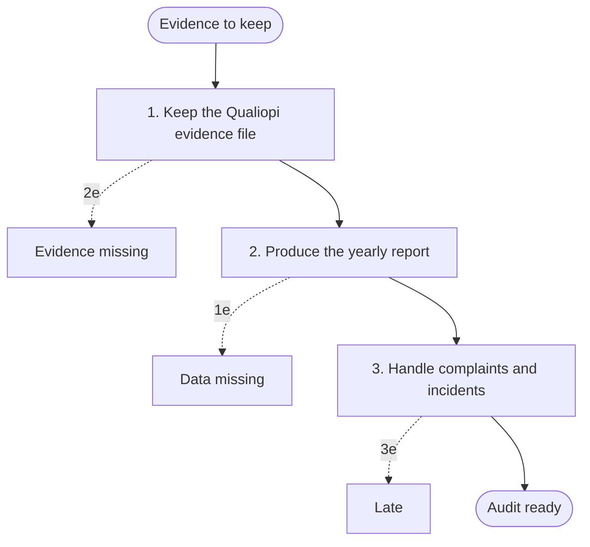

🏠 [Specs](../../../README.md) › 🏷️ [Sectors](../../README.md) › 🎓 [SC12 Education and training](../README.md) ›
🔀 [Flows](README.md) › 🔀 FL-SC12-04 Quality and reports

# 🔀 FL-SC12-04 Quality and reports

**Status:** ✅ specified

## Summary

Quality evidence, the yearly report and complaints. It covers
[UC-SC12-12 Keep the Qualiopi evidence file](../use-cases/04-quality-and-reports/uc-sc12-12-keep-the-qualiopi-evidence-file.md),
[UC-SC12-13 Produce the yearly report](../use-cases/04-quality-and-reports/uc-sc12-13-produce-the-yearly-report.md),
[UC-SC12-14 Handle complaints and incidents](../use-cases/04-quality-and-reports/uc-sc12-14-handle-complaints-and-incidents.md).

## Personas

- [U05 Accounting](../../../01-users/personas/u05-accounting.md)
- [U09 Customer](../../../01-users/personas/u09-customer.md)
- [U13 Owner](../../../01-users/personas/u13-owner.md)
- [U38 Training coordinator](../../../01-users/personas/u38-training-coordinator.md)

## Flowchart

## Sequence diagram

See each use case.

## Steps

| Step | Persona | Screen | Use case | What happens |
|---|---|---|---|---|
| 1 | U38, U13 | [S-SC12-12](../screens/04-quality-and-reports/s-sc12-12-quality-file.md) | [UC-SC12-12](../use-cases/04-quality-and-reports/uc-sc12-12-keep-the-qualiopi-evidence-file.md) | The coordinator collects the evidence each quality criterion needs, reviews it with the owner and prepares the audit |
| 2 | U38, U05 | [S-SC12-13](../screens/04-quality-and-reports/s-sc12-13-yearly-report.md) | [UC-SC12-13](../use-cases/04-quality-and-reports/uc-sc12-13-produce-the-yearly-report.md) | The coordinator and accounting compute the yearly training provider report from sessions, learners, hours and income, check and file it |
| 3 | U38, U09 | [S-SC12-14](../screens/04-quality-and-reports/s-sc12-14-complaints.md) | [UC-SC12-14](../use-cases/04-quality-and-reports/uc-sc12-14-handle-complaints-and-incidents.md) | The coordinator records complaints and incidents, answers them and acts, they feed the quality review |

### Entities and screens

| Entity | States in this flow | Shown at step and screen | Aggregated view |
|---|---|---|---|
| [E-SC12-12 Quality evidence](../data/e-sc12-12-quality-evidence.md) | Recorded | 1 [S-SC12-12](../screens/04-quality-and-reports/s-sc12-12-quality-file.md) | Quality evidences |
| [E-SC12-13 Yearly training report](../data/e-sc12-13-yearly-training-report.md) | Prepared, Filed | 2 [S-SC12-13](../screens/04-quality-and-reports/s-sc12-13-yearly-report.md) | Yearly training reports |
| [E-SC12-09 Survey answer](../data/e-sc12-09-survey-answer.md) | Recorded | 3 [S-SC12-14](../screens/04-quality-and-reports/s-sc12-14-complaints.md) | Survey answers |

## Errors

- [UC-SC12-12](../use-cases/04-quality-and-reports/uc-sc12-12-keep-the-qualiopi-evidence-file.md) 2e. Evidence missing:
  it is listed.
- [UC-SC12-12](../use-cases/04-quality-and-reports/uc-sc12-12-keep-the-qualiopi-evidence-file.md) 4e. The audit date
  near: the owner is reminded.
- [UC-SC12-13](../use-cases/04-quality-and-reports/uc-sc12-13-produce-the-yearly-report.md) 1e. Data missing: it is
  listed.
- [UC-SC12-13](../use-cases/04-quality-and-reports/uc-sc12-13-produce-the-yearly-report.md) 4e. The deadline near: a
  reminder is sent.
- [UC-SC12-14](../use-cases/04-quality-and-reports/uc-sc12-14-handle-complaints-and-incidents.md) 3e. Late: the
  coordinator is alerted.
- [UC-SC12-14](../use-cases/04-quality-and-reports/uc-sc12-14-handle-complaints-and-incidents.md) 4e. Closed without
  action: it is refused.

## Images

Every step and error, for each persona taking part, in light and dark mode (D120). Steps are numbered as in the Steps
table; E rows are the error cases.

| Step | Persona | Device | Light | Dark |
|---|---|---|---|---|
| 1 | U38 | desktop | [light](../images/04-quality-and-reports/u38-training-coordinator/1-quality-file-desktop-light.png) | [dark](../images/04-quality-and-reports/u38-training-coordinator/1-quality-file-desktop-dark.png) |
| 1 | U13 | desktop | [light](../images/04-quality-and-reports/u13-owner/1-quality-file-desktop-light.png) | [dark](../images/04-quality-and-reports/u13-owner/1-quality-file-desktop-dark.png) |
| 1 | U13 | phone | [light](../images/04-quality-and-reports/u13-owner/1-quality-file-phone-light.png) | [dark](../images/04-quality-and-reports/u13-owner/1-quality-file-phone-dark.png) |
| 2 | U38 | desktop | [light](../images/04-quality-and-reports/u38-training-coordinator/2-yearly-report-desktop-light.png) | [dark](../images/04-quality-and-reports/u38-training-coordinator/2-yearly-report-desktop-dark.png) |
| 2 | U05 | desktop | [light](../images/04-quality-and-reports/u05-accounting/2-yearly-report-desktop-light.png) | [dark](../images/04-quality-and-reports/u05-accounting/2-yearly-report-desktop-dark.png) |
| 3 | U38 | desktop | [light](../images/04-quality-and-reports/u38-training-coordinator/3-complaints-desktop-light.png) | [dark](../images/04-quality-and-reports/u38-training-coordinator/3-complaints-desktop-dark.png) |
| 3 | U09 | phone | [light](../images/04-quality-and-reports/u09-customer/3-complaints-phone-light.png) | [dark](../images/04-quality-and-reports/u09-customer/3-complaints-phone-dark.png) |
| E1 | U13 | desktop | [light](../images/04-quality-and-reports/u13-owner/e1-evidence-missing-desktop-light.png) | [dark](../images/04-quality-and-reports/u13-owner/e1-evidence-missing-desktop-dark.png) |
| E1 | U13 | phone | [light](../images/04-quality-and-reports/u13-owner/e1-evidence-missing-phone-light.png) | [dark](../images/04-quality-and-reports/u13-owner/e1-evidence-missing-phone-dark.png) |

## Open questions

None.

---

⬅️ [FL-SC12-03 Deliver and assess](fl-sc12-03-deliver-and-assess.md) · ⬆️ [Up](README.md) ·
➡️ [FL-SC12-05 Private school](fl-sc12-05-private-school.md)
