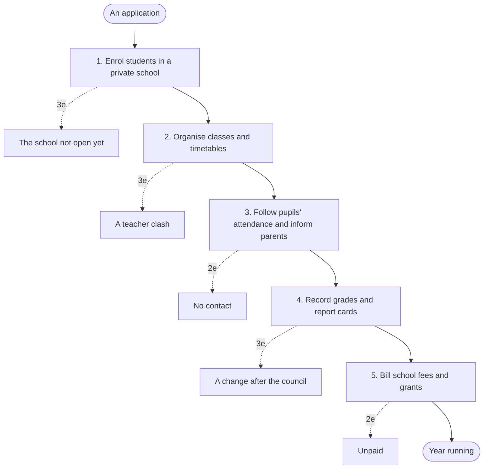

🏠 [Specs](../../../README.md) › 🏷️ [Sectors](../../README.md) › 🎓 [SC12 Education and training](../README.md) ›
🔀 [Flows](README.md) › 🔀 FL-SC12-05 Private school

# 🔀 FL-SC12-05 Private school

**Status:** ✅ specified

## Summary

The private school: enrolment, timetable, attendance, grades and fees. It covers
[UC-SC12-15 Enrol students in a private school](../use-cases/05-private-school/uc-sc12-15-enrol-students-in-a-private-school.md),
[UC-SC12-16 Organise classes and timetables](../use-cases/05-private-school/uc-sc12-16-organise-classes-and-timetables.md),
[UC-SC12-18 Follow pupils' attendance and inform parents](../use-cases/05-private-school/uc-sc12-18-follow-pupils-attendance-and-inform-parents.md),
[UC-SC12-17 Record grades and report cards](../use-cases/05-private-school/uc-sc12-17-record-grades-and-report-cards.md),
[UC-SC12-19 Bill school fees and grants](../use-cases/05-private-school/uc-sc12-19-bill-school-fees-and-grants.md).

## Personas

- [U05 Accounting](../../../01-users/personas/u05-accounting.md)
- [U09 Customer](../../../01-users/personas/u09-customer.md)
- [U38 Training coordinator](../../../01-users/personas/u38-training-coordinator.md)
- [U39 Trainer](../../../01-users/personas/u39-trainer.md)

## Flowchart

## Sequence diagram

See each use case.

## Steps

| Step | Persona | Screen | Use case | What happens |
|---|---|---|---|---|
| 1 | U38, U09, U05 | [S-SC12-15](../screens/05-private-school/s-sc12-15-school-enrolment.md), [S-SC12-19](../screens/05-private-school/s-sc12-19-school-fees.md) | [UC-SC12-15](../use-cases/05-private-school/uc-sc12-15-enrol-students-in-a-private-school.md) | Parents apply, the school admits and enrols students, the school opens only after its declaration period |
| 2 | U38 | [S-SC12-16](../screens/05-private-school/s-sc12-16-timetables.md) | [UC-SC12-16](../use-cases/05-private-school/uc-sc12-16-organise-classes-and-timetables.md) | The coordinator forms classes and builds the timetable with teachers and rooms on the shared booking engine, then publishes it |
| 3 | U39, U09, U38 | [S-SC12-18](../screens/05-private-school/s-sc12-18-pupil-attendance.md) | [UC-SC12-18](../use-cases/05-private-school/uc-sc12-18-follow-pupils-attendance-and-inform-parents.md) | Teachers take attendance, parents are told of an absence the same day on the parents' portal, the reason is recorded |
| 4 | U39, U38, U09 | [S-SC12-17](../screens/05-private-school/s-sc12-17-grades.md) | [UC-SC12-17](../use-cases/05-private-school/uc-sc12-17-record-grades-and-report-cards.md) | Teachers enter grades, the class council approves report cards, and they are published, grades lock after the council |
| 5 | U05, U09 | [S-SC12-19](../screens/05-private-school/s-sc12-19-school-fees.md) | [UC-SC12-19](../use-cases/05-private-school/uc-sc12-19-bill-school-fees-and-grants.md) | Accounting bills fees by period, collects them, and accounts for grants received with the shared grant accounting |

### Entities and screens

| Entity | States in this flow | Shown at step and screen | Aggregated view |
|---|---|---|---|
| [E-F18-06 Application](../../../02-functional/f18-hosted-websites-and-domains/data/e-f18-06-application.md) | Interview, New, Rejected | Shown elsewhere: [S-F18-07 Applications](../../../02-functional/f18-hosted-websites-and-domains/screens/02-careers/s-f18-07-applications.md) | Applications |
| [E-SC12-14 Student](../data/e-sc12-14-student.md) | Active | 1 [S-SC12-15](../screens/05-private-school/s-sc12-15-school-enrolment.md); 1, 5 [S-SC12-19](../screens/05-private-school/s-sc12-19-school-fees.md) | Students |
| [E-SC12-15 Class](../data/e-sc12-15-class.md) | Active | 2 [S-SC12-16](../screens/05-private-school/s-sc12-16-timetables.md) | Classes |
| [E-SC12-17 Pupil absence](../data/e-sc12-17-pupil-absence.md) | Active | 3 [S-SC12-18](../screens/05-private-school/s-sc12-18-pupil-attendance.md) | Pupil absences |
| [E-SC12-16 Grade](../data/e-sc12-16-grade.md) | Active | 4 [S-SC12-17](../screens/05-private-school/s-sc12-17-grades.md) | Grades |
| [E-SC12-18 School fee](../data/e-sc12-18-school-fee.md) | Active | 1, 5 [S-SC12-19](../screens/05-private-school/s-sc12-19-school-fees.md) | School fees |
| [E-F8-18 Grant](../../../02-functional/f08-accounting/data/e-f08-18-grant.md) | Granted, Received | 1, 5 [S-SC12-19](../screens/05-private-school/s-sc12-19-school-fees.md) | Grants |

## Errors

- [UC-SC12-15](../use-cases/05-private-school/uc-sc12-15-enrol-students-in-a-private-school.md) 3e. The school not open
  yet: enrolment is blocked ([BR-SC12-11](../business-rules/br-sc12-11-school-opened-after-declaration.md)).
- [UC-SC12-15](../use-cases/05-private-school/uc-sc12-15-enrol-students-in-a-private-school.md) 1e. Documents missing:
  they are asked.
- [UC-SC12-16](../use-cases/05-private-school/uc-sc12-16-organise-classes-and-timetables.md) 3e. A teacher clash: it is
  refused.
- [UC-SC12-16](../use-cases/05-private-school/uc-sc12-16-organise-classes-and-timetables.md) 2e. No room free: another
  slot is proposed.
- [UC-SC12-18](../use-cases/05-private-school/uc-sc12-18-follow-pupils-attendance-and-inform-parents.md) 2e. No contact:
  the office calls.
- [UC-SC12-18](../use-cases/05-private-school/uc-sc12-18-follow-pupils-attendance-and-inform-parents.md) 1e. No network
  in class: attendance is kept and synced.
- [UC-SC12-17](../use-cases/05-private-school/uc-sc12-17-record-grades-and-report-cards.md) 3e. A change after the
  council: it is refused.
- [UC-SC12-17](../use-cases/05-private-school/uc-sc12-17-record-grades-and-report-cards.md) 1e. A grade missing: the
  council is warned.
- [UC-SC12-19](../use-cases/05-private-school/uc-sc12-19-bill-school-fees-and-grants.md) 2e. Unpaid: a reminder is sent.
- [UC-SC12-19](../use-cases/05-private-school/uc-sc12-19-bill-school-fees-and-grants.md) 4e. A grant condition not met:
  it is not recognised,
  [BR-F8-14](../../../02-functional/f08-accounting/business-rules/br-f08-14-a-grant-is-earned-as-its-conditions-are-met.md).

## Images

Every step and error, for each persona taking part, in light and dark mode (D120). Steps are numbered as in the Steps
table; E rows are the error cases.

| Step | Persona | Device | Light | Dark |
|---|---|---|---|---|
| 1 | U38 | desktop | [light](../images/05-private-school/u38-training-coordinator/1-school-enrolment-desktop-light.png) | [dark](../images/05-private-school/u38-training-coordinator/1-school-enrolment-desktop-dark.png) |
| 1 | U05 | desktop | [light](../images/05-private-school/u05-accounting/1-school-enrolment-desktop-light.png) | [dark](../images/05-private-school/u05-accounting/1-school-enrolment-desktop-dark.png) |
| 1 | U09 | phone | [light](../images/05-private-school/u09-customer/1-school-enrolment-phone-light.png) | [dark](../images/05-private-school/u09-customer/1-school-enrolment-phone-dark.png) |
| 2 | U38 | desktop | [light](../images/05-private-school/u38-training-coordinator/2-timetable-desktop-light.png) | [dark](../images/05-private-school/u38-training-coordinator/2-timetable-desktop-dark.png) |
| 3 | U39 | phone | [light](../images/05-private-school/u39-trainer/3-absences-phone-light.png) | [dark](../images/05-private-school/u39-trainer/3-absences-phone-dark.png) |
| 3 | U39 | desktop | [light](../images/05-private-school/u39-trainer/3-absences-desktop-light.png) | [dark](../images/05-private-school/u39-trainer/3-absences-desktop-dark.png) |
| 3 | U39 | tablet | [light](../images/05-private-school/u39-trainer/3-absences-tablet-light.png) | [dark](../images/05-private-school/u39-trainer/3-absences-tablet-dark.png) |
| 3 | U09 | phone | [light](../images/05-private-school/u09-customer/3-absences-phone-light.png) | [dark](../images/05-private-school/u09-customer/3-absences-phone-dark.png) |
| 3 | U38 | desktop | [light](../images/05-private-school/u38-training-coordinator/3-absences-desktop-light.png) | [dark](../images/05-private-school/u38-training-coordinator/3-absences-desktop-dark.png) |
| 4 | U39 | phone | [light](../images/05-private-school/u39-trainer/4-grades-phone-light.png) | [dark](../images/05-private-school/u39-trainer/4-grades-phone-dark.png) |
| 4 | U39 | desktop | [light](../images/05-private-school/u39-trainer/4-grades-desktop-light.png) | [dark](../images/05-private-school/u39-trainer/4-grades-desktop-dark.png) |
| 4 | U39 | tablet | [light](../images/05-private-school/u39-trainer/4-grades-tablet-light.png) | [dark](../images/05-private-school/u39-trainer/4-grades-tablet-dark.png) |
| 4 | U09 | phone | [light](../images/05-private-school/u09-customer/4-grades-phone-light.png) | [dark](../images/05-private-school/u09-customer/4-grades-phone-dark.png) |
| 4 | U38 | desktop | [light](../images/05-private-school/u38-training-coordinator/4-grades-desktop-light.png) | [dark](../images/05-private-school/u38-training-coordinator/4-grades-desktop-dark.png) |
| 5 | U05 | desktop | [light](../images/05-private-school/u05-accounting/5-fees-desktop-light.png) | [dark](../images/05-private-school/u05-accounting/5-fees-desktop-dark.png) |
| 5 | U09 | phone | [light](../images/05-private-school/u09-customer/5-fees-phone-light.png) | [dark](../images/05-private-school/u09-customer/5-fees-phone-dark.png) |
| E1 | U39 | phone | [light](../images/05-private-school/u39-trainer/e1-grades-locked-phone-light.png) | [dark](../images/05-private-school/u39-trainer/e1-grades-locked-phone-dark.png) |
| E1 | U39 | desktop | [light](../images/05-private-school/u39-trainer/e1-grades-locked-desktop-light.png) | [dark](../images/05-private-school/u39-trainer/e1-grades-locked-desktop-dark.png) |
| E1 | U39 | tablet | [light](../images/05-private-school/u39-trainer/e1-grades-locked-tablet-light.png) | [dark](../images/05-private-school/u39-trainer/e1-grades-locked-tablet-dark.png) |

## Open questions

None.

---

⬅️ [FL-SC12-04 Quality and reports](fl-sc12-04-quality-and-reports.md) · ⬆️ [Up](README.md) ·
➡️ [FL-SC12-06](fl-sc12-06-apprentices-driving-nurseries-and-canteens.md)
