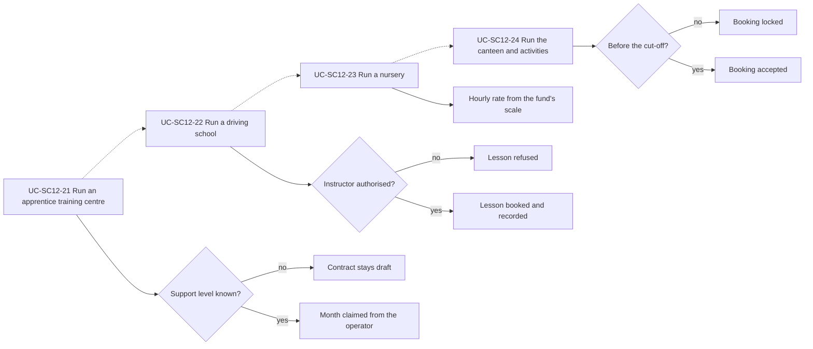
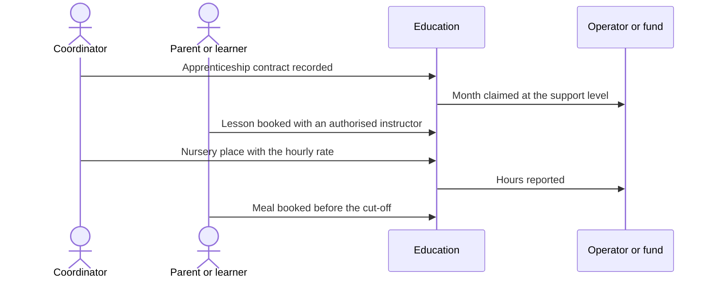

🏠 [Specs](../../../README.md) › 🏷️ [Sectors](../../README.md) › 🎓 [SC12 Education and training](../README.md) ›
🔀 [Flows](README.md) › 🔀 FL-SC12-06 Apprentices, driving schools, nurseries, canteens

# 🔀 FL-SC12-06 Apprentices, driving schools, nurseries, canteens

**Status:** 🔄 waiting for the owner

## Summary

Four situations of education and training providers that school suites handle: an apprentice training centre funded by
the skills operator, a driving school with authorised instructors, a nursery funded on the family allowance scale, and a
canteen with booking cut-offs
([D556](../../../06-decisions/sectors/d556-benchmark-gaps-sc12-education-and-training.md)).

## Personas

- [U38 Training coordinator](../../../01-users/personas/u38-training-coordinator.md), who records contracts, plans and
  counts
- [U01 Employee](../../../01-users/personas/u01-employee.md), who follows their schedule on the phone
- [U39 Trainer](../../../01-users/personas/u39-trainer.md), who gives and records the lessons
- [U09 Customer](../../../01-users/personas/u09-customer.md), who books and reads on the phone

## Flowchart

## Sequence diagram

## Steps

| Step | Persona | Screen | Use case | What happens |
|---|---|---|---|---|
| 1 | [U38](../../../01-users/personas/u38-training-coordinator.md) | [S-SC12-21](../screens/06-apprentices-driving-nurseries-and-canteens/s-sc12-21-cfa.md) | [UC-SC12-21](../use-cases/06-apprentices-driving-nurseries-and-canteens/uc-sc12-21-run-an-apprentice-training-centre.md) | The coordinator records the apprenticeship contract and claims each month from the operator at the support level |
| 2 | [U38](../../../01-users/personas/u38-training-coordinator.md) | [S-SC12-22](../screens/06-apprentices-driving-nurseries-and-canteens/s-sc12-22-driving-school.md) | [UC-SC12-22](../use-cases/06-apprentices-driving-nurseries-and-canteens/uc-sc12-22-run-a-driving-school.md) | The learner books a lesson on the phone and the instructor records it, only if authorised |
| 3 | [U38](../../../01-users/personas/u38-training-coordinator.md) | [S-SC12-23](../screens/06-apprentices-driving-nurseries-and-canteens/s-sc12-23-nursery.md) | [UC-SC12-23](../use-cases/06-apprentices-driving-nurseries-and-canteens/uc-sc12-23-run-a-nursery.md) | The director books the nursery place, the family signs on the phone and the hours are reported to the fund |
| 4 | [U38](../../../01-users/personas/u38-training-coordinator.md) | [S-SC12-24](../screens/06-apprentices-driving-nurseries-and-canteens/s-sc12-24-canteen.md) | [UC-SC12-24](../use-cases/06-apprentices-driving-nurseries-and-canteens/uc-sc12-24-run-the-canteen-and-activities.md) | The parent books meals on the phone before the cut-off and the kitchen sees the count |

### Entities and screens

| Entity | States in this flow | Shown at step and screen | Aggregated view |
|---|---|---|---|
| [E-SC12-20 Apprenticeship contract](../data/e-sc12-20-apprenticeship-contract.md) | Draft, Registered, Broken, Ended | 1 [S-SC12-21](../screens/06-apprentices-driving-nurseries-and-canteens/s-sc12-21-cfa.md) | Apprenticeship contracts |
| [E-SC12-21 Driving lesson](../data/e-sc12-21-driving-lesson.md) | Booked, Done, Cancelled, Missed | 2 [S-SC12-22](../screens/06-apprentices-driving-nurseries-and-canteens/s-sc12-22-driving-school.md) | Driving lessons |
| [E-SC12-22 Childcare place](../data/e-sc12-22-childcare-place.md) | Waiting, Active, Ended, Cancelled | 3 [S-SC12-23](../screens/06-apprentices-driving-nurseries-and-canteens/s-sc12-23-nursery.md) | Childcare places |
| [E-SC12-23 Meal booking](../data/e-sc12-23-meal-booking.md) | Booked, Locked, Cancelled, Served | 4 [S-SC12-24](../screens/06-apprentices-driving-nurseries-and-canteens/s-sc12-24-canteen.md) | Meal bookings |

## Errors

- **E1 The instructor is not authorised.** The authorisation to teach has ended or does not cover the category; the
  lesson is refused and the coordinator is told
  ([BR-SC12-17](../business-rules/br-sc12-17-lessons-are-taught-by-an-authorised-instructor.md), step 2).

## Images

Every step and error, for each persona taking part, in light and dark mode (D120). Steps are numbered as in the Steps
table; E rows are the error cases.

| Step | Persona | Device | Light | Dark |
|---|---|---|---|---|
| 1 | U38 | desktop | [light](../images/06-apprentices-driving-nurseries-and-canteens/u38-training-coordinator/1-cfa-desktop-light.png) | [dark](../images/06-apprentices-driving-nurseries-and-canteens/u38-training-coordinator/1-cfa-desktop-dark.png) |
| 1 | U01 | phone | [light](../images/06-apprentices-driving-nurseries-and-canteens/u01-employee/1-cfa-phone-light.png) | [dark](../images/06-apprentices-driving-nurseries-and-canteens/u01-employee/1-cfa-phone-dark.png) |
| 2 | U38 | desktop | [light](../images/06-apprentices-driving-nurseries-and-canteens/u38-training-coordinator/2-driving-school-desktop-light.png) | [dark](../images/06-apprentices-driving-nurseries-and-canteens/u38-training-coordinator/2-driving-school-desktop-dark.png) |
| 2 | U39 | phone | [light](../images/06-apprentices-driving-nurseries-and-canteens/u39-trainer/2-driving-school-phone-light.png) | [dark](../images/06-apprentices-driving-nurseries-and-canteens/u39-trainer/2-driving-school-phone-dark.png) |
| 3 | U38 | desktop | [light](../images/06-apprentices-driving-nurseries-and-canteens/u38-training-coordinator/3-nursery-desktop-light.png) | [dark](../images/06-apprentices-driving-nurseries-and-canteens/u38-training-coordinator/3-nursery-desktop-dark.png) |
| 3 | U09 | phone | [light](../images/06-apprentices-driving-nurseries-and-canteens/u09-customer/3-nursery-phone-light.png) | [dark](../images/06-apprentices-driving-nurseries-and-canteens/u09-customer/3-nursery-phone-dark.png) |
| 4 | U38 | desktop | [light](../images/06-apprentices-driving-nurseries-and-canteens/u38-training-coordinator/4-canteen-desktop-light.png) | [dark](../images/06-apprentices-driving-nurseries-and-canteens/u38-training-coordinator/4-canteen-desktop-dark.png) |
| 4 | U09 | phone | [light](../images/06-apprentices-driving-nurseries-and-canteens/u09-customer/4-canteen-phone-light.png) | [dark](../images/06-apprentices-driving-nurseries-and-canteens/u09-customer/4-canteen-phone-dark.png) |
| E1 | U38 | desktop | [light](../images/06-apprentices-driving-nurseries-and-canteens/u38-training-coordinator/e1-the-instructor-is-not-authorised-desktop-light.png) | [dark](../images/06-apprentices-driving-nurseries-and-canteens/u38-training-coordinator/e1-the-instructor-is-not-authorised-desktop-dark.png) |

## Open questions

None.

---

⬅️ [FL-SC12-05 Private school](fl-sc12-05-private-school.md) · ⬆️ [Up](README.md)
