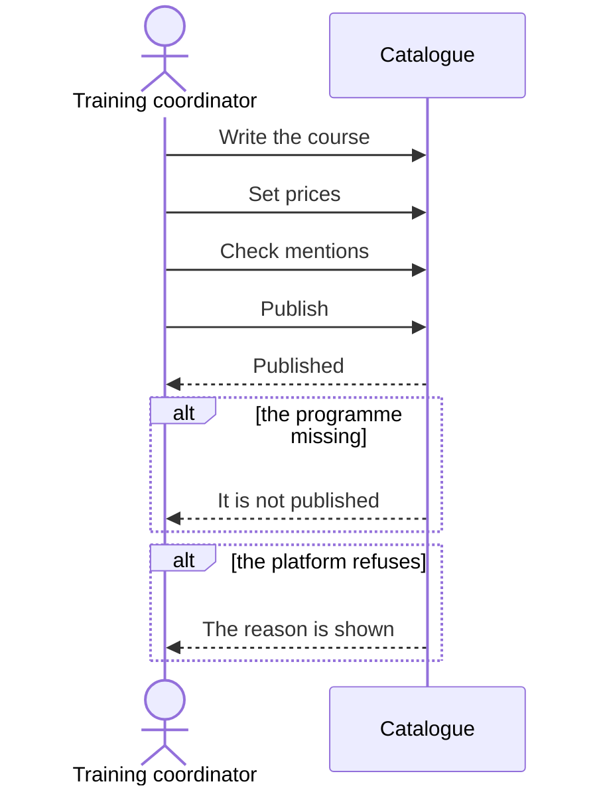

🏠 [Specs](../../../../README.md) › 🏷️ [Sectors](../../../README.md) › 🎓 [SC12 Education and training](../../README.md) ›
📝 [Use cases](../README.md) › 📝 [Use cases: FL-SC12-01 Offer and sessions](README.md) ›
📝 UC-SC12-01 Publish the course catalogue

# 📝 UC-SC12-01 Publish the course catalogue

**Status:** ✅ specified

## Summary

The training coordinator writes courses with objectives, programme, duration and prices, and publishes them on the
website and the training account platform.

## Personas

- [U38 Training coordinator](../../../../01-users/personas/u38-training-coordinator.md)

## Goal

A catalogue learners and employers can enrol from.

## Trigger

A new course or a yearly update.

## Frequency

Monthly updates.

## Preconditions

- The SC12 sector pack is installed for the company,
  [UC-F14-02](../../../../02-functional/f14-plugin-store/use-cases/01-find-and-install/uc-f14-02-install-a-plugin-or-sector-pack.md),
  and its users have their roles,
  [UC-F1-06](../../../../02-functional/f01-administration/use-cases/04-edit-a-role/uc-f01-06-edit-a-role-and-its-record-rules.md).

## Postconditions

- **Success:** the course is published.
- **Failed:** the course stays a draft.

## Main flow

1. The coordinator writes objectives and programme on
   [S-SC12-01 Catalogue](../../screens/01-offer-and-sessions/s-sc12-01-catalogue.md).
2. The coordinator sets duration and price.
3. The declaration number shows ([BR-SC12-02](../../business-rules/br-sc12-02-declaration-number-on-documents.md)).
4. The course goes on the website,
   [UC-F11-02](../../../../02-functional/f11-online-shop/use-cases/01-build-the-shop/uc-f11-02-publish-the-catalogue.md).

## Alternative flows

- 4a. On the training account platform: the course is sent through its connector (T12).

## Error flows

- 1e. The programme missing: it is not published.
- 4e. The platform refuses: the reason is shown.
- Any step: a call to a service or an outside system fails: it is retried first
  ([BR-F3-32](../../../../02-functional/f03-assistant/business-rules/br-f03-32-retry-before-an-error.md)), then the
  error message pattern ([D122](../../../../06-decisions/ux/d122-error-message-standard.md)) says what failed; what was
  typed is kept.

## Business rules

- [BR-SC12-01 Education follows the country pack](../../business-rules/br-sc12-01-education-follows-the-country-pack.md)
- [BR-SC12-02 Declaration number on documents](../../business-rules/br-sc12-02-declaration-number-on-documents.md)

## Entities

- [E-SC12-01 Course](../../data/e-sc12-01-course.md)

## Permissions

The training coordinator roles; the record rules of their role and site apply,
[UC-F1-06](../../../../02-functional/f01-administration/use-cases/04-edit-a-role/uc-f01-06-edit-a-role-and-its-record-rules.md).

## Notifications

None beyond the in-app updates of the records concerned.

## Audit events

Every creation, change and state change of course records, with who, when and the values before and after (T3).

## AI involvement

The AI assistant answers questions on the course records of this use case, with links, and prepares them as drafts the
user confirms. It works within the user's rights,
[BR-F3-34](../../../../02-functional/f03-assistant/business-rules/br-f03-34-every-capability-is-reachable-from-the-assistant.md),
and never deletes or does anything irreversible without the user's confirmation,
[BR-F3-07](../../../../02-functional/f03-assistant/business-rules/br-f03-07-no-deletes-no-irreversible-acts.md).

## API, MCP and A2A exposure

Through the API and webhooks (T5) and the MCP and A2A gateway (T6), with the caller's rights,
[BR-F3-34](../../../../02-functional/f03-assistant/business-rules/br-f03-34-every-capability-is-reachable-from-the-assistant.md),
reading, creating and changing the records of this use case; nothing irreversible without a person's confirmation.

## Screens

- [S-SC12-01 Catalogue](../../screens/01-offer-and-sessions/s-sc12-01-catalogue.md)

## Flowchart

See [FL-SC12-01 Offer and sessions](../../flows/fl-sc12-01-offer-and-sessions.md#flowchart).

## Sequence diagram

## Acceptance criteria

1. **Given** the example training centre's Excel advanced, 14 hours at 690 EUR **when** it is published **then** it
   shows on the website.
2. **Given** Excel advanced without programme **when** it is published **then** it is not published.

## Non-functional notes

[D408](../../../../06-decisions/technical/d408-performance-and-profiles.md)'s targets
([performance](../../../../05-non-functional/performance.md)): 95 % of screens within 1 second; lists paged on the
server, the first page within 1 second; reports within 5 seconds or in the background. WCAG 2.2 AA and RGAA
([D46](../../../../06-decisions/ux/d46-accessibility-standard.md)).

## Regulatory references

Legal values from the France country pack:
[CR-FR-155 Training provider's declaration](../../../../10-country-packs/france/education/cr-fr-155-training-provider-declaration.md).

## Related use cases

- [UC-SC12-02 Plan sessions with trainers and rooms](uc-sc12-02-plan-sessions-with-trainers-and-rooms.md)

## Open questions

None.

---

⬆️ [Up](README.md) ·
➡️ [UC-SC12-02 Plan sessions with trainers and rooms](uc-sc12-02-plan-sessions-with-trainers-and-rooms.md)
