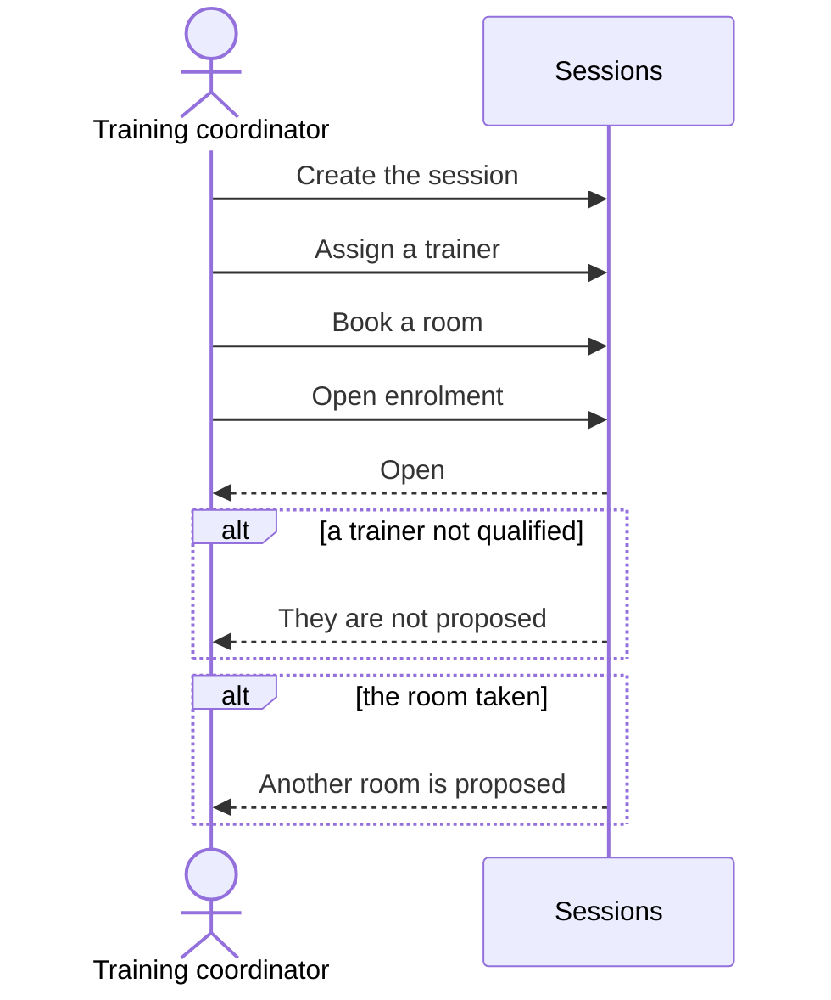

🏠 [Specs](../../../../README.md) › 🏷️ [Sectors](../../../README.md) › 🎓 [SC12 Education and training](../../README.md) ›
📝 [Use cases](../README.md) › 📝 [Use cases: FL-SC12-01 Offer and sessions](README.md) ›
📝 UC-SC12-02 Plan sessions with trainers and rooms

# 📝 UC-SC12-02 Plan sessions with trainers and rooms

**Status:** ✅ specified

## Summary

The training coordinator creates sessions, assigns a qualified trainer and books a room through the shared booking
engine, then opens enrolment.

## Personas

- [U38 Training coordinator](../../../../01-users/personas/u38-training-coordinator.md)

## Goal

Sessions with a qualified trainer and a room, never double-booked.

## Trigger

Demand for a course.

## Frequency

Weekly.

## Preconditions

- The SC12 sector pack is installed for the company,
  [UC-F14-02](../../../../02-functional/f14-plugin-store/use-cases/01-find-and-install/uc-f14-02-install-a-plugin-or-sector-pack.md),
  and its users have their roles,
  [UC-F1-06](../../../../02-functional/f01-administration/use-cases/04-edit-a-role/uc-f01-06-edit-a-role-and-its-record-rules.md).

## Postconditions

- **Success:** the session is open for enrolment.
- **Failed:** the session stays planned.

## Main flow

1. The coordinator creates the session on
   [S-SC12-02 Sessions](../../screens/01-offer-and-sessions/s-sc12-02-sessions.md).
2. Only qualified, available trainers are proposed
   ([BR-SC12-09](../../business-rules/br-sc12-09-trainers-qualified-for-the-course.md)).
3. The room is booked,
   [UC-F2-19](../../../../02-functional/f02-no-code-configuration/use-cases/08-views-and-bookings/uc-f02-19-book-a-resource.md),
   [BR-F2-18](../../../../02-functional/f02-no-code-configuration/business-rules/br-f02-18-one-booking-per-resource-and-slot.md).
4. Enrolment opens.

## Alternative flows

- 3a. A remote session: no room; a video link is created,
  [UC-F4-25](../../../../02-functional/f04-meetings/use-cases/12-rooms-and-client-video/uc-f04-25-hold-a-client-video-meeting.md).

## Error flows

- 2e. A trainer not qualified: they are not proposed.
- 3e. The room taken: another room is proposed.
- Any step: a call to a service or an outside system fails: it is retried first
  ([BR-F3-32](../../../../02-functional/f03-assistant/business-rules/br-f03-32-retry-before-an-error.md)), then the
  error message pattern ([D122](../../../../06-decisions/ux/d122-error-message-standard.md)) says what failed; what was
  typed is kept.

## Business rules

- [BR-SC12-09 Trainers qualified for the course](../../business-rules/br-sc12-09-trainers-qualified-for-the-course.md)
- [BR-F2-18 One booking per resource and slot](../../../../02-functional/f02-no-code-configuration/business-rules/br-f02-18-one-booking-per-resource-and-slot.md)

## Entities

- [E-SC12-02 Course session](../../data/e-sc12-02-course-session.md)
- [E-F2-18 Resource booking](../../../../02-functional/f02-no-code-configuration/data/e-f02-18-resource-booking.md)

## Permissions

The training coordinator roles; the record rules of their role and site apply,
[UC-F1-06](../../../../02-functional/f01-administration/use-cases/04-edit-a-role/uc-f01-06-edit-a-role-and-its-record-rules.md).

## Notifications

None beyond the in-app updates of the records concerned.

## Audit events

Every creation, change and state change of session, booking records, with who, when and the values before and after
(T3).

## AI involvement

The AI assistant answers questions on the session, booking records of this use case, with links, and prepares them as
drafts the user confirms. It works within the user's rights,
[BR-F3-34](../../../../02-functional/f03-assistant/business-rules/br-f03-34-every-capability-is-reachable-from-the-assistant.md),
and never deletes or does anything irreversible without the user's confirmation,
[BR-F3-07](../../../../02-functional/f03-assistant/business-rules/br-f03-07-no-deletes-no-irreversible-acts.md).

## API, MCP and A2A exposure

Through the API and webhooks (T5) and the MCP and A2A gateway (T6), with the caller's rights,
[BR-F3-34](../../../../02-functional/f03-assistant/business-rules/br-f03-34-every-capability-is-reachable-from-the-assistant.md),
reading, creating and changing the records of this use case; nothing irreversible without a person's confirmation.

## Screens

- [S-SC12-02 Sessions](../../screens/01-offer-and-sessions/s-sc12-02-sessions.md)

## Flowchart

See [FL-SC12-01 Offer and sessions](../../flows/fl-sc12-01-offer-and-sessions.md#flowchart).

## Sequence diagram

## Acceptance criteria

1. **Given** the example training centre's session S-41 on 3 and 4 December in room 2 for 10 **when** it opens **then**
   room 2 is booked those days.
2. **Given** a trainer without Excel skills **when** the trainer is chosen **then** they are not proposed.

## Non-functional notes

[D408](../../../../06-decisions/technical/d408-performance-and-profiles.md)'s targets
([performance](../../../../05-non-functional/performance.md)): 95 % of screens within 1 second; lists paged on the
server, the first page within 1 second; reports within 5 seconds or in the background. WCAG 2.2 AA and RGAA
([D46](../../../../06-decisions/ux/d46-accessibility-standard.md)).

## Regulatory references

None specific to this use case; the sector's legal rules are listed in [SC12 regulatory](../../regulatory.md).

## Related use cases

- [UC-SC12-03 Enrol learners with quotes and agreements](../02-enrol-and-fund/uc-sc12-03-enrol-learners-with-quotes-and-agreements.md)

## Open questions

None.

---

⬅️ [UC-SC12-01 Publish the course catalogue](uc-sc12-01-publish-the-course-catalogue.md) · ⬆️ [Up](README.md) ·
➡️ [UC-SC12-03](../02-enrol-and-fund/uc-sc12-03-enrol-learners-with-quotes-and-agreements.md)
