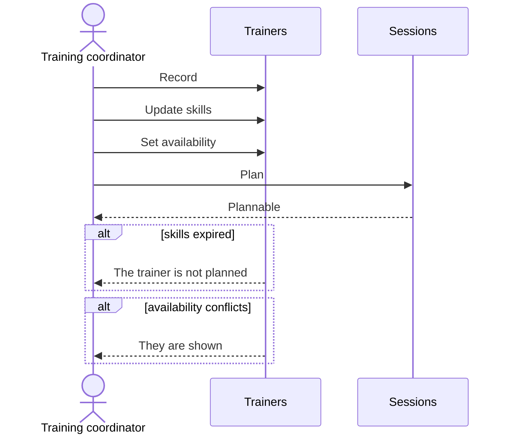

🏠 [Specs](../../../../README.md) › 🏷️ [Sectors](../../../README.md) › 🎓 [SC12 Education and training](../../README.md) ›
📝 [Use cases](../README.md) › 📝 [Use cases: FL-SC12-01 Offer and sessions](README.md) › 📝 UC-SC12-11 Manage trainers

# 📝 UC-SC12-11 Manage trainers

**Status:** ✅ specified

## Summary

The training coordinator records trainers' contracts, skills and availability, and plans them.

## Personas

- [U38 Training coordinator](../../../../01-users/personas/u38-training-coordinator.md)

## Goal

Trainers known by skills and availability.

## Trigger

A new trainer or a change.

## Frequency

Monthly.

## Preconditions

- The SC12 sector pack is installed for the company,
  [UC-F14-02](../../../../02-functional/f14-plugin-store/use-cases/01-find-and-install/uc-f14-02-install-a-plugin-or-sector-pack.md),
  and its users have their roles,
  [UC-F1-06](../../../../02-functional/f01-administration/use-cases/04-edit-a-role/uc-f01-06-edit-a-role-and-its-record-rules.md).

## Postconditions

- **Success:** the trainer can be planned.
- **Failed:** the trainer is not planned.

## Main flow

1. The coordinator records the trainer on
   [S-SC12-11 Trainers](../../screens/01-offer-and-sessions/s-sc12-11-trainers.md).
2. Skills and evidence are updated.
3. Availability is set.
4. Planning uses them ([UC-SC12-02](uc-sc12-02-plan-sessions-with-trainers-and-rooms.md)).

## Alternative flows

- 1a. Freelance trainers: their contracts and documents are checked,
  [UC-F9-32](../../../../02-functional/f09-hr-and-projects/use-cases/11-capacity-rounds-and-partners/uc-f09-32-work-with-subcontractors-and-freelancers-on-projects.md).

## Error flows

- 2e. Skills expired: the trainer is not planned.
- 3e. Availability conflicts: they are shown.
- Any step: a call to a service or an outside system fails: it is retried first
  ([BR-F3-32](../../../../02-functional/f03-assistant/business-rules/br-f03-32-retry-before-an-error.md)), then the
  error message pattern ([D122](../../../../06-decisions/ux/d122-error-message-standard.md)) says what failed; what was
  typed is kept.

## Business rules

- [BR-SC12-09 Trainers qualified for the course](../../business-rules/br-sc12-09-trainers-qualified-for-the-course.md)

## Entities

- [E-SC12-11 Trainer profile](../../data/e-sc12-11-trainer-profile.md)

## Permissions

The training coordinator roles; the record rules of their role and site apply,
[UC-F1-06](../../../../02-functional/f01-administration/use-cases/04-edit-a-role/uc-f01-06-edit-a-role-and-its-record-rules.md).

## Notifications

None beyond the in-app updates of the records concerned.

## Audit events

Every creation, change and state change of trainer profile records, with who, when and the values before and after (T3).

## AI involvement

The AI assistant answers questions on the trainer profile records of this use case, with links, and prepares them as
drafts the user confirms. It works within the user's rights,
[BR-F3-34](../../../../02-functional/f03-assistant/business-rules/br-f03-34-every-capability-is-reachable-from-the-assistant.md),
and never deletes or does anything irreversible without the user's confirmation,
[BR-F3-07](../../../../02-functional/f03-assistant/business-rules/br-f03-07-no-deletes-no-irreversible-acts.md).

## API, MCP and A2A exposure

Through the API and webhooks (T5) and the MCP and A2A gateway (T6), with the caller's rights,
[BR-F3-34](../../../../02-functional/f03-assistant/business-rules/br-f03-34-every-capability-is-reachable-from-the-assistant.md),
reading, creating and changing the records of this use case; nothing irreversible without a person's confirmation.

## Screens

- [S-SC12-11 Trainers](../../screens/01-offer-and-sessions/s-sc12-11-trainers.md)
- [S-SC12-02 Sessions](../../screens/01-offer-and-sessions/s-sc12-02-sessions.md)

## Flowchart

See [FL-SC12-01 Offer and sessions](../../flows/fl-sc12-01-offer-and-sessions.md#flowchart).

## Sequence diagram

## Acceptance criteria

1. **Given** the example training centre's trainer U39, Excel, Monday to Thursday **when** a Friday session is planned
   **then** she is not proposed.
2. **Given** a certification expired **when** a session is planned **then** the trainer is not planned.

## Non-functional notes

[D408](../../../../06-decisions/technical/d408-performance-and-profiles.md)'s targets
([performance](../../../../05-non-functional/performance.md)): 95 % of screens within 1 second; lists paged on the
server, the first page within 1 second; reports within 5 seconds or in the background. WCAG 2.2 AA and RGAA
([D46](../../../../06-decisions/ux/d46-accessibility-standard.md)).

## Regulatory references

None specific to this use case; the sector's legal rules are listed in [SC12 regulatory](../../regulatory.md).

## Related use cases

- [UC-SC12-02 Plan sessions with trainers and rooms](uc-sc12-02-plan-sessions-with-trainers-and-rooms.md)

## Open questions

None.

---

⬅️ [UC-SC12-10](../02-enrol-and-fund/uc-sc12-10-bill-learners-employers-and-funders.md) · ⬆️ [Up](README.md) ·
➡️ [UC-SC12-12](../04-quality-and-reports/uc-sc12-12-keep-the-qualiopi-evidence-file.md)
