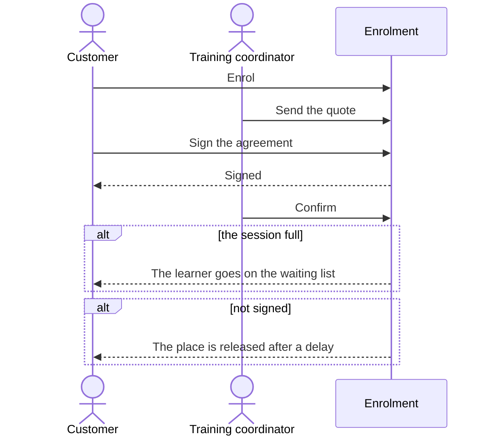

🏠 [Specs](../../../../README.md) › 🏷️ [Sectors](../../../README.md) › 🎓 [SC12 Education and training](../../README.md) ›
📝 [Use cases](../README.md) › 📝 [Use cases: FL-SC12-02 Enrol and fund](README.md) ›
📝 UC-SC12-03 Enrol learners with quotes and agreements

# 📝 UC-SC12-03 Enrol learners with quotes and agreements

**Status:** ✅ specified

## Summary

The training coordinator enrols learners, sends the quote and has the agreement signed; an individual paying keeps a
withdrawal period.

## Personas

- [U38 Training coordinator](../../../../01-users/personas/u38-training-coordinator.md)
- [U09 Customer](../../../../01-users/personas/u09-customer.md)

## Goal

Enrolments under signed agreements.

## Trigger

A learner or employer asks.

## Frequency

Daily.

## Preconditions

- The SC12 sector pack is installed for the company,
  [UC-F14-02](../../../../02-functional/f14-plugin-store/use-cases/01-find-and-install/uc-f14-02-install-a-plugin-or-sector-pack.md),
  and its users have their roles,
  [UC-F1-06](../../../../02-functional/f01-administration/use-cases/04-edit-a-role/uc-f01-06-edit-a-role-and-its-record-rules.md).

## Postconditions

- **Success:** the agreement is signed and the learner enrolled.
- **Failed:** the enrolment stays pending.

## Main flow

1. The learner or employer enrols on [S-SC12-03 Enrolment](../../screens/02-enrol-and-fund/s-sc12-03-enrolment.md).
2. The quote goes out,
   [UC-F6-03](../../../../02-functional/f06-customers-and-sales/use-cases/01-lead-to-quote/uc-f06-03-create-and-send-a-quote.md).
3. The agreement is signed ([BR-SC12-03](../../business-rules/br-sc12-03-training-sold-under-an-agreement.md)).
4. The learner is enrolled.

## Alternative flows

- 1a. A group of employees: one agreement covers them.

## Error flows

- 1e. The session full: the learner goes on the waiting list.
- 3e. Not signed: the place is released after a delay.
- Any step: a call to a service or an outside system fails: it is retried first
  ([BR-F3-32](../../../../02-functional/f03-assistant/business-rules/br-f03-32-retry-before-an-error.md)), then the
  error message pattern ([D122](../../../../06-decisions/ux/d122-error-message-standard.md)) says what failed; what was
  typed is kept.

## Business rules

- [BR-SC12-02 Declaration number on documents](../../business-rules/br-sc12-02-declaration-number-on-documents.md)
- [BR-SC12-03 Training sold under an agreement](../../business-rules/br-sc12-03-training-sold-under-an-agreement.md)

## Entities

- [E-SC12-03 Enrolment](../../data/e-sc12-03-enrolment.md)
- [E-SC12-04 Training agreement](../../data/e-sc12-04-training-agreement.md)

## Permissions

The training coordinator and customer roles; the record rules of their role and site apply,
[UC-F1-06](../../../../02-functional/f01-administration/use-cases/04-edit-a-role/uc-f01-06-edit-a-role-and-its-record-rules.md).

## Notifications

None beyond the in-app updates of the records concerned.

## Audit events

Every creation, change and state change of enrolment, training agreement records, with who, when and the values before
and after (T3).

## AI involvement

The AI assistant answers questions on the enrolment, training agreement records of this use case, with links, and
prepares them as drafts the user confirms. It works within the user's rights,
[BR-F3-34](../../../../02-functional/f03-assistant/business-rules/br-f03-34-every-capability-is-reachable-from-the-assistant.md),
and never deletes or does anything irreversible without the user's confirmation,
[BR-F3-07](../../../../02-functional/f03-assistant/business-rules/br-f03-07-no-deletes-no-irreversible-acts.md).

## API, MCP and A2A exposure

Through the API and webhooks (T5) and the MCP and A2A gateway (T6), with the caller's rights,
[BR-F3-34](../../../../02-functional/f03-assistant/business-rules/br-f03-34-every-capability-is-reachable-from-the-assistant.md),
reading, creating and changing the records of this use case; nothing irreversible without a person's confirmation.

## Screens

- [S-SC12-03 Enrolment](../../screens/02-enrol-and-fund/s-sc12-03-enrolment.md)

## Flowchart

See [FL-SC12-02 Enrol and fund](../../flows/fl-sc12-02-enrol-and-fund.md#flowchart).

## Sequence diagram

## Acceptance criteria

1. **Given** the example training centre's agreement with Acme for S-41 at 690 EUR **when** it is signed **then** J.
   Martin is enrolled.
2. **Given** S-41 with 10 enrolled **when** J. Martin enrols **then** the learner goes on the waiting list.

## Non-functional notes

[D408](../../../../06-decisions/technical/d408-performance-and-profiles.md)'s targets
([performance](../../../../05-non-functional/performance.md)): 95 % of screens within 1 second; lists paged on the
server, the first page within 1 second; reports within 5 seconds or in the background. WCAG 2.2 AA and RGAA
([D46](../../../../06-decisions/ux/d46-accessibility-standard.md)).

## Regulatory references

Legal values from the France country pack:
[CR-FR-158 Training agreement or contract](../../../../10-country-packs/france/education/cr-fr-158-training-agreement.md).

## Related use cases

- [UC-SC12-04 Get funding](uc-sc12-04-get-funding.md)

## Open questions

None.

---

⬅️ [UC-SC12-02](../01-offer-and-sessions/uc-sc12-02-plan-sessions-with-trainers-and-rooms.md) · ⬆️ [Up](README.md) ·
➡️ [UC-SC12-04 Get funding](uc-sc12-04-get-funding.md)
