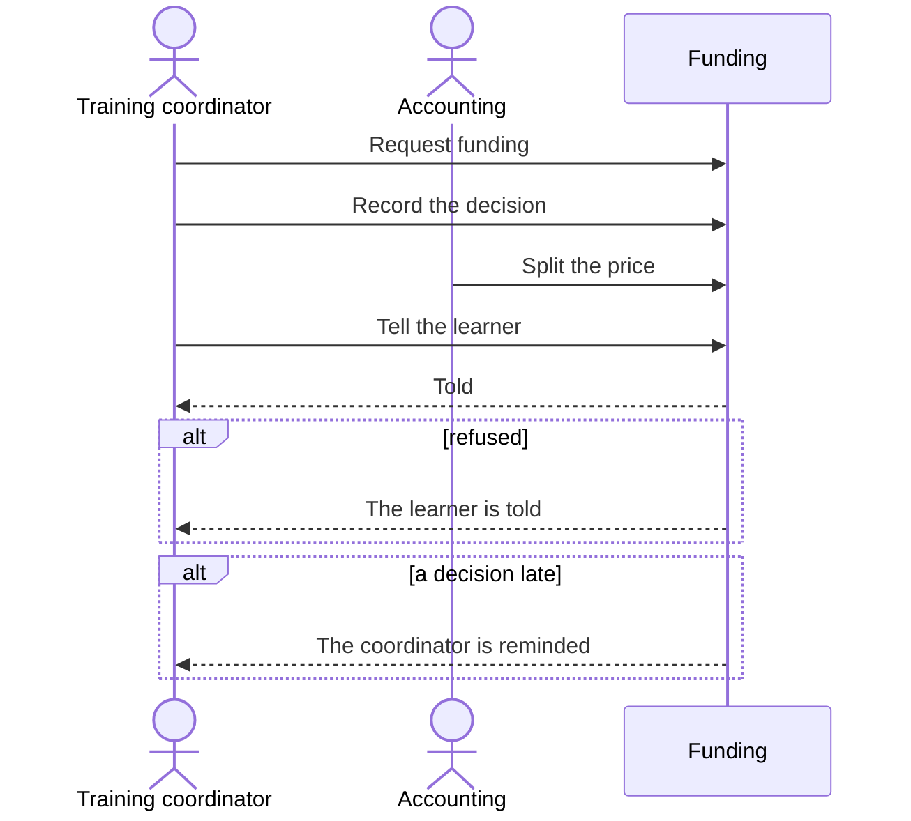

🏠 [Specs](../../../../README.md) › 🏷️ [Sectors](../../../README.md) › 🎓 [SC12 Education and training](../../README.md) ›
📝 [Use cases](../README.md) › 📝 [Use cases: FL-SC12-02 Enrol and fund](README.md) › 📝 UC-SC12-04 Get funding

# 📝 UC-SC12-04 Get funding

**Status:** ✅ specified

## Summary

The training coordinator requests funding from the employer, skills operators or the training account, records
decisions, and the price is split with the shared multi-payer invoicing.

## Personas

- [U38 Training coordinator](../../../../01-users/personas/u38-training-coordinator.md)
- [U05 Accounting](../../../../01-users/personas/u05-accounting.md)

## Goal

Each payer's share known before the session.

## Trigger

An enrolment needing funding.

## Frequency

Per enrolment.

## Preconditions

- The SC12 sector pack is installed for the company,
  [UC-F14-02](../../../../02-functional/f14-plugin-store/use-cases/01-find-and-install/uc-f14-02-install-a-plugin-or-sector-pack.md),
  and its users have their roles,
  [UC-F1-06](../../../../02-functional/f01-administration/use-cases/04-edit-a-role/uc-f01-06-edit-a-role-and-its-record-rules.md).

## Postconditions

- **Success:** the funding is granted and the shares set.
- **Failed:** the learner is told and pays.

## Main flow

1. The coordinator requests on [S-SC12-04 Funding](../../screens/02-enrol-and-fund/s-sc12-04-funding.md).
2. The funder's decision is recorded.
3. The shares follow the funder agreements,
   [UC-F6-20](../../../../02-functional/f06-customers-and-sales/use-cases/07-special-invoicing/uc-f06-20-invoice-several-payers-with-funders-and-caps.md),
   [BR-F6-13](../../../../02-functional/f06-customers-and-sales/business-rules/br-f06-13-each-payer-pays-its-share-up-to-its-cap.md).
4. The learner sees their share.

## Alternative flows

- 3a. Partial funding: the rest goes to the employer or learner.

## Error flows

- 2e. Refused: the learner is told.
- 2f. A decision late: the coordinator is reminded.
- Any step: a call to a service or an outside system fails: it is retried first
  ([BR-F3-32](../../../../02-functional/f03-assistant/business-rules/br-f03-32-retry-before-an-error.md)), then the
  error message pattern ([D122](../../../../06-decisions/ux/d122-error-message-standard.md)) says what failed; what was
  typed is kept.

## Business rules

- [BR-SC12-05 Funding split by funder](../../business-rules/br-sc12-05-funding-split-by-funder.md)
- [BR-F6-13 Each payer pays its share up to its cap](../../../../02-functional/f06-customers-and-sales/business-rules/br-f06-13-each-payer-pays-its-share-up-to-its-cap.md)

## Entities

- [E-SC12-05 Training funding](../../data/e-sc12-05-training-funding.md)
- [E-F6-14 Funder agreement](../../../../02-functional/f06-customers-and-sales/data/e-f06-14-funder-agreement.md)

## Permissions

The training coordinator and accounting roles; the record rules of their role and site apply,
[UC-F1-06](../../../../02-functional/f01-administration/use-cases/04-edit-a-role/uc-f01-06-edit-a-role-and-its-record-rules.md).

## Notifications

None beyond the in-app updates of the records concerned.

## Audit events

Every creation, change and state change of funding, funder agreement records, with who, when and the values before and
after (T3).

## AI involvement

The AI assistant answers questions on the funding, funder agreement records of this use case, with links, and prepares
them as drafts the user confirms. It works within the user's rights,
[BR-F3-34](../../../../02-functional/f03-assistant/business-rules/br-f03-34-every-capability-is-reachable-from-the-assistant.md),
and never deletes or does anything irreversible without the user's confirmation,
[BR-F3-07](../../../../02-functional/f03-assistant/business-rules/br-f03-07-no-deletes-no-irreversible-acts.md).

## API, MCP and A2A exposure

Through the API and webhooks (T5) and the MCP and A2A gateway (T6), with the caller's rights,
[BR-F3-34](../../../../02-functional/f03-assistant/business-rules/br-f03-34-every-capability-is-reachable-from-the-assistant.md),
reading, creating and changing the records of this use case; nothing irreversible without a person's confirmation.

## Screens

- [S-SC12-04 Funding](../../screens/02-enrol-and-fund/s-sc12-04-funding.md)

## Flowchart

See [FL-SC12-02 Enrol and fund](../../flows/fl-sc12-02-enrol-and-fund.md#flowchart).

## Sequence diagram

## Acceptance criteria

1. **Given** the example training centre's J. Martin with 540 EUR from the skills operator on 690 EUR **when** the price
   is split **then** the operator owes 540 EUR and Acme 150 EUR.
2. **Given** the operator refusing J. Martin's request **when** it is recorded **then** the learner is told.

## Non-functional notes

[D408](../../../../06-decisions/technical/d408-performance-and-profiles.md)'s targets
([performance](../../../../05-non-functional/performance.md)): 95 % of screens within 1 second; lists paged on the
server, the first page within 1 second; reports within 5 seconds or in the background. WCAG 2.2 AA and RGAA
([D46](../../../../06-decisions/ux/d46-accessibility-standard.md)).

## Regulatory references

Legal values from the France country pack:
[CR-FR-159 Personal training account (CPF)](../../../../10-country-packs/france/education/cr-fr-159-personal-training-account.md).

## Related use cases

- [UC-SC12-10 Bill learners, employers and funders](uc-sc12-10-bill-learners-employers-and-funders.md)

## Open questions

None.

---

⬅️ [UC-SC12-03 Enrol learners with quotes and agreements](uc-sc12-03-enrol-learners-with-quotes-and-agreements.md) ·
⬆️ [Up](README.md) ·
➡️ [UC-SC12-05 Send invitations and needs assessments](uc-sc12-05-send-invitations-and-needs-assessments.md)
