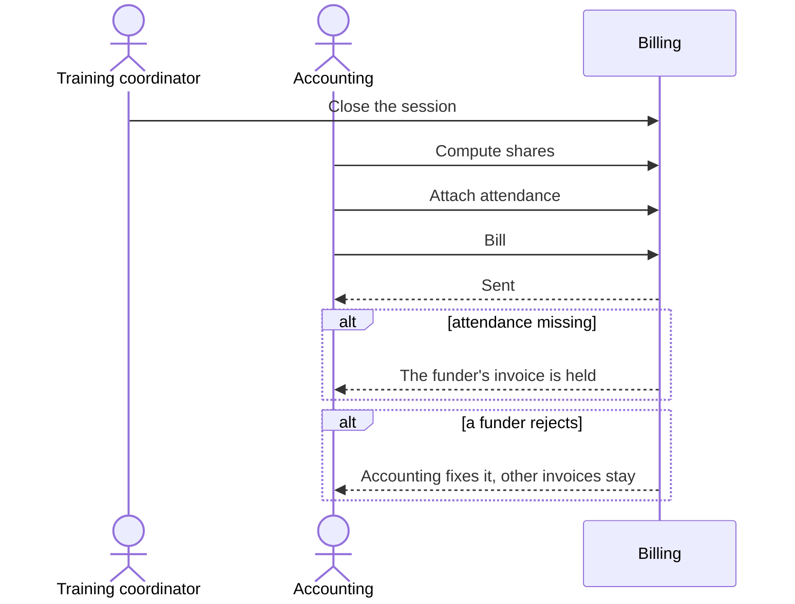

🏠 [Specs](../../../../README.md) › 🏷️ [Sectors](../../../README.md) › 🎓 [SC12 Education and training](../../README.md) ›
📝 [Use cases](../README.md) › 📝 [Use cases: FL-SC12-02 Enrol and fund](README.md) ›
📝 UC-SC12-10 Bill learners, employers and funders

# 📝 UC-SC12-10 Bill learners, employers and funders

**Status:** ✅ specified

## Summary

Accounting closes the session, and simple-ERP bills each payer its share through the shared multi-payer invoicing, with
attendance as proof.

## Personas

- [U05 Accounting](../../../../01-users/personas/u05-accounting.md)
- [U38 Training coordinator](../../../../01-users/personas/u38-training-coordinator.md)

## Goal

Each payer billed its share with proof.

## Trigger

The session ends.

## Frequency

Per session.

## Preconditions

- The SC12 sector pack is installed for the company,
  [UC-F14-02](../../../../02-functional/f14-plugin-store/use-cases/01-find-and-install/uc-f14-02-install-a-plugin-or-sector-pack.md),
  and its users have their roles,
  [UC-F1-06](../../../../02-functional/f01-administration/use-cases/04-edit-a-role/uc-f01-06-edit-a-role-and-its-record-rules.md).

## Postconditions

- **Success:** one invoice per payer is sent.
- **Failed:** the invoices are held.

## Main flow

1. The coordinator closes the session on [S-SC12-10 Billing](../../screens/02-enrol-and-fund/s-sc12-10-billing.md).
2. Shares follow the funding,
   [UC-F6-20](../../../../02-functional/f06-customers-and-sales/use-cases/07-special-invoicing/uc-f06-20-invoice-several-payers-with-funders-and-caps.md).
3. Attendance sheets go with the funder's invoice
   ([BR-SC12-04](../../business-rules/br-sc12-04-attendance-per-half-day.md)).
4. One invoice per payer.

## Alternative flows

- 4a. A training account payment: the platform pays its share.

## Error flows

- 3e. Attendance missing: the funder's invoice is held.
- 4e. A funder rejects: accounting fixes it; other invoices stay.
- Any step: a call to a service or an outside system fails: it is retried first
  ([BR-F3-32](../../../../02-functional/f03-assistant/business-rules/br-f03-32-retry-before-an-error.md)), then the
  error message pattern ([D122](../../../../06-decisions/ux/d122-error-message-standard.md)) says what failed; what was
  typed is kept.

## Business rules

- [BR-SC12-05 Funding split by funder](../../business-rules/br-sc12-05-funding-split-by-funder.md)
- [BR-SC12-04 Attendance per half-day](../../business-rules/br-sc12-04-attendance-per-half-day.md)
- [BR-F6-13 Each payer pays its share up to its cap](../../../../02-functional/f06-customers-and-sales/business-rules/br-f06-13-each-payer-pays-its-share-up-to-its-cap.md)

## Entities

- [E-SC12-10 Training invoice](../../data/e-sc12-10-training-invoice.md)

## Permissions

The accounting and training coordinator roles; the record rules of their role and site apply,
[UC-F1-06](../../../../02-functional/f01-administration/use-cases/04-edit-a-role/uc-f01-06-edit-a-role-and-its-record-rules.md).

## Notifications

None beyond the in-app updates of the records concerned.

## Audit events

Every creation, change and state change of training invoice records, with who, when and the values before and after
(T3).

## AI involvement

The AI assistant answers questions on the training invoice records of this use case, with links, and prepares them as
drafts the user confirms. It works within the user's rights,
[BR-F3-34](../../../../02-functional/f03-assistant/business-rules/br-f03-34-every-capability-is-reachable-from-the-assistant.md),
and never deletes or does anything irreversible without the user's confirmation,
[BR-F3-07](../../../../02-functional/f03-assistant/business-rules/br-f03-07-no-deletes-no-irreversible-acts.md).

## API, MCP and A2A exposure

Through the API and webhooks (T5) and the MCP and A2A gateway (T6), with the caller's rights,
[BR-F3-34](../../../../02-functional/f03-assistant/business-rules/br-f03-34-every-capability-is-reachable-from-the-assistant.md),
reading, creating and changing the records of this use case; nothing irreversible without a person's confirmation.

## Screens

- [S-SC12-10 Billing](../../screens/02-enrol-and-fund/s-sc12-10-billing.md)

## Flowchart

See [FL-SC12-02 Enrol and fund](../../flows/fl-sc12-02-enrol-and-fund.md#flowchart).

## Sequence diagram

## Acceptance criteria

1. **Given** the example training centre's S-41 with J. Martin funded 540 EUR **when** it is billed **then** the
   operator gets 540 EUR with the sheets and Acme 150 EUR.
2. **Given** S-41 with a half-day unsigned **when** it is billed **then** the funder's invoice is held.

## Non-functional notes

[D408](../../../../06-decisions/technical/d408-performance-and-profiles.md)'s targets
([performance](../../../../05-non-functional/performance.md)): 95 % of screens within 1 second; lists paged on the
server, the first page within 1 second; reports within 5 seconds or in the background. WCAG 2.2 AA and RGAA
([D46](../../../../06-decisions/ux/d46-accessibility-standard.md)).

## Regulatory references

None specific to this use case; the sector's legal rules are listed in [SC12 regulatory](../../regulatory.md).

## Related use cases

- [UC-SC12-04 Get funding](uc-sc12-04-get-funding.md)

## Open questions

None.

---

⬅️ [UC-SC12-09 Collect satisfaction](../03-deliver-and-assess/uc-sc12-09-collect-satisfaction.md) · ⬆️ [Up](README.md) ·
➡️ [UC-SC12-11 Manage trainers](../01-offer-and-sessions/uc-sc12-11-manage-trainers.md)
