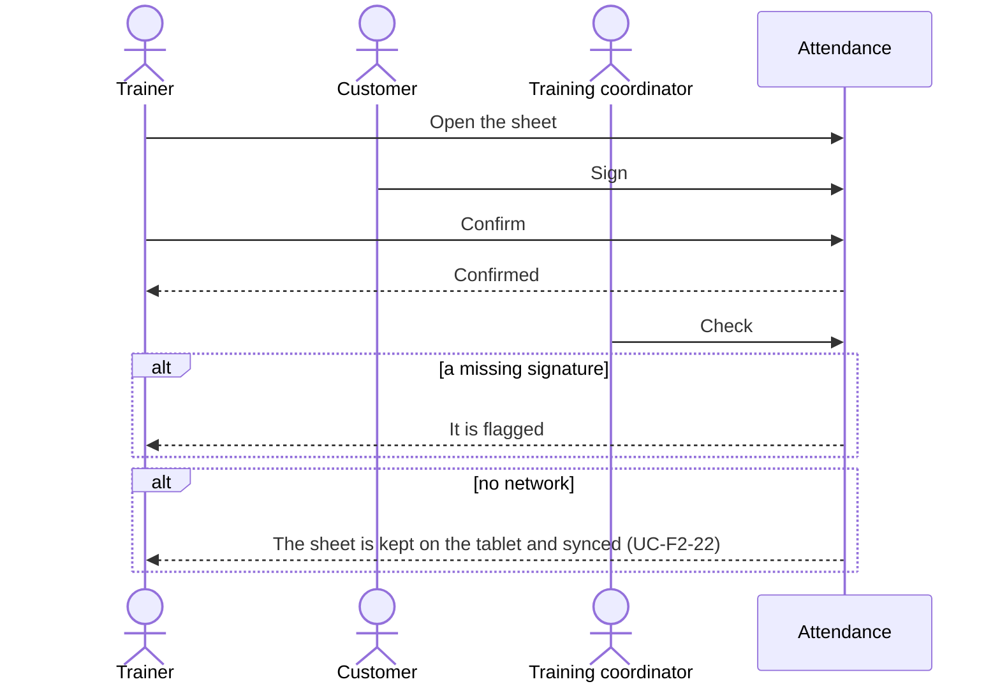

🏠 [Specs](../../../../README.md) › 🏷️ [Sectors](../../../README.md) › 🎓 [SC12 Education and training](../../README.md) ›
📝 [Use cases](../README.md) › 📝 [Use cases: FL-SC12-03 Deliver and assess](README.md) ›
📝 UC-SC12-06 Sign attendance per half-day

# 📝 UC-SC12-06 Sign attendance per half-day

**Status:** ✅ specified

## Summary

Learners sign attendance per half-day on the trainer's tablet or their phone; the trainer confirms.

## Personas

- [U39 Trainer](../../../../01-users/personas/u39-trainer.md)
- [U09 Customer](../../../../01-users/personas/u09-customer.md)
- [U38 Training coordinator](../../../../01-users/personas/u38-training-coordinator.md)

## Goal

Attendance proved per half-day.

## Trigger

Each half-day.

## Frequency

Per half-day.

## Preconditions

- The SC12 sector pack is installed for the company,
  [UC-F14-02](../../../../02-functional/f14-plugin-store/use-cases/01-find-and-install/uc-f14-02-install-a-plugin-or-sector-pack.md),
  and its users have their roles,
  [UC-F1-06](../../../../02-functional/f01-administration/use-cases/04-edit-a-role/uc-f01-06-edit-a-role-and-its-record-rules.md).

## Postconditions

- **Success:** the sheet is confirmed.
- **Failed:** missing signatures are flagged.

## Main flow

1. The trainer opens the sheet on [S-SC12-06 Attendance](../../screens/03-deliver-and-assess/s-sc12-06-attendance.md).
2. Learners sign.
3. The trainer confirms ([BR-SC12-04](../../business-rules/br-sc12-04-attendance-per-half-day.md)).
4. The coordinator checks the sheets.

## Alternative flows

- 2a. Remote attendance: learners sign online with a code.

## Error flows

- 3e. A missing signature: it is flagged.
- 1e. No network: the sheet is kept on the tablet and synced,
  [UC-F2-22](../../../../02-functional/f02-no-code-configuration/use-cases/09-portals-and-offline-forms/uc-f02-22-fill-a-form-offline-on-the-phone.md).
- Any step: a call to a service or an outside system fails: it is retried first
  ([BR-F3-32](../../../../02-functional/f03-assistant/business-rules/br-f03-32-retry-before-an-error.md)), then the
  error message pattern ([D122](../../../../06-decisions/ux/d122-error-message-standard.md)) says what failed; what was
  typed is kept.

## Business rules

- [BR-SC12-04 Attendance per half-day](../../business-rules/br-sc12-04-attendance-per-half-day.md)
- [BR-F2-21 Offline forms keep only what is needed and sync in order](../../../../02-functional/f02-no-code-configuration/business-rules/br-f02-21-offline-forms-keep-only-what-is-needed-and-sync-in-order.md)

## Entities

- [E-SC12-06 Attendance sheet](../../data/e-sc12-06-attendance-sheet.md)

## Permissions

The trainer, customer and training coordinator roles; the record rules of their role and site apply,
[UC-F1-06](../../../../02-functional/f01-administration/use-cases/04-edit-a-role/uc-f01-06-edit-a-role-and-its-record-rules.md).

## Notifications

None beyond the in-app updates of the records concerned.

## Audit events

Every creation, change and state change of attendance sheet records, with who, when and the values before and after
(T3).

## AI involvement

The AI assistant answers questions on the attendance sheet records of this use case, with links, and prepares them as
drafts the user confirms. It works within the user's rights,
[BR-F3-34](../../../../02-functional/f03-assistant/business-rules/br-f03-34-every-capability-is-reachable-from-the-assistant.md),
and never deletes or does anything irreversible without the user's confirmation,
[BR-F3-07](../../../../02-functional/f03-assistant/business-rules/br-f03-07-no-deletes-no-irreversible-acts.md).

## API, MCP and A2A exposure

Through the API and webhooks (T5) and the MCP and A2A gateway (T6), with the caller's rights,
[BR-F3-34](../../../../02-functional/f03-assistant/business-rules/br-f03-34-every-capability-is-reachable-from-the-assistant.md),
reading, creating and changing the records of this use case; nothing irreversible without a person's confirmation.

## Screens

- [S-SC12-06 Attendance](../../screens/03-deliver-and-assess/s-sc12-06-attendance.md)

## Flowchart

See [FL-SC12-03 Deliver and assess](../../flows/fl-sc12-03-deliver-and-assess.md#flowchart).

## Sequence diagram

## Acceptance criteria

1. **Given** the example training centre's S-41 on 3 December morning **when** 10 sign **then** the sheet is complete.
2. **Given** 9 signatures of 10 on 3 December morning **when** the trainer confirms **then** it is flagged.

## Non-functional notes

[D408](../../../../06-decisions/technical/d408-performance-and-profiles.md)'s targets
([performance](../../../../05-non-functional/performance.md)): 95 % of screens within 1 second; lists paged on the
server, the first page within 1 second; reports within 5 seconds or in the background. WCAG 2.2 AA and RGAA
([D46](../../../../06-decisions/ux/d46-accessibility-standard.md)).

## Regulatory references

None specific to this use case; the sector's legal rules are listed in [SC12 regulatory](../../regulatory.md).

## Related use cases

- [UC-SC12-08 Assess learners and issue certificates](uc-sc12-08-assess-learners-and-issue-certificates.md)

## Open questions

None.

---

⬅️ [UC-SC12-05](../02-enrol-and-fund/uc-sc12-05-send-invitations-and-needs-assessments.md) · ⬆️ [Up](README.md) ·
➡️ [UC-SC12-07 Run e-learning modules](uc-sc12-07-run-e-learning-modules.md)
