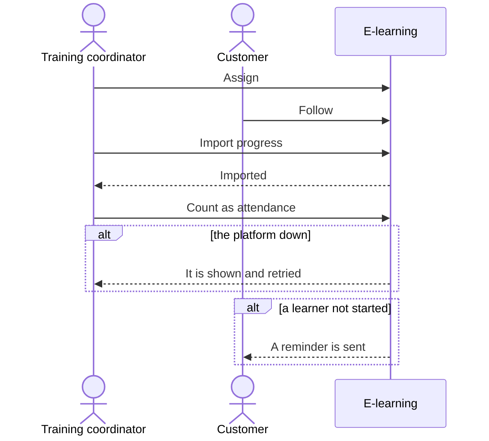

🏠 [Specs](../../../../README.md) › 🏷️ [Sectors](../../../README.md) › 🎓 [SC12 Education and training](../../README.md) ›
📝 [Use cases](../README.md) › 📝 [Use cases: FL-SC12-03 Deliver and assess](README.md) ›
📝 UC-SC12-07 Run e-learning modules

# 📝 UC-SC12-07 Run e-learning modules

**Status:** ✅ specified

## Summary

The coordinator assigns modules on the learning platform; learners follow them; progress and time are imported.

## Personas

- [U09 Customer](../../../../01-users/personas/u09-customer.md)
- [U38 Training coordinator](../../../../01-users/personas/u38-training-coordinator.md)

## Goal

E-learning tracked as evidence.

## Trigger

A blended or online course.

## Frequency

Per learner.

## Preconditions

- The SC12 sector pack is installed for the company,
  [UC-F14-02](../../../../02-functional/f14-plugin-store/use-cases/01-find-and-install/uc-f14-02-install-a-plugin-or-sector-pack.md),
  and its users have their roles,
  [UC-F1-06](../../../../02-functional/f01-administration/use-cases/04-edit-a-role/uc-f01-06-edit-a-role-and-its-record-rules.md).

## Postconditions

- **Success:** progress is imported.
- **Failed:** the gap is shown.

## Main flow

1. The coordinator assigns modules on
   [S-SC12-07 E-learning](../../screens/03-deliver-and-assess/s-sc12-07-e-learning.md).
2. The learner follows them.
3. Progress is imported ([BR-SC12-15](../../business-rules/br-sc12-15-e-learning-tracked.md)).
4. Time counts when the programme says so.

## Alternative flows

- 1a. A blended course: modules and sessions are combined.

## Error flows

- 3e. The platform down: it is shown and retried.
- 2e. A learner not started: a reminder is sent.
- Any step: a call to a service or an outside system fails: it is retried first
  ([BR-F3-32](../../../../02-functional/f03-assistant/business-rules/br-f03-32-retry-before-an-error.md)), then the
  error message pattern ([D122](../../../../06-decisions/ux/d122-error-message-standard.md)) says what failed; what was
  typed is kept.

## Business rules

- [BR-SC12-15 E-learning tracked](../../business-rules/br-sc12-15-e-learning-tracked.md)

## Entities

- [E-SC12-07 E-learning record](../../data/e-sc12-07-e-learning-record.md)

## Permissions

The customer and training coordinator roles; the record rules of their role and site apply,
[UC-F1-06](../../../../02-functional/f01-administration/use-cases/04-edit-a-role/uc-f01-06-edit-a-role-and-its-record-rules.md).

## Notifications

None beyond the in-app updates of the records concerned.

## Audit events

Every creation, change and state change of e-learning record records, with who, when and the values before and after
(T3).

## AI involvement

The AI assistant answers questions on the e-learning record records of this use case, with links, and prepares them as
drafts the user confirms. It works within the user's rights,
[BR-F3-34](../../../../02-functional/f03-assistant/business-rules/br-f03-34-every-capability-is-reachable-from-the-assistant.md),
and never deletes or does anything irreversible without the user's confirmation,
[BR-F3-07](../../../../02-functional/f03-assistant/business-rules/br-f03-07-no-deletes-no-irreversible-acts.md).

## API, MCP and A2A exposure

Through the API and webhooks (T5) and the MCP and A2A gateway (T6), with the caller's rights,
[BR-F3-34](../../../../02-functional/f03-assistant/business-rules/br-f03-34-every-capability-is-reachable-from-the-assistant.md),
reading, creating and changing the records of this use case; nothing irreversible without a person's confirmation.

## Screens

- [S-SC12-07 E-learning](../../screens/03-deliver-and-assess/s-sc12-07-e-learning.md)

## Flowchart

See [FL-SC12-03 Deliver and assess](../../flows/fl-sc12-03-deliver-and-assess.md#flowchart).

## Sequence diagram

## Acceptance criteria

1. **Given** the example training centre's J. Martin with 2 hours on module 3 **when** progress is imported **then** 2
   hours count.
2. **Given** the platform unavailable **when** progress is imported **then** it is shown and retried.

## Non-functional notes

[D408](../../../../06-decisions/technical/d408-performance-and-profiles.md)'s targets
([performance](../../../../05-non-functional/performance.md)): 95 % of screens within 1 second; lists paged on the
server, the first page within 1 second; reports within 5 seconds or in the background. WCAG 2.2 AA and RGAA
([D46](../../../../06-decisions/ux/d46-accessibility-standard.md)).

## Regulatory references

None specific to this use case; the sector's legal rules are listed in [SC12 regulatory](../../regulatory.md).

## Related use cases

- [UC-SC12-08 Assess learners and issue certificates](uc-sc12-08-assess-learners-and-issue-certificates.md)

## Open questions

None.

---

⬅️ [UC-SC12-06 Sign attendance per half-day](uc-sc12-06-sign-attendance-per-half-day.md) · ⬆️ [Up](README.md) ·
➡️ [UC-SC12-08 Assess learners and issue certificates](uc-sc12-08-assess-learners-and-issue-certificates.md)
