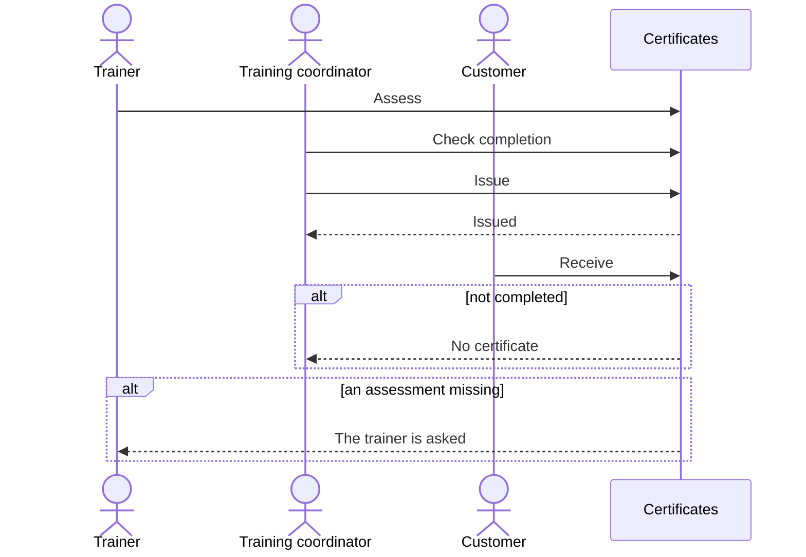

🏠 [Specs](../../../../README.md) › 🏷️ [Sectors](../../../README.md) › 🎓 [SC12 Education and training](../../README.md) ›
📝 [Use cases](../README.md) › 📝 [Use cases: FL-SC12-03 Deliver and assess](README.md) ›
📝 UC-SC12-08 Assess learners and issue certificates

# 📝 UC-SC12-08 Assess learners and issue certificates

**Status:** ✅ specified

## Summary

The trainer assesses learners; the coordinator checks completion and issues certificates.

## Personas

- [U39 Trainer](../../../../01-users/personas/u39-trainer.md)
- [U38 Training coordinator](../../../../01-users/personas/u38-training-coordinator.md)
- [U09 Customer](../../../../01-users/personas/u09-customer.md)

## Goal

Certificates only for completed courses.

## Trigger

The session ends.

## Frequency

Per session.

## Preconditions

- The SC12 sector pack is installed for the company,
  [UC-F14-02](../../../../02-functional/f14-plugin-store/use-cases/01-find-and-install/uc-f14-02-install-a-plugin-or-sector-pack.md),
  and its users have their roles,
  [UC-F1-06](../../../../02-functional/f01-administration/use-cases/04-edit-a-role/uc-f01-06-edit-a-role-and-its-record-rules.md).

## Postconditions

- **Success:** certificates are issued.
- **Failed:** no certificate.

## Main flow

1. The trainer records assessments on
   [S-SC12-08 Certificates](../../screens/03-deliver-and-assess/s-sc12-08-certificates.md).
2. Attendance and assessment are checked
   ([BR-SC12-06](../../business-rules/br-sc12-06-certificates-only-after-completion.md)).
3. Certificates are issued.
4. Learners download them on the portal.

## Alternative flows

- 1a. A certification exam: the exam's result is recorded.

## Error flows

- 2e. Not completed: no certificate.
- 1e. An assessment missing: the trainer is asked.
- Any step: a call to a service or an outside system fails: it is retried first
  ([BR-F3-32](../../../../02-functional/f03-assistant/business-rules/br-f03-32-retry-before-an-error.md)), then the
  error message pattern ([D122](../../../../06-decisions/ux/d122-error-message-standard.md)) says what failed; what was
  typed is kept.

## Business rules

- [BR-SC12-06 Certificates only after completion](../../business-rules/br-sc12-06-certificates-only-after-completion.md)

## Entities

- [E-SC12-08 Completion certificate](../../data/e-sc12-08-completion-certificate.md)

## Permissions

The trainer, training coordinator and customer roles; the record rules of their role and site apply,
[UC-F1-06](../../../../02-functional/f01-administration/use-cases/04-edit-a-role/uc-f01-06-edit-a-role-and-its-record-rules.md).

## Notifications

None beyond the in-app updates of the records concerned.

## Audit events

Every creation, change and state change of certificate records, with who, when and the values before and after (T3).

## AI involvement

The AI assistant answers questions on the certificate records of this use case, with links, and prepares them as drafts
the user confirms. It works within the user's rights,
[BR-F3-34](../../../../02-functional/f03-assistant/business-rules/br-f03-34-every-capability-is-reachable-from-the-assistant.md),
and never deletes or does anything irreversible without the user's confirmation,
[BR-F3-07](../../../../02-functional/f03-assistant/business-rules/br-f03-07-no-deletes-no-irreversible-acts.md).

## API, MCP and A2A exposure

Through the API and webhooks (T5) and the MCP and A2A gateway (T6), with the caller's rights,
[BR-F3-34](../../../../02-functional/f03-assistant/business-rules/br-f03-34-every-capability-is-reachable-from-the-assistant.md),
reading, creating and changing the records of this use case; nothing irreversible without a person's confirmation.

## Screens

- [S-SC12-08 Certificates](../../screens/03-deliver-and-assess/s-sc12-08-certificates.md)

## Flowchart

See [FL-SC12-03 Deliver and assess](../../flows/fl-sc12-03-deliver-and-assess.md#flowchart).

## Sequence diagram

## Acceptance criteria

1. **Given** the example training centre's J. Martin completing S-41 **when** certificates are issued **then** his is
   dated 4 December.
2. **Given** J. Martin absent one half-day **when** certificates are issued **then** no certificate.

## Non-functional notes

[D408](../../../../06-decisions/technical/d408-performance-and-profiles.md)'s targets
([performance](../../../../05-non-functional/performance.md)): 95 % of screens within 1 second; lists paged on the
server, the first page within 1 second; reports within 5 seconds or in the background. WCAG 2.2 AA and RGAA
([D46](../../../../06-decisions/ux/d46-accessibility-standard.md)).

## Regulatory references

None specific to this use case; the sector's legal rules are listed in [SC12 regulatory](../../regulatory.md).

## Related use cases

- [UC-SC12-09 Collect satisfaction](uc-sc12-09-collect-satisfaction.md)

## Open questions

None.

---

⬅️ [UC-SC12-07 Run e-learning modules](uc-sc12-07-run-e-learning-modules.md) · ⬆️ [Up](README.md) ·
➡️ [UC-SC12-09 Collect satisfaction](uc-sc12-09-collect-satisfaction.md)
