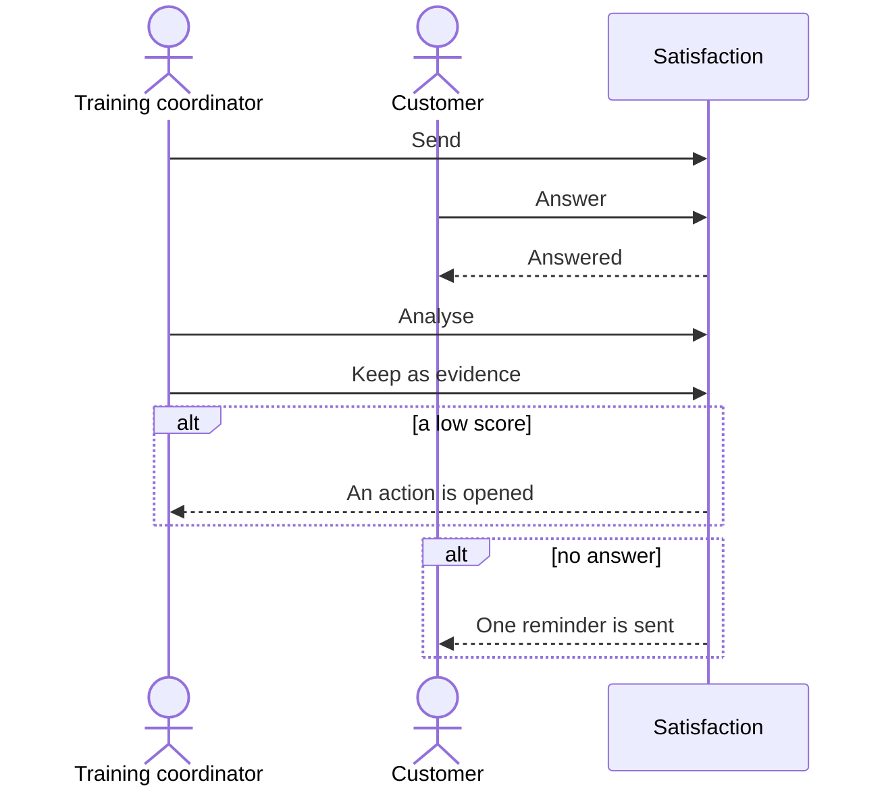

🏠 [Specs](../../../../README.md) › 🏷️ [Sectors](../../../README.md) › 🎓 [SC12 Education and training](../../README.md) ›
📝 [Use cases](../README.md) › 📝 [Use cases: FL-SC12-03 Deliver and assess](README.md) ›
📝 UC-SC12-09 Collect satisfaction

# 📝 UC-SC12-09 Collect satisfaction

**Status:** ✅ specified

## Summary

The coordinator sends hot and cold surveys, collects and analyses them; a low score leads to an action.

## Personas

- [U38 Training coordinator](../../../../01-users/personas/u38-training-coordinator.md)
- [U09 Customer](../../../../01-users/personas/u09-customer.md)

## Goal

Satisfaction known and acted on.

## Trigger

End of session and later.

## Frequency

Per session.

## Preconditions

- The SC12 sector pack is installed for the company,
  [UC-F14-02](../../../../02-functional/f14-plugin-store/use-cases/01-find-and-install/uc-f14-02-install-a-plugin-or-sector-pack.md),
  and its users have their roles,
  [UC-F1-06](../../../../02-functional/f01-administration/use-cases/04-edit-a-role/uc-f01-06-edit-a-role-and-its-record-rules.md).

## Postconditions

- **Success:** answers are analysed.
- **Failed:** a low score opens an action.

## Main flow

1. Surveys go out on [S-SC12-09 Satisfaction](../../screens/03-deliver-and-assess/s-sc12-09-satisfaction.md),
   [UC-F5-12](../../../../02-functional/f05-social-media/use-cases/08-pages-forms-surveys-and-whatsapp/uc-f05-12-run-surveys-and-live-polls.md).
2. Learners answer.
3. The coordinator analyses.
4. Results are kept as quality evidence.

## Alternative flows

- 1a. An employer survey: the employer is asked later.

## Error flows

- 3e. A low score: an action is opened.
- 2e. No answer: one reminder is sent.
- Any step: a call to a service or an outside system fails: it is retried first
  ([BR-F3-32](../../../../02-functional/f03-assistant/business-rules/br-f03-32-retry-before-an-error.md)), then the
  error message pattern ([D122](../../../../06-decisions/ux/d122-error-message-standard.md)) says what failed; what was
  typed is kept.

## Business rules

- [BR-SC12-07 Quality evidence kept](../../business-rules/br-sc12-07-quality-evidence-kept.md)

## Entities

- [E-SC12-09 Survey answer](../../data/e-sc12-09-survey-answer.md)

## Permissions

The training coordinator and customer roles; the record rules of their role and site apply,
[UC-F1-06](../../../../02-functional/f01-administration/use-cases/04-edit-a-role/uc-f01-06-edit-a-role-and-its-record-rules.md).

## Notifications

None beyond the in-app updates of the records concerned.

## Audit events

Every creation, change and state change of survey answer records, with who, when and the values before and after (T3).

## AI involvement

The AI assistant answers questions on the survey answer records of this use case, with links, and prepares them as
drafts the user confirms. It works within the user's rights,
[BR-F3-34](../../../../02-functional/f03-assistant/business-rules/br-f03-34-every-capability-is-reachable-from-the-assistant.md),
and never deletes or does anything irreversible without the user's confirmation,
[BR-F3-07](../../../../02-functional/f03-assistant/business-rules/br-f03-07-no-deletes-no-irreversible-acts.md).

## API, MCP and A2A exposure

Through the API and webhooks (T5) and the MCP and A2A gateway (T6), with the caller's rights,
[BR-F3-34](../../../../02-functional/f03-assistant/business-rules/br-f03-34-every-capability-is-reachable-from-the-assistant.md),
reading, creating and changing the records of this use case; nothing irreversible without a person's confirmation.

## Screens

- [S-SC12-09 Satisfaction](../../screens/03-deliver-and-assess/s-sc12-09-satisfaction.md)

## Flowchart

See [FL-SC12-03 Deliver and assess](../../flows/fl-sc12-03-deliver-and-assess.md#flowchart).

## Sequence diagram

## Acceptance criteria

1. **Given** the example training centre's J. Martin's hot survey at 9 **when** it is analysed **then** S-41 shows 9.
2. **Given** a score of 4 of 10 **when** it is analysed **then** an action is opened.

## Non-functional notes

[D408](../../../../06-decisions/technical/d408-performance-and-profiles.md)'s targets
([performance](../../../../05-non-functional/performance.md)): 95 % of screens within 1 second; lists paged on the
server, the first page within 1 second; reports within 5 seconds or in the background. WCAG 2.2 AA and RGAA
([D46](../../../../06-decisions/ux/d46-accessibility-standard.md)).

## Regulatory references

None specific to this use case; the sector's legal rules are listed in [SC12 regulatory](../../regulatory.md).

## Related use cases

- [UC-SC12-12 Keep the Qualiopi evidence file](../04-quality-and-reports/uc-sc12-12-keep-the-qualiopi-evidence-file.md)

## Open questions

None.

---

⬅️ [UC-SC12-08 Assess learners and issue certificates](uc-sc12-08-assess-learners-and-issue-certificates.md) ·
⬆️ [Up](README.md) · ➡️ [UC-SC12-10](../02-enrol-and-fund/uc-sc12-10-bill-learners-employers-and-funders.md)
