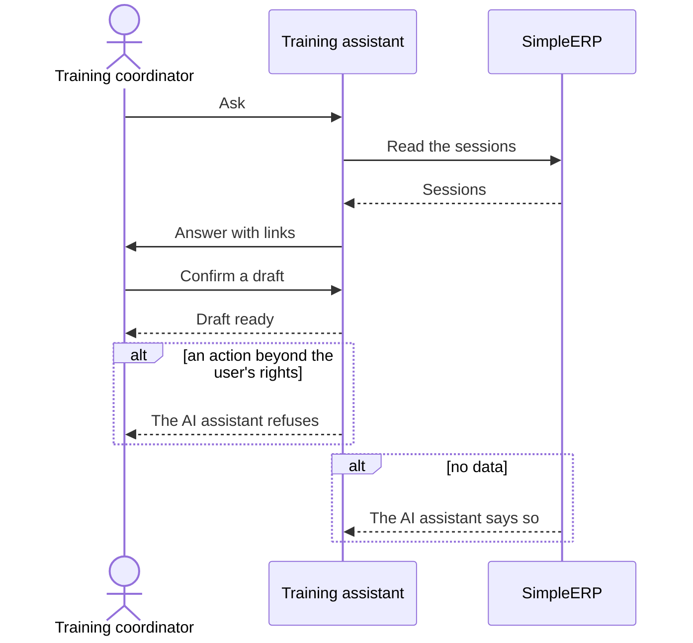

🏠 [Specs](../../../../README.md) › 🏷️ [Sectors](../../../README.md) › 🎓 [SC12 Education and training](../../README.md) ›
📝 [Use cases](../README.md) › 📝 [Use cases: FL-SC12-03 Deliver and assess](README.md) ›
📝 UC-SC12-20 Ask the AI assistant

# 📝 UC-SC12-20 Ask the AI assistant

**Status:** ✅ specified

## Summary

The coordinator or trainer asks the AI assistant about sessions to fill, funding to chase or a learner's attendance,
within their role's rights.

## Personas

- [U38 Training coordinator](../../../../01-users/personas/u38-training-coordinator.md)
- [U39 Trainer](../../../../01-users/personas/u39-trainer.md)

## Goal

Answers without hunting.

## Trigger

A question.

## Frequency

Daily.

## Preconditions

- The SC12 sector pack is installed for the company,
  [UC-F14-02](../../../../02-functional/f14-plugin-store/use-cases/01-find-and-install/uc-f14-02-install-a-plugin-or-sector-pack.md),
  and its users have their roles,
  [UC-F1-06](../../../../02-functional/f01-administration/use-cases/04-edit-a-role/uc-f01-06-edit-a-role-and-its-record-rules.md).

## Postconditions

- **Success:** the answer cites the records, or the draft is confirmed.
- **Failed:** the AI assistant says it cannot answer or act, and why.

## Main flow

1. The coordinator asks on
   [S-SC12-20 Training assistant](../../screens/03-deliver-and-assess/s-sc12-20-training-assistant.md): "Which sessions
   in December are under half full?".
2. The AI assistant reads sessions within the user's rights.
3. The AI assistant lists them.
4. The coordinator asks for an invitation; the AI assistant drafts it,
   [UC-F3-04](../../../../02-functional/f03-assistant/use-cases/04-summarise-or-draft/uc-f03-04-summarise-and-draft.md).

## Alternative flows

- 1a. A trainer asks for attendance: the AI assistant shows the sheet.

## Error flows

- 4e. An action beyond the user's rights: the AI assistant refuses.
- 2e. No data: the AI assistant says so.
- Any step: a call to a service or an outside system fails: it is retried first
  ([BR-F3-32](../../../../02-functional/f03-assistant/business-rules/br-f03-32-retry-before-an-error.md)), then the
  error message pattern ([D122](../../../../06-decisions/ux/d122-error-message-standard.md)) says what failed; what was
  typed is kept.

## Business rules

- [BR-SC12-01 Education follows the country pack](../../business-rules/br-sc12-01-education-follows-the-country-pack.md)
- [BR-F3-34 All capabilities via the AI assistant](../../../../02-functional/f03-assistant/business-rules/br-f03-34-every-capability-is-reachable-from-the-assistant.md)
- [BR-F3-07 No deletes, no irreversible acts](../../../../02-functional/f03-assistant/business-rules/br-f03-07-no-deletes-no-irreversible-acts.md)

## Entities

- [E-SC12-02 Course session](../../data/e-sc12-02-course-session.md)
- [E-SC12-06 Attendance sheet](../../data/e-sc12-06-attendance-sheet.md)

## Permissions

The training coordinator and trainer roles; the record rules of their role and site apply,
[UC-F1-06](../../../../02-functional/f01-administration/use-cases/04-edit-a-role/uc-f01-06-edit-a-role-and-its-record-rules.md).

## Notifications

None beyond the in-app updates of the records concerned.

## Audit events

Every creation, change and state change of session, attendance sheet records, with who, when and the values before and
after (T3).

## AI involvement

The AI assistant answers questions on the session, attendance sheet records of this use case, with links, and prepares
them as drafts the user confirms. It works within the user's rights,
[BR-F3-34](../../../../02-functional/f03-assistant/business-rules/br-f03-34-every-capability-is-reachable-from-the-assistant.md),
and never deletes or does anything irreversible without the user's confirmation,
[BR-F3-07](../../../../02-functional/f03-assistant/business-rules/br-f03-07-no-deletes-no-irreversible-acts.md).

## API, MCP and A2A exposure

Through the API and webhooks (T5) and the MCP and A2A gateway (T6), with the caller's rights,
[BR-F3-34](../../../../02-functional/f03-assistant/business-rules/br-f03-34-every-capability-is-reachable-from-the-assistant.md),
reading, creating and changing the records of this use case; nothing irreversible without a person's confirmation.

## Screens

- [S-SC12-20 Training assistant](../../screens/03-deliver-and-assess/s-sc12-20-training-assistant.md)

## Flowchart

See [FL-SC12-03 Deliver and assess](../../flows/fl-sc12-03-deliver-and-assess.md#flowchart).

## Sequence diagram

## Acceptance criteria

1. **Given** the example training centre's 2 December sessions under half full **when** the coordinator asks **then**
   the AI assistant lists the 2.
2. **Given** a trainer asking to change a price **when** she asks **then** the AI assistant refuses.

## Non-functional notes

[D408](../../../../06-decisions/technical/d408-performance-and-profiles.md)'s targets
([performance](../../../../05-non-functional/performance.md)): 95 % of screens within 1 second; lists paged on the
server, the first page within 1 second; reports within 5 seconds or in the background. WCAG 2.2 AA and RGAA
([D46](../../../../06-decisions/ux/d46-accessibility-standard.md)).

## Regulatory references

None specific to this use case; the sector's legal rules are listed in [SC12 regulatory](../../regulatory.md).

## Related use cases

- [UC-SC12-02 Plan sessions with trainers and rooms](../01-offer-and-sessions/uc-sc12-02-plan-sessions-with-trainers-and-rooms.md)

## Open questions

None.

---

⬅️ [UC-SC12-19 Bill school fees and grants](../05-private-school/uc-sc12-19-bill-school-fees-and-grants.md) ·
⬆️ [Up](README.md) ·
➡️ [UC-SC12-21](../06-apprentices-driving-nurseries-and-canteens/uc-sc12-21-run-an-apprentice-training-centre.md)
